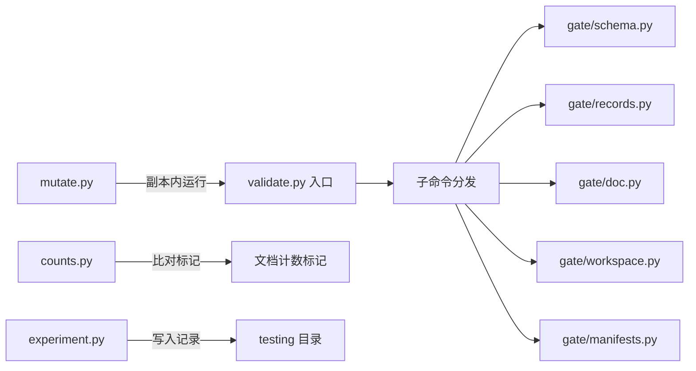
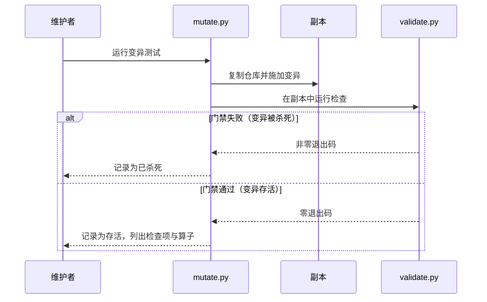
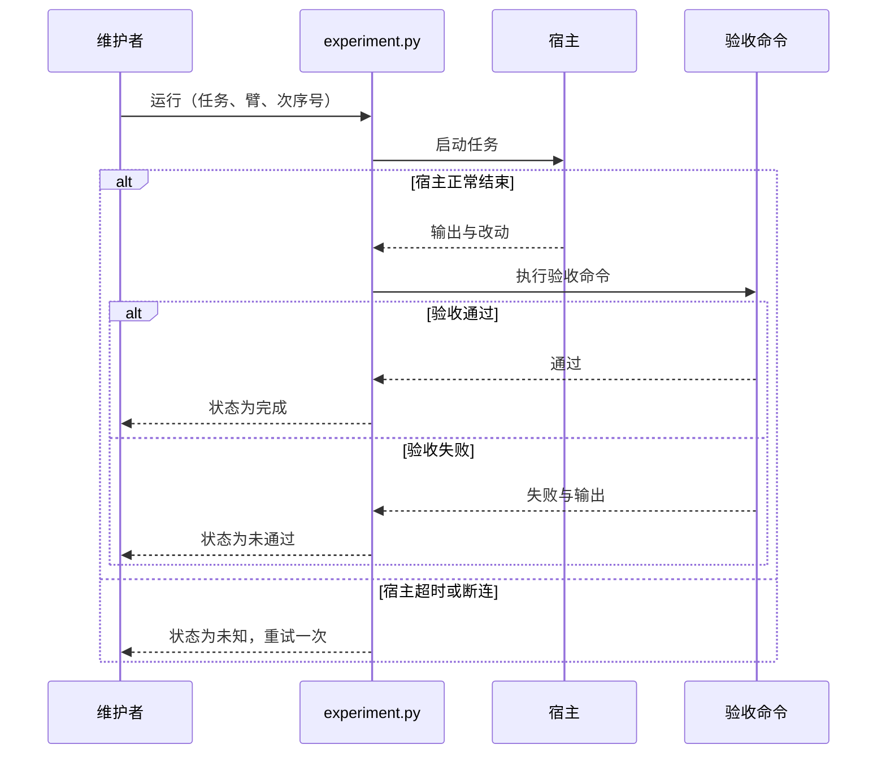
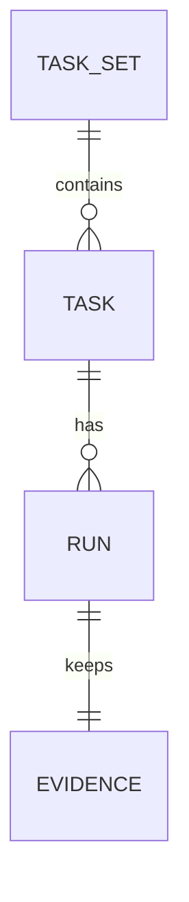

# 质量提升批 — 工具链技术方案（design/be）

> 前置输入：`spec/be/backend.md` §5 至 §7。契约基准：`tools/lab/validate.py` 现行子命令与各函数边界（2733 行单文件，2026-10-13 核实）。文档状态：草案，待独立评审。影响面：见 §1.6。

## 0. 先说结论
| 问题 | 结论 | 禁令/注意 |
| --- | --- | --- |
| 门禁如何拆分 | `validate.py` 保留 CLI 与子命令分发；检查函数按主题迁入 `tools/lab/gate/` 下五个模块 | 拆分提交与行为变更分开提交；拆分前后逐行比对输出 |
| 变异测试放在哪里 | 独立脚本 `tools/lab/mutate.py`，不并入 `validate.py all` | 变异只在 `cp -r` 出的副本中运行，绝不触碰真实工作树（AGENTS.md「实验与恢复」） |
| 实验 harness 现在写到哪一步 | 只交付接口、字段契约与参数校验；Q-01 与 Q-03 确认前不实现宿主调用，也不运行任何实验 | 未确认预算前，`EXPERIMENT_BUDGET_RUNS` 默认 0，任何运行都会被拒绝 |
| 回滚 | 每个模块可独立 `git revert`；`validate.py` 薄入口保证 CLI 不变 | 回滚后须重跑 `validate.py all` 与单元测试 |

## 1. 设计方案

### 1.1 整体设计

#### 1.1.1 技术挑战
| 优先级 | 技术挑战 | 应对 |
| --- | --- | --- |
| P0 | 拆分时检查顺序或共享状态可能改变结果 | 拆分前一次性记录 `validate.py all` 的完整输出作为基线，拆分后逐行比对 |
| P0 | 变异测试可能改坏真实工作树 | 只在副本中运行；副本运行失败即丢弃。`tools/lab/isolation.py` 已有同类先例 |
| P1 | 实验宿主不稳定（试水中出现过 502 与挂起） | 「未知」状态独立计数，不计为失败；重试一次，上限明确 |
| P1 | 文档计数与脚本输出容易脱节 | 计数值用成对的标记包裹，门禁只比对标记之间的内容 |

#### 1.1.2 技术架构


| 组件 | 负责 | 不负责 |
| --- | --- | --- |
| `validate.py` 入口 | 解析子命令、调用各模块、汇总退出码 | 任何具体检查逻辑 |
| `gate/*` | 各主题的检查函数 | 命令行解析 |
| `mutate.py` | 生成变异、在副本中运行、统计存活 | 判断门禁「应当」失败与否 |
| `counts.py` | 计算计数项、检查或替换文档标记 | 决定哪些事实值得计数 |
| `experiment.py` | 参数校验、记录格式校验、`compare` 统计 | 宿主调用的具体实现（Q-01 确认后补） |

#### 1.1.3 核心业务流程

##### 1.1.3.1 变异测试主链路
| 步骤 | 调用方→承接方 | 动作/输入输出 | 状态或数据变化 | 失败处理 | 观测点 |
| --- | --- | --- | --- | --- | --- |
| S1 | 维护者→`mutate.py` | 指定检查项与算子；缺省为全部 | 无 | 检查项不存在：退出码 2 | 变异清单 |
| S2 | `mutate.py`→副本 | `cp -r` 仓库到临时目录，施加一处变异 | 仅副本内源码改变 | 复制失败：中止并报告，真实树不受影响 | 副本路径 |
| S3 | `mutate.py`→`validate.py` | 在副本中运行对应检查 | 产生退出码与输出 | 超时：按存活计，并标注超时 | 退出码、输出 |
| S4 | `mutate.py`→报告 | 汇总存活数，写入报告文件 | 报告文件生成 | 写入失败：退出码 1 | 存活数与清单 |



##### 1.1.3.2 实验运行主链路


##### 1.1.3.3 记录关系图


### 1.2 核心算法与关键逻辑

#### 1.2.1 存活判定
**触发条件**：对一个变异运行门禁。
**输入输出**：输入为变异与其所属检查项；输出为「已杀死」「存活」之一。超时计为存活。
**判断顺序**：先在副本中施加变异，并确认副本与真实树在该文件上确有差异（无差异则该变异无效，报错）；再运行门禁；最后依退出码判定。
**不变式**：存活数 = 总变异数 − 已杀死数 − 无效数，且无效数必须为 0。
**代码职责落点**：`tools/lab/mutate.py`（新增）。

```python
def classify(mutation):
    copy = clone_to_tmp(ROOT)
    apply(mutation, copy)
    if not differs(copy, ROOT, mutation.path):
        raise InvalidMutation(mutation.id)
    rc = run_gate(copy, mutation.check, timeout=MUTATE_TIMEOUT_S)
    if rc is None:
        return "存活"
    return "已杀死" if rc != 0 else "存活"
```

#### 1.2.2 计数标记替换
**触发条件**：运行 `counts.py`。
**输入输出**：输入为文档中的标记对，形如 `<!-- count:tests -->78<!-- /count -->`；输出为检查结果，或在写入模式下替换后的文档。
**判断顺序**：计算计数值 → 比对标记内的数字 → 检查模式下不一致则失败；写入模式下仅替换标记之间的内容。
**不变式**：标记之外的文字一字不改。

### 1.3 核心数据与存储设计

#### 1.3.1 数据怎么流转
定义与实例分开看待。任务集是定义：冻结后不再修改。运行记录是实例：每次运行追加一份 JSON，不覆盖。一份记录在运行结束时一次写入，写入后只读。

#### 1.3.2 DDL
本批不引入数据库，记录以文件形式保存。
| 项 | 结论 | 理由 |
| --- | --- | --- |
| 新增表 | 无 | 记录量小，文件即可；引入数据库会扩大受保护面 |
| 迁移 | 无 | 无表结构变化 |

#### 1.3.3 配置键
| 键 | 默认值 | 说明 |
| --- | --- | --- |
| `MUTATE_TIMEOUT_S` | 120 | 单次变异运行的超时秒数，超时计为存活 |
| `EXPERIMENT_RETRY` | 1 | 「未知」状态的重试次数上限 |
| `EXPERIMENT_BUDGET_RUNS` | 0 | 运行次数上限。默认 0 表示预算未确认，拒绝启动（见 proposal Q-03） |

#### 1.3.4 现有设施复用
| 设施 | 用法 | 改动 |
| --- | --- | --- |
| `tools/lab/isolation.py` | 副本与变更检查的既有做法 | 无 |
| `tools/lab/artifact_digest.py` | 副本的确定性摘要 | 无 |
| `validate.py` 子命令 | 变异的运行对象 | 不改 CLI |

### 1.4 详细接口设计

#### 1.4.1 契约真源
门禁的 CLI 契约以 `validate.py --help` 的子命令集合与各子命令退出码为准，本批不改。实验记录字段契约以 `spec/be/backend.md` §6 为准。

#### 1.4.2 接口清单
| 接口 | 方法 | 变更类型 | 说明 |
| --- | --- | --- | --- |
| `tools/lab/mutate.py` | 命令行 | 新增 | `mutate.py --check <名称>` 运行指定检查项的变异；无参数时列出清单 |
| `tools/lab/counts.py` | 命令行 | 新增 | `counts.py` 仅检查；`counts.py --write` 替换标记内容 |
| `tools/lab/experiment.py` | 命令行 | 新增 | `run` 与 `compare` 两个子命令；`run` 在 Q-01 确认前只做参数校验 |
| `tools/lab/validate.py` | 命令行 | 不变 | 子命令与退出码不变，内部改为分发 |

反向说明：外部脚本若直接 `import validate` 并调用其内部函数，拆分后这些函数的位置会变化。仓库内无此类调用（2026-10-13 检索结果）；外部是否存在未核实。

#### 1.4.3 关键接口契约
`experiment.py run` 的参数：

| 参数 | 类型 | 必填 | 错误语义 |
| --- | --- | --- | --- |
| `--task` | 冻结集中的 task_id | 是 | 不在集中：退出码 2，不运行 |
| `--arm` | `bare` 或 `agentflow` | 是 | 其它取值：退出码 2，不运行 |
| `--rep` | 整数 1 至 3 | 是 | 越界：退出码 2，不运行 |
| `--budget-runs` | 整数 | 是 | 小于计划运行数或为 0：拒绝启动，退出码 2，不产生记录 |

`mutate.py` 的参数：

| 参数 | 类型 | 必填 | 错误语义 |
| --- | --- | --- | --- |
| `--check` | 检查项名称 | 否 | 不存在：退出码 2 |
| `--report` | 报告文件路径 | 否 | 无法写入：退出码 1 |

| 接口 | 请求字段 | 响应字段 | 错误语义 |
| --- | --- | --- | --- |
| `experiment.py run` | `--task`、`--arm`、`--rep`、`--budget-runs`（见上表） | 退出码；成功时写入一份运行记录（字段见 `spec/be` §6） | 见 §1.4.5 |
| `mutate.py` | `--check`（可选）、`--report`（可选） | 退出码；报告文件逐项列出已杀死或存活 | 见 §1.4.5 |
| `counts.py` | 无参数（检查）或 `--write`（替换） | 退出码；差异列表（每条含文件与标记名） | 标记缺失：退出码 1 |

#### 1.4.4 接口运行逻辑
`experiment.py run` 的执行顺序：先校验全部参数；再核对预算，`EXPERIMENT_BUDGET_RUNS` 不足则拒绝；校验通过后才调用宿主。宿主未确认的阶段只执行到参数校验为止，不发起任何调用。

#### 1.4.5 错误、幂等与状态约束
| 场景 | 退出码 | 行为 |
| --- | --- | --- |
| 参数非法 | 2 | 不运行，不写记录 |
| 预算不足 | 2 | 拒绝启动，不写记录 |
| 宿主超时或断连 | 0 | 写入「未知」记录；重试一次，两次尝试均保留 |
| 验收命令失败 | 0 | 写入「未通过」记录，原始输出存入 `evidence_path` |
| 报告无法写入 | 1 | 标准错误输出说明路径，不吞异常 |

### 1.5 外部依赖改动需求
| 依赖 | 改动 | 强度 |
| --- | --- | --- |
| 宿主（Claude Code、ZCode、Codex） | 实验运行需要宿主可被无人值守调用（Q-01 确认后核实） | 强依赖（仅 G1） |
| GitHub Actions runner | 首次在真实 runner 上运行 CI | 强依赖（G2） |
| 用户本机插件安装 | 重装插件以同步快照 | 强依赖（G3） |

### 1.6 兼容性思考 & 影响面评估

#### 1.6.1 影响等级
本批定级 **L2（中）**。依据：`validate.py` 的内部结构大改，但 CLI 与退出码不变；`validate.py`、`protected-paths.txt`、`.github/workflows/` 属于受保护路径，需要人工评审。取本次变更中最高等级。

#### 1.6.2 变更兼容性分类
| 变更 | 类型 | 处理 |
| --- | --- | --- |
| 拆分 `validate.py` 为 `gate/*` | 非破坏性（内部） | 逐行比对基线输出 |
| 新增 `mutate.py`、`counts.py`、`experiment.py` | 非破坏性（新增） | 不影响既有命令 |
| 文档计数标记 | 非破坏性（文档内） | 标记外文字不变 |
| 用户重装插件 | 运行态变化 | 重装后复跑 `installed` |

#### 1.6.3 影响面 Checklist
| 维度 | 检查项 | 结论 |
| --- | --- | --- |
| 接口契约 | 子命令、参数、退出码 | 不变 |
| 运行行为 | 门禁逐行输出 | 拆分前后比对，须一致 |
| 数据与存储 | 文件记录格式 | 新增，无既有数据变化 |
| 缓存与配置 | `EXPERIMENT_BUDGET_RUNS` 默认值 | 新增，默认拒绝启动 |
| 上下游 | 宿主安装快照 | 需用户重装 |
| 监控运维 | CI 结果 | 首次实跑，结果未知 |

#### 1.6.4 强弱依赖与结论
| 类型 | 定义 | 本批处理 |
| --- | --- | --- |
| 强依赖 | 不可用则无法完成目标 | 宿主（仅 G1）、CI runner（G2）、重装（G3）：均需用户或外部确认 |
| 弱依赖 | 可降级 | 无 |

**结论项**：
- 向后兼容发布：是（CLI 与退出码不变）。
- 强依赖方是否全部确认：否。宿主、CI runner、重装均未确认。
- 是否需要版本边界或 deprecation：否。
- 与回滚及灰度的关联：见 §3.2 与 §3.3。

## 2. 外部不变式
门禁行为不变是本批最重要的约束。拆分后，`validate.py all` 的输出（去掉行号）、各子命令退出码，必须与拆分前基线逐行一致。基线在第一步记录，且只读。

## 3. 稳定性方案

### 3.1 上线顺序与异常策略
| 顺序 | 动作 | 判据 |
| --- | --- | --- |
| 1 | 记录拆分前 `validate.py all` 的完整输出作为基线 | 基线文件存在，退出码为 0 |
| 2 | 拆分 `gate/*` 模块，保留 `validate.py` 薄入口 | 逐行比对与基线一致 |
| 3 | 新增 `mutate.py` 并生成存活报告 | 存活数有记录，超时项有标注 |
| 4 | 新增 `counts.py` 与文档计数标记 | `counts.py` 检查模式通过 |
| 5 | 用户重装插件 | `validate.py installed` 退出码为 0 |
| 6 | 实验 harness（仅在 Q-01 与 Q-03 确认后） | 预算与判据均已书面确认 |

| 异常场景 | 策略 |
| --- | --- |
| 拆分后输出与基线不一致 | 停止拆分，逐模块定位差异，修复前不进入第 3 步 |
| 变异副本运行超时 | 按存活计，并在报告中标注，不静默跳过 |
| 宿主超时两次 | 记为「未知」，不重试第三次，不计入失败 |

### 3.2 回滚
| 步骤 | 回滚动作 | 数据后果 |
| --- | --- | --- |
| 1 | `git revert` 对应的模块提交 | 无 |
| 2 | 重跑 `validate.py all` 与单元测试 | 无 |
| 3 | 重新执行 `validate.py installed` | 用户需重装以同步 |

不可回退点：若实验已在宿主上运行，宿主侧的副作用无法由仓库回退。运行记录保留，并可标注为作废，但不得删除。

### 3.3 灰度与开关
| 开关 | 默认值 | 放量方式 | 回滚方式 |
| --- | --- | --- | --- |
| `EXPERIMENT_BUDGET_RUNS` | 0 | 用户确认预算后设为计划运行数 | 设回 0 |

### 3.4 监控告警与问题定位
| 现象 | 首查 | 日志 | 原因 | 动作 |
| --- | --- | --- | --- | --- |
| 拆分后 `validate.py all` 输出与基线不一致 | 比对差异行所在的模块 | 差异 diff | 模块内检查顺序或共享状态改变 | 回退该模块，修复后重新比对 |
| 变异存活数上升 | 存活清单中新增项 | 变异报告 | 新增检查项缺少变异覆盖，或检查被削弱 | 补变异算子，或补回归测试 |
| 实验未知占比过高 | 未知记录的超时位置 | 运行记录 | 宿主不稳定 | 按 proposal Q-03 的判据处理，不改判据 |

## 4. Design 评审前自检
- ☑ 主链路含失败分支的时序图与步骤表一致（见 §1.1.3.1）
- ☑ 状态图与记录关系图与字段契约一致（见 §1.1.3.2、§1.1.3.3 与 `spec/be` §6）
- ☑ 影响面定级 L2，依据已写明（见 §1.6.1）
- ☑ 回滚点与发布顺序逐条配对（见 §3.1 与 §3.2）
- ☐ 实验 harness 的执行路径待 Q-01 确认后复核（当前只设计到参数校验）
