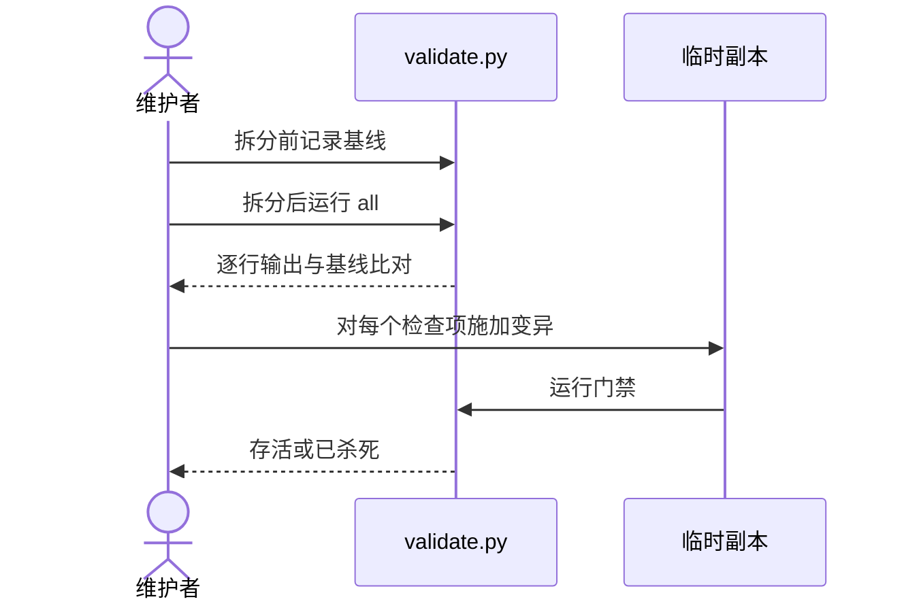

# 质量提升批 — 测试与验证方案（design/qa）

> 前置输入：`spec/qa/acceptance.md` 各验收点。验证用例编号形如 `TC-<模块号>-<序号>`，与 `schemas/test-plan.schema.json` 的用例 id 同构。

## 1. 前置门禁与环境
| 检查项 | 期望事实 | 当前结论 | 阻塞提测 |
| --- | --- | --- | --- |
| 基线可复现 | `validate.py all` 当前 9 项 PASS | 已具备（2026-10-13 运行） | 是 |
| 单元测试基线 | `unittest discover` 78 项 OK | 已具备（2026-10-13 运行） | 是 |
| 运行态同步 | `validate.py installed` 退出码为 0 | 缺失，需用户重装插件 | 是（M-D） |

| 测试环境 | 用途 | 提供入口 | 必须就绪阶段 | 未就绪影响 |
| --- | --- | --- | --- | --- |
| 本机仓库工作区 | 门禁与单元测试 | 仓库根目录 | 每个阶段 | 无 |
| 临时副本目录 | 变异测试与隔离运行 | `cp -r` 生成 | M-B 运行前 | 无法隔离则不运行变异 |
| 宿主与模型 | 实验运行 | 待 Q-01 确认 | M-F 运行前 | 不运行实验 |
| CI runner | 真实环境下的门禁 | GitHub Actions | M-A 完成后 | CI 结论未知 |

## 2. 模块 × 验证类型矩阵
| 模块 | 验证用例编号 | 验证类型 | 执行端 |
| --- | --- | --- | --- |
| M-A 门禁拆分 | TC-01-01、TC-01-02、TC-01-03 | 功能、兼容 | 本机命令 |
| M-B 变异测试 | TC-02-01、TC-02-02 | 功能、边界 | 本机临时副本 |
| M-C 计数脚本 | TC-03-01、TC-03-02 | 功能 | 本机命令 |
| M-D 运行态同步 | TC-04-01 | 功能 | 本机命令（需用户先重装） |
| M-E 角色场景 | TC-05-01 | 功能 | 子代理场景运行 |
| M-F 实验 harness | TC-06-01、TC-06-02、TC-06-03 | 边界、异常 | 本机命令，不涉及宿主 |

## 3. 核心流程测试设计

| 分支 | 覆盖说明 | 关联验证用例 |
| --- | --- | --- |
| 拆分后行为不变 | 逐行比对基线输出与退出码 | TC-01-01、TC-01-02 |
| 变异存活 | 人为构造一个无检查的模块，应报告存活 | TC-02-02 |
| 未知状态 | 模拟宿主超时，应记为未知且不计失败 | TC-06-02 |

## 4. 边界与异常覆盖
| 类型 | 条件/触发 | 正确结果 | 关联 AC |
| --- | --- | --- | --- |
| 数据与组合 | `--rep` 取 0 或 4 | 退出码 2，不产生记录 | M-F-AC-03 |
| 下游异常 | 宿主连续超时两次 | 状态为未知，两次记录均保留，不计失败 | M-F-AC-02 |
| 状态与时间 | 变异副本运行超过 `MUTATE_TIMEOUT_S` | 计为存活，报告中标注超时 | M-B-AC-02 |
| 权限与配置 | `EXPERIMENT_BUDGET_RUNS` 为默认值 0 | 拒绝启动，退出码 2 | M-F-AC-03 |

## 5. 测试准备
| 准备项 | 具体内容 | 使用哪些验证用例 | 准备/复位方式 | 未就绪处理 |
| --- | --- | --- | --- | --- |
| 拆分前基线 | `validate.py all` 的完整输出，去掉行号后保存 | TC-01-01 | 拆分前生成，只读保存在测试子目录下（运行记录格式见 `examples/testing/`） | 缺失则不得开始拆分 |
| 模拟超时宿主 | 一个永不返回的假宿主脚本 | TC-06-02 | 测试内启动，结束后清理 | 无 |
| 预算配置 | 把 `EXPERIMENT_BUDGET_RUNS` 设为 0 与设为计划值 | TC-06-03 | 测试内设置，结束后还原 | 无 |

## 6. 验证命令
| 命令 | 覆盖什么 |
| --- | --- |
| `PYTHONDONTWRITEBYTECODE=1 python3 -B tools/lab/validate.py all` | 全套门禁（项数以 `--list` 自报为准，当前 11 项） |
| `PYTHONDONTWRITEBYTECODE=1 python3 -B -m unittest discover -s tests` | 单元测试 |
| `PYTHONDONTWRITEBYTECODE=1 python3 -B tools/lab/doc_chain.py --self-test` | 文档链 linter 自测 |
| `PYTHONDONTWRITEBYTECODE=1 python3 -B tools/lab/validate.py installed` | 宿主安装快照同步 |

## 7. 发布判断条件
| 判断项 | 必须满足 | 不满足时 |
| --- | --- | --- |
| 核心验证用例 | TC-01、TC-02、TC-04 全部通过 | 阻塞发布 |
| 实验数据 | 按 `spec/qa/acceptance.md` §4 判定，给出结论 | 不得发布任何效果结论 |
| 回滚 | `design/be` §3.2 的步骤可执行并已验证 | 阻塞发布 |

## 8. 自检清单
- ☑ 每个范围内验收点都至少由一个验证用例承接（见 §2）
- ☑ 基线与运行态同步的前置条件已列明（见 §1）
- ☑ 验证命令与入口已明确（见 §6）
- ☐ 实验相关用例待 Q-01 与 Q-03 确认后才能执行
