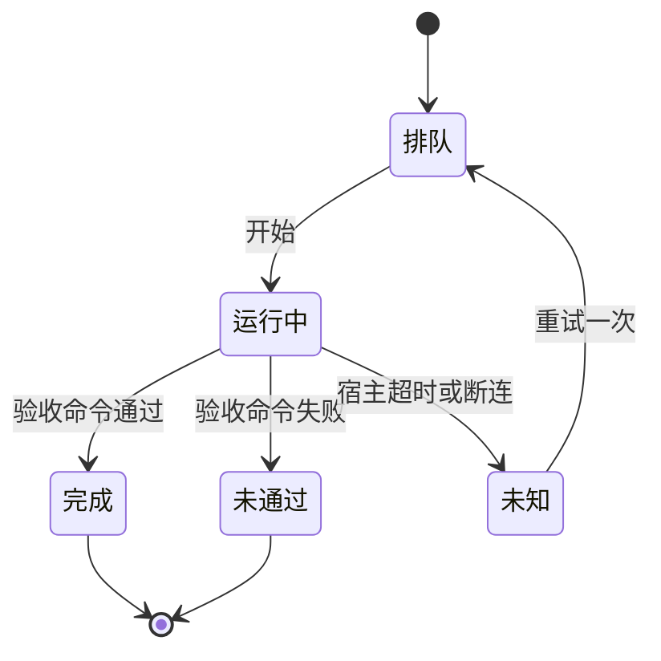

# 质量提升批 — 工程需求补充（spec/be）

> 前置依赖/文档状态：`proposal/prd.md` 草案，待独立评审。冻结语义：门禁对外行为不变（子命令、退出码、输出格式），只允许内部重组与新增检查项。

## 0. Proposal 反审 checklist
| # | 缺口（引原文位置） | 阻塞 | 工程默认值 | 状态 |
| --- | --- | --- | --- | --- |
| PRD-01 | `prd.md` §1.2 G1 的判据依赖 Q-01 与 Q-03 | 是 | 先写判据，不运行实验；Q-01 与 Q-03 关闭前不执行 M-F 的运行 | 已关闭（默认值已写入 §3 与 §5 的 M-F） |
| PRD-02 | `prd.md` §1.2 G2 的「600 行」阈值依据不明 | 否 | 600 行作为可读性经验上限，不是硬约束；超出时须在评审中说明理由 | 已关闭 |
| PRD-03 | `prd.md` §六 的角色指标需要真实任务集 | 是 | 任务集草案见 `spec/qa/acceptance.md` §2，由用户在 Q-03 确认后冻结 | 已关闭 |

## 1. 对象模型与口径

### 1.1 核心对象
| 对象 | 定义 | 关键字段 | 来源 |
| --- | --- | --- | --- |
| 门禁检查项 | `validate.py` 中的一个 `validate_*` 函数，或 `doc_chain.py` 中的一个 C 编号 | 名称、所在模块、是否有变异覆盖 | 现有代码 |
| 变异 | 对一个检查项做的一处可控改坏（删断言、反转条件、放宽枚举） | 检查项、算子、是否被杀死 | 本批新增 |
| 实验任务 | 冻结后的一个真实任务：描述、验收命令、预埋缺陷（如有） | task_id、描述哈希、验收命令 | 本批新增 |
| 实验运行 | 某任务在某一臂上的一次执行 | run_id、arm、rep、状态、指标 | 本批新增 |
| 计数项 | 文档中出现的一个可量化事实（测试数、schema 数等） | 名称、来源命令、期望值 | 本批新增 |

### 1.2 运行状态图
一图回答一个问题：一次实验运行处于什么状态，以及「未知」为何不计为失败。

## 2. 核心语义
| 语义 | 判定顺序 | 不变式 | 边界 |
| --- | --- | --- | --- |
| 门禁行为不变 | 拆分与重组后，`validate.py all` 的逐行输出（去掉行号）与退出码，与拆分前基线一致 | 任何检查的通过/失败结论不变；例外只有修缺陷的改动，且该改动须附回归测试 | 基线在拆分前一次性记录 |
| 变异存活 | 对检查项施加变异，运行门禁。若门禁仍通过，则变异存活 | 存活数只减不增 | 不可变异的检查项（纯输出类）列入豁免清单，并逐条说明理由 |
| 未知不计失败 | 运行状态为「未知」的记录单独计数，不计入「完成」或「未通过」 | 未知数必须在报告中公开 | 重试次数上限为一次 |
| 计数由脚本输出 | 文档中的计数值由 `tools/lab/counts.py` 计算（新增），门禁比对文档标记与计算结果 | 文档与磁盘不一致即门禁失败 | 历史条目（CHANGELOG、episodes）不纳入比对 |

## 3. 冻结问题承接
| 编号 | 问题 | 工程口径 | 与建议值关系 | 关闭条件 |
| --- | --- | --- | --- | --- |
| Q-01 | 是否恢复评测装置 | 未决前，M-F 只交付判据、接口与记录格式，不写执行代码 | 不替用户决定 | 用户书面确认 |
| Q-02 | 角色取向 | 本批不合并角色；G5 产出通过率数据 | 不替用户决定 | 用户书面选定 |
| Q-03 | 实验预算 | 预算上限未确认前，不发起任何实验运行。配置键 `EXPERIMENT_BUDGET_RUNS` 默认 0，即拒绝启动 | 建议值为 60 次运行，由用户确认 | 用户确认上限 |
| Q-04 | 外部记录迁出 | 本批不迁移，只在台账中标注来源 | 无建议值 | 用户选定位置 |

## 4. 对前端的能力面
本批不涉及前端，无接口需要前端对接。

| 能力 | 接口/方法 | 请求关键字段 | 响应关键字段 | 状态 |
| --- | --- | --- | --- | --- |
| 无 | 无 | 无 | 无 | N/A（本批不涉及前端） |

## 5. 工程模块清单
| 模块 | 内容 | 依赖 | 优先级 |
| --- | --- | --- | --- |
| M-A 门禁拆分 | `validate.py` 拆为 `tools/lab/gate/` 下的检查模块（实际落地 13 个：checks、common、docs、examples、installed、manifests、plan、records、reports、schema、testing、workspace 与 `__init__`）；`validate.py` 保留为薄入口 | 无 | P0 |
| M-B 变异测试 | 新增 `tools/lab/mutate.py`：算子集、对每个检查项施加变异、在副本中运行并统计存活 | M-A（需要稳定的检查项边界） | P0 |
| M-C 计数脚本 | 新增 `tools/lab/counts.py`：计算测试数、schema 数、角色数、批次数、`validate.py` 行数；门禁比对文档标记 | 无 | P1 |
| M-D 运行态同步 | 用户重装插件后，`validate.py installed` 退出码为 0 | 用户重装 | P0 |
| M-E 角色场景 | 每个角色至少两个「必须拒绝」场景，以测试计划形式存放于 `docs/features/feature-2026-10-13-质量提升/testing/agentflows-role-boundary/plan-2026-10-13-001.md`，执行结果另行记录 | 无 | P1 |
| M-F 实验 harness | 本批不实现：按 Q-01 拍板的方案 D，仅保留判据与人工 A/B 约定；恢复装置需另立门变更批次 | Q-01、Q-03（历史决定见 README 与评审分析） | 本期不做 |

## 6. M-F 历史提案字段契约
> 以下保留原始方案的字段草案作历史依据；本批 M-F 不实施这些记录或命令。恢复评测装置需重新评审字段与门变更。
每次运行写一份 JSON 记录。字段为契约的一部分，不得随意增删。

| 字段 | 类型 | 必填 | 说明 |
| --- | --- | --- | --- |
| run_id | string | 是 | 形如 `EXP-<日期>-<序号>` |
| task_id | string | 是 | 来自冻结任务集，不在集中则拒绝 |
| arm | enum：`bare` / `agentflow` | 是 | 两臂 |
| rep | integer，1 至 3 | 是 | 第几次重复 |
| host | string | 是 | 宿主名称与版本 |
| model | string | 是 | 模型标识 |
| state | enum：`完成` / `未通过` / `未知` | 是 | 见 §1.2 |
| defects_missed | integer ≥ 0 | 是（状态为「完成」或「未通过」时） | 独立检查发现、而运行方未发现的缺陷数 |
| rework_rounds | integer ≥ 0 | 是 | 返工轮次 |
| duration_s | number | 是 | 墙钟秒数 |
| tokens_in / tokens_out | integer 或 null | 是 | 宿主报告值；无法获取时写 null 并说明原因 |
| evidence_path | string | 是 | 原始输出的仓库内相对路径 |

## 7. M-F 历史命令错误语义
> 以下为原方案的错误语义草案，不代表当前工具支持这些子命令。
| 场景 | 行为 |
| --- | --- |
| task_id 不在冻结集中 | 退出码 2，不运行 |
| arm 或 rep 取值非法 | 退出码 2，不运行 |
| 预算上限低于计划运行数，或上限为 0 | 退出码 2，拒绝启动，不产生任何记录 |
| 宿主超时或断连 | 状态记为「未知」，最多重试一次，两次尝试均记录 |
| 验收命令失败 | 状态记为「未通过」，原始输出写入 `evidence_path` |

## 8. 需求评审前自检
- 已确认 proposal 的 G1–G5 均能映射到本文件的模块（G1 → M-F；G2 → M-A、M-B；G3 → M-D；G4 → M-C；G5 → M-E）。
- 已确认 M-F 的字段与状态图一致（§1.2 与 §6）。
- 已确认未决问题 Q-01 至 Q-04 在 proposal 台账中有 owner 与关闭条件。
