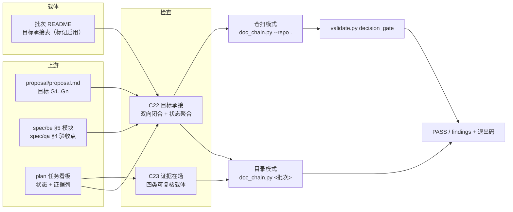
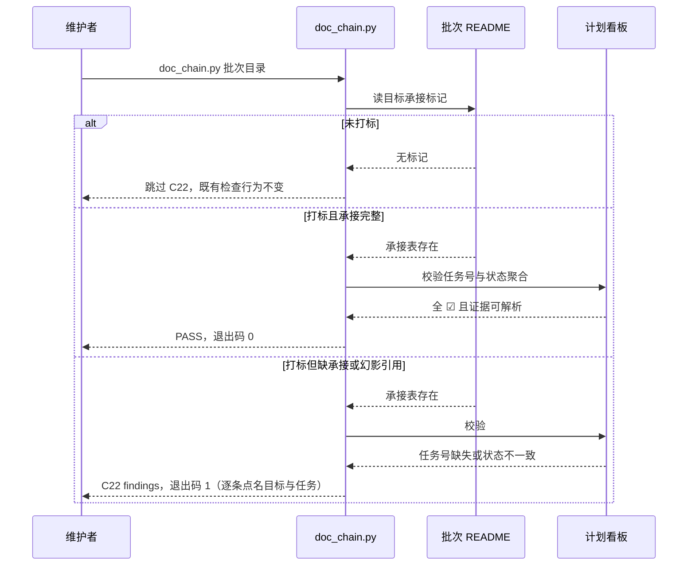
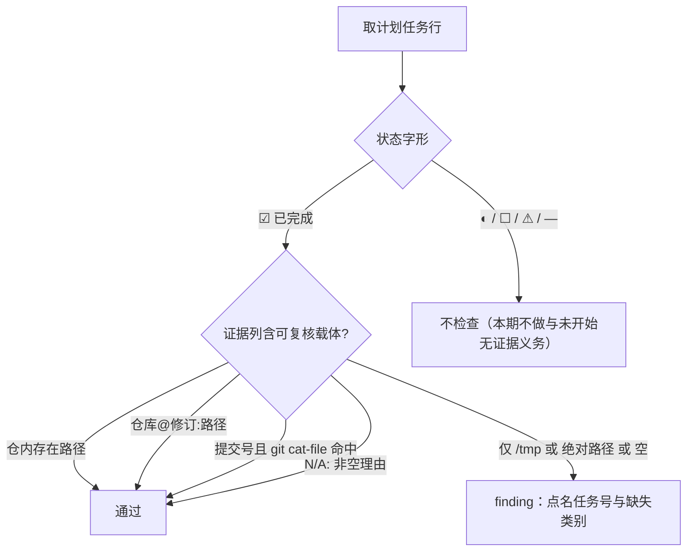
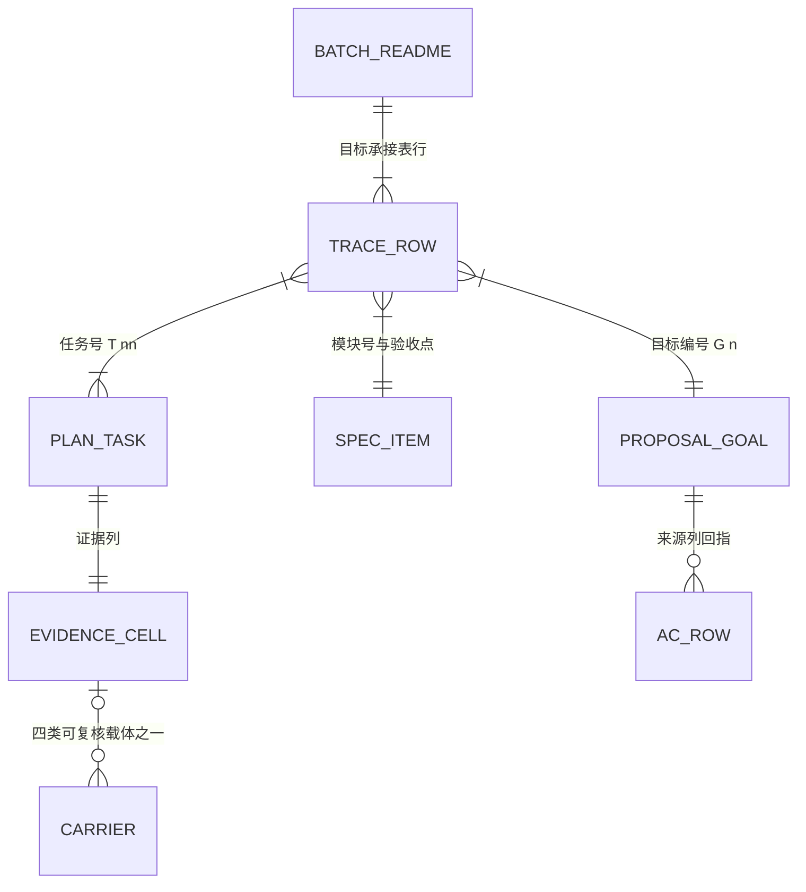

# 追溯闭环与证据在场批 — 工具链技术方案（design/be）

> 前置输入：`spec/be/backend.md` §5 至 §7、`spec/qa/acceptance.md` §2 至 §4。
> 契约基准：`tools/lab/doc_chain.py` 的检查集合（判据清单以该文件头注释为唯一真源）与 `tools/lab/gate/`
> 的门禁项集合（以 `python3 tools/lab/validate.py --list` 自报为准）。本文件不写这两个数字——
> 写了就会在下一条判据落地时变成假话。文档状态：成文，待技术方案评审。影响面见 §1.6。

## 0. 先说结论

| 问题 | 结论 | 禁令或注意 |
| --- | --- | --- |
| 目标失踪怎么拦 | 批次 README 新增「目标承接表」，由新检查 C22 双向闭合（上游声明的目标都要有落点，下游引用的编号都要存在） | 承接表是唯一载体；不允许再在散文里补一句「本目标由 Txx 承接」 |
| 证据散失怎么拦 | C23 只判「☑ 已完成行的证据列能否被第三方复核」，四类载体放行，`/tmp` 不放行 | 只判可复核性，不判内容质量；改判据须走门变更 |
| 新门怎么不重演零采用 | C22 用标记启用式（与 C11、C15 至 C21 一致），但本批把标记打到活文件：本批 README 与拍板口；C23 不加标记，覆盖所有批次的计划行；夹具继续留在 `examples/` | 采用面用 G1-AC-05 与 G3-AC-02 机器验收，不接受「实现了就算」的摘要 |
| 历史批次会被不会被误伤 | C22 只扫描打标批次；C23 无标记并检查所有批次计划的已完成任务证据。对 C23 命中逐项分辨证据缺失与判据误伤 | 修正错误证据或按现行契约处理 finding；不得以摘 C22 标记关闭 C23 |
| 拍板口八列的豁免通道从哪来 | `schemas/bug-record.schema.json` 增可选 `disposition`（`deferred` / `not-doing`），先改契约再登记记录 | 契约变更与登记必须同批，否则登记当天编译失败 |

## 1. 设计方案

### 1.1 整体设计

#### 1.1.1 技术挑战

| 优先级 | 技术挑战 | 应对 |
| --- | --- | --- |
| P0 | 承接表与计划看板的聚合口径不一致会制造假红（批次状态是任务状态的聚合） | 状态列只与「所引任务行的字形集合」比对：全 ☑ 才允许 ☑；出现 ☐/◐/⚠ 即要求降级为对应值，不做时间戳推断 |
| P0 | 证据列的自由文本极多，识别过窄会误杀真实证据、过宽等于没门 | 采用四类载体的白名单式识别（§1.4.3），且只判「有没有」，不判「写得好不好」；每类都有正反夹具 |
| P0 | 提交号判定依赖 git，环境缺失时可能静默放行 | 失败关闭：无 git 或对象不存在时不算可复核，直接判 finding（与 §1.4.5 一致） |
| P1 | 目标编号抽取易被措辞绕过（`G1` 写成「目标一」） | 上游以 `proposal/` 文本的 `\bG\d+\b` 集合为准，并加负夹具钉住「表里出现 proposal 没有的编号」同样红 |
| P1 | 新检查写进 `lint()` 会影响目录模式，`--repo` 模式需要能复用同一实现 | 单一实现：`goal_traceability_findings()` 与 `evidence_presence_findings()` 同时被目录模式与仓扫模式调用，避免第二处副本 |

#### 1.1.2 技术架构



| 组件 | 负责 | 不负责 |
| --- | --- | --- |
| `tools/lab/doc_chain.py` | C22、C23 的判据实现与自测夹具 | 记录 schema 校验（`schemas/` 与 `gate/` 侧） |
| `schemas/bug-record.schema.json` | `disposition` 字段的取值合法性 | 归属语义判断（属 C18） |
| `tools/lab/gate/checks.py` | 把仓扫模式的 C22/C23 结果并入 `decision_gate` 项 | 新增门禁项（本批项数不变，仍以 `--list` 自报） |
| 批次 README 承接表 | 承载目标到 spec、plan 的映射 | 承载进度权威（权威只在计划看板） |
| `docs/trend.jsonl` | 记录门自身信号趋势 | 本批不新增字段、不回填历史失实值（历史记录只追加） |

#### 1.1.3 核心业务流程

##### 1.1.3.1 C22 目标承接主链路

| 步骤 | 调用方→承接方 | 动作或输入输出 | 状态或数据变化 | 失败处理 | 观测点 |
| --- | --- | --- | --- | --- | --- |
| S1 | 维护者→`doc_chain.py` | 传入批次目录；读 README | 无 | README 缺失按既有 C1 处理 | 文件清单 |
| S2 | `doc_chain.py`→承接表解析 | README 无 `agentflow 目标承接` 标记则整项跳过 | 无 | 未打标不产出任何 finding（G1-AC-04） | 跳过计数 |
| S3 | 承接表→proposal 与 spec 文本 | 抽取 `G\d+` 集合、模块号与验收点编号 | 无 | 表头缺必需列直接红（不猜列） | 集合差 |
| S4 | 承接表→plan 任务表 | 逐个任务号定位行、读状态字形与证据列 | 无 | 任务号不存在红；☑/⚠ 任务未被任何行引用红 | 引用覆盖表 |
| S5 | 判定→输出 | 汇总 findings，非空退出码 1 | 无 | 逐条打印原文再判，不静默 | 原始输出 |



##### 1.1.3.2 C23 证据在场判定流程



#### 1.1.3.3 数据关系

一图回答一个问题：C22 与 C23 各自读哪些载体，载体之间靠什么键连接。



关系中 `EVIDENCE_CELL` 到 `CARRIER` 是零或一：缺载体即 C23 finding；`TRACE_ROW` 到 `PLAN_TASK`
是多对多，但每个已完成或阻塞的任务行必须被至少一条承接行覆盖，否则即孤儿任务 finding。

### 1.2 核心算法与关键逻辑

#### 1.2.1 承接闭合

**触发条件**：批次 README 含 `agentflow 目标承接`。
**输入输出**：输入为批次目录内 README、proposal、spec、plan 文本；输出为 findings 列表。
**判断顺序**：先校表头必需列，再抽取集合，最后做双向差集与状态聚合。
**不变式**：`proposal 目标集合 == 承接表目标集合`，且 `承接表引用的任务号 ⊆ 计划任务号`，
且 `计划中 ☑/⚠ 任务号 ⊆ 承接表引用的任务号`。
**代码职责落点**：`tools/lab/doc_chain.py`（新增 `goal_traceability_findings`）。

```python
def goal_traceability_findings(feature_dir, repo_root):
    readme = read(feature_dir / "README.md")
    if TRACE_MARKER not in readme:
        return []                      # 标记启用式：未打标整项跳过
    targets_doc = g_ids(proposal_text(feature_dir))      # 上游声明
    rows = table(readme, header_superset=TRACE_COLUMNS)  # 缺列直接红，不猜
    errs = []
    for name, declared, used in diff_both_ways(targets_doc, table_ids(rows)):
        ...  # 缺承接 / 幻影目标
    for row in rows:
        errs += spec_refs_findings(row, spec_texts)      # 模块号与 AC 必须存在于 spec
        errs += task_refs_findings(row, plan_rows)       # 任务号存在 + 状态聚合一致
    errs += orphan_findings(plan_rows, referenced)       # ☑/⚠ 任务必须被引用
    return errs
```

#### 1.2.2 证据载体识别

**触发条件**：计划任务行状态为 `☑`。
**判断顺序**：仓内路径 → 仓限定引用 → 提交号（需 git 命中）→ `N/A:`；任一命中即通过。
**不变式**：识别函数对同一行的判定与行内其余文字无关；含任一有效载体即通过，即使同行还提到 `/tmp`。
**代码职责落点**：`tools/lab/doc_chain.py`（新增 `evidence_presence_findings`），复用既有
`_ref_is_in_repo()` 以免第二套路径解析口径。

### 1.3 核心数据与存储设计

#### 1.3.1 数据怎么流转

承接表是定义（人写、机器读，随批次走）；计划看板是实例状态（执行期唯一可回写的是状态与证据两列）。
本批新增的落盘证据（门基线输出、变异报告）是一次运行的产物：写入 `testing/agentflows-gate-evidence/`
后只读，更正以追加新文件的方式，不回写旧文件内容。

#### 1.3.2 DDL

本批不引入数据库；`disposition` 是记录 frontmatter 的可选字符串字段。

| 项 | 结论 | 理由 |
| --- | --- | --- |
| 新增表 | 无 | 记录仍以 Markdown + frontmatter 保存，沿用 `validate.py artifacts` 编译 |
| 新增 schema 字段 | 有：`disposition`（可选，枚举 `deferred` / `not-doing`） | C18 的豁免通道在文本里已被引用但契约里没有；缺失会让登记动作直接编译失败 |
| 迁移 | 无 | 可选字段，历史记录不填即不参与判定 |

#### 1.3.3 配置键

| 键 | 默认值 | 说明 |
| --- | --- | --- |
| `TRACE_COLUMNS` | 目标 / proposal 出处 / spec 承接 / plan 任务 / 状态 | C22 必需列集合，缺列即红 |
| `TRACE_MARKER` | `agentflow 目标承接` | C22 的启用标记 |
| `EVIDENCE_GLYPH` | `☑` | C23 只对已完成行生效的状态字形 |
| `MIN_DOC_CHAIN_SELF_TEST_CASES` | 20 | 既有下限守卫；本批只增不减，不改数值 |

#### 1.3.4 现有设施复用

| 设施 | 用法 | 改动 |
| --- | --- | --- |
| `doc_chain.py` 的 `md_tables()` | 承接表与任务表解析 | 无 |
| `doc_chain.py` 的 `_ref_is_in_repo()` | 证据列路径与外部仓引用判别 | 无（同一口径，避免双源） |
| `doc_chain.py` 的 `_last_commit()` 写法 | 新增 `git cat-file -e` 探测 | 新增同族小函数，不复用 `git log`（语义不同） |
| `gate/checks.py` 的 `validate_decision_gate` | 仓扫入口，把 C22/C23 带进门 | 仅改其调用的 linter 实现，不改门禁项集合 |

### 1.4 详细接口设计

#### 1.4.1 契约真源

文档链检查的对外契约是 `doc_chain.py` 的三种模式（目录、`--file`、`--repo`）与「逐条打印 findings
原文再判 PASS/FAIL」的输出形态，本批不改形态，只新增检查号。门禁项集合的真源是
`tools/lab/validate.py --list` 的自报，本批不增删项。记录字段契约的真源是 `schemas/`，本批按 §1.3.2 改一处。

#### 1.4.2 接口清单

| 接口 | 方法 | 变更类型 | 说明 |
| --- | --- | --- | --- |
| `tools/lab/doc_chain.py` | 目录模式命令行 | 行为新增 | 每个批次额外执行 C23（证据在场，不设标记）；C22 仅对打 `agentflow 目标承接` 标记的批次生效，其余批次行为不变 |
| `tools/lab/doc_chain.py` | `--repo` 模式 | 行为新增 | 仓扫遍历 `docs/features/*/` 全部批次目录（不以「有没有 README」为门槛）执行同一实现；其中 C22 仍按标记启用（G1-AC-05） |
| `tools/lab/doc_chain.py` | `--self-test` | 用例新增 | 新增 C22/C23 判别夹具，用例数只增 |
| `schemas/bug-record.schema.json` | 记录契约 | 兼容新增 | 可选 `disposition`，老记录不填仍通过 |
| `tools/lab/gate/plan.py`、`gate/records.py` | 计划与记录校验 | 不变 | 状态枚举与必填集合不动 |

反向说明：`doc_chain.py` 的**被 import 方**只有 `tests/test_lab_contracts.py`（全仓检索 `import doc_chain` 命中 1 处）；
它同时被五个位置当**子进程**调用（`tools/lab/validate.py`、`tools/lab/mutate.py`、`tools/lab/gate/checks.py`、
`tools/lab/gate/examples.py`、`tools/lab/trend.py`，按 `grep -rn "doc_chain" tools tests` 计 106 行命中，逐条看过）。
新增函数只增不改既有签名，因此子进程调用面不变；两条口径分开陈述，是因为第二轮评审指出原句用「调用方」
一词把 import 与 subprocess 混成一件事，且用裸 grep 下了存在性结论（`AGENTS.md` 明令禁止）。

#### 1.4.3 关键接口契约

`goal_traceability_findings(feature_dir, repo_root)` 的入参与返回：

| 参数 | 类型 | 必填 | 错误语义 |
| --- | --- | --- | --- |
| `feature_dir` | 路径 | 是 | 目录不存在由调用方（`lint()`）按既有行为报错，本函数不重复判 |
| `repo_root` | 路径 | 是 | 用于把反引号路径解析到仓根；无法解析的段按外部引用处理 |
| 返回 | `list[str]` | 是 | 每条以 `C22 目标承接:` 开头，点名批次、目标号或任务号；未打标返回空表 |

`evidence_presence_findings(plan_label, plan_text, repo_root, batch_dir=None)` 的入参与返回：

| 参数 | 类型 | 必填 | 错误语义 |
| --- | --- | --- | --- |
| `plan_label` | 相对路径字符串 | 是 | 出现在 finding 文本里，便于定位 |
| `plan_text` | 计划正文 | 是 | 无任务表时返回空（形态缺失由 C9 负责，不重复报） |
| `repo_root` | 路径 | 是 | 路径与提交号解析基准 |
| `batch_dir` | 路径 | 否 | 批次目录；证据列里的路径也按它试一次（存量写法两种都有） |
| 返回 | `list[str]` | 是 | 每条以 `C23 证据在场:` 开头，含任务号与缺失类别 |

接口契约总览（下表只是导航；字段级契约的形态基线是上面两张逐字段表，别把字段塞进本表）：

| 接口（函数与调用位置） | 请求字段 | 响应字段 | 错误语义 |
| --- | --- | --- | --- |
| `goal_traceability_findings()`，经 `batch_traceability_findings()` 被两种模式各调一次 | `feature_dir`、`repo_root` | `list[str]` findings，前缀 `C22 目标承接:` | 未打标返回空表；缺表或缺列返回点名 finding，不抛异常 |
| `evidence_presence_findings()`，由 `batch_traceability_findings()` 调用 | `plan_label`、`plan_text`、`repo_root`、`batch_dir` | `list[str]` findings，前缀 `C23 证据在场:` | 无任务表返回空；仅临时目录载体返回 finding |
| `evidence_carriers(cell, repo_root, batch_dir=None)`（内部共用） | 证据单元格文本、`repo_root`、可选批次目录 | `list[str]` 命中的载体类别（空表即无载体） | 无 git 时提交号不计入载体（失败关闭）；`/tmp` 与绝对路径永不算 |

#### 1.4.4 运行逻辑

两种模式都通过同一个入口 `batch_traceability_findings(批次目录, 仓根)` 进入判定，因此**判据**不可能分叉；
差别只在**批次集合**：目录模式跑被指定的那一个目录，仓扫跑 `docs/features/*/` 下全部目录。
finding 文本的标签形态不同（目录模式相对批次目录、仓扫相对仓根），实质结论一致——这一点由
`tests/test_lab_contracts.py` 的双模式对照断言钉住，不靠本段文字自证。

#### 1.4.5 错误、幂等与状态约束

| 场景 | 行为 |
| --- | --- |
| README 有标记但无承接表 | finding：点名「标记启用但缺表」，不静默跳过 |
| 表头缺必需列 | finding：列出缺失列名，不猜测列序 |
| 计划里没有任何 ☑ 行 | C23 返回空（本批不要求计划必须有已完成行才可跑） |
| 提交号存在但 git 不可调用 | finding（失败关闭），并写明「环境无 git，提交号不可核」 |
| 同一批次同时被目录与仓扫模式跑 | 结果一致；两次运行不写任何文件（检查器幂等、只读） |
| 承接表状态列与看板聚合不符 | finding 点名不一致的任务号与实际字形（过报与漏报两个方向都判） |
| 表头写成 `**目标**` 之类装饰形态 | 列名按 `_norm_col()` 归一化后照常校验，不得退化成「缺表」 |
| 批次目录没有 README.md | C22 无从判定即跳过；C23 仍读它 `plan/` 下的任务表 |

### 1.5 外部依赖改动需求

| 依赖 | 改动 | 强度 |
| --- | --- | --- |
| git | C23 的提交号探测需要 `git cat-file` | 强依赖（缺失时失败关闭，不影响其它判据） |
| 宿主安装快照 | M-F 需重建 `packaging/runtime` 并比对安装面 | 强依赖（发布侧） |
| 无新增第三方依赖 | ruff、mypy 沿用 `requirements-dev.txt` 钉版 | 弱依赖 |

### 1.6 兼容性思考与影响面评估

#### 1.6.1 影响等级

本批定级 **L2（中）**。实际改动的受保护路径共 5 个：`tools/lab/doc_chain.py`、
`tools/lab/gate/examples.py`（反例登记表）、`tools/lab/mutate.py`（新判据的变异覆盖）、
`schemas/bug-record.schema.json`、`tests/test_lab_contracts.py`（钉住测试）。
`tools/lab/gate/checks.py` 与 `protected-paths.txt` 本批**没有**改动（门禁项集合不变）。对外命令形态不变。授权来源为用户 2026-10-22 会话内问答选定的「全部授权」（选项说明文本由作者撰写，非用户逐字列出改动项），终审由独立评审与用户保留。

#### 1.6.2 变更兼容性分类

| 变更 | 类型 | 处理 |
| --- | --- | --- |
| 新增 C22、C23 | C22 为标记启用；C23 无标记、扫描全部批次已完成任务 | 既有批次需复核 C23 发现；不因未打 C22 标记而豁免 |
| `disposition` 进契约 | 非破坏（可选字段） | 老记录不填仍通过；新增反例夹具钉住非法值被拒 |
| 拍板口改八列 | 破坏性（表结构变） | 内容逐条搬运并补齐现状核验与关闭条件，不改结论；`decision_gate` 当场复跑 |
| 16 条记录追加 `disposition` 与变更记录行 | 非破坏（只追加） | 正文与状态不改写；`artifacts` 复跑 |
| 文本收口（D-01 至 D-08） | 非破坏（文档） | 双源收口保留真源，另一处改指针；`validate.py docs` 复跑 |

#### 1.6.3 影响面 checklist

| 维度 | 检查项 | 结论 |
| --- | --- | --- |
| 接口契约 | `doc_chain.py` 三种模式与退出码 | 形态不变，仅 findings 增加 |
| 门禁项 | `validate.py --list` 自报项集合 | 不变（项数不写进任何文档） |
| 运行行为 | 既有各条检查的判定结果 | 不因本批变化，实测两批目录模式对比留档 |
| 数据与记录 | bug 记录 frontmatter | 新增可选字段，历史不填即不适用 |
| 上下游 | `examples/`、`tests/`、正反例 | 同批补夹具与回归测试，否则视为未完成 |
| 宿主侧 | 生成树与安装面 | 生成树重建后 `installed` 复跑；角色文本本批不改（除 D-04/D-05 指针化） |
| 监控运维 | `doc_chain_live` 活面扫描 | 作用域不变，但结果会变：它对 `docs/features/` 跑的是**整目录判据**，所以 C23 一落地就把存量批次的散失证据暴露进门里（本轮实测 2 条），由 T10 补齐载体后转绿；`docs/product/` 走逐文件文本判据，其结构缺口（plan 目录空、无 qa 轨）仍在门的作用域之外，本批不扩大 |

#### 1.6.4 强弱依赖与结论

- 向后兼容发布：是（命令与门禁项不变；唯一表结构变更是拍板口，属本仓自有载体）。
- 强依赖方是否全部确认：git 在本仓可用（实测）；宿主重装与推送均未获授权，本批不动。
- 是否需要版本边界或弃用说明：否。`disposition` 是向后兼容的可选字段，无旧写法需淘汰。
- 与回滚及灰度的关联：见 §3.2 与 §3.3。

## 2. 外部不变式

对使用者的三条承诺：未打标批次不进入 C22，但仍受 C23 证据检查；既有检查号（C1 至 C21）的判定不因新增而变；
门禁项集合与 `--list` 自报一致且任何文档都不手写它。任何一条被实测打破，本批不得发布。

## 3. 稳定性方案

### 3.1 上线顺序与异常策略

| 顺序 | 动作 | 判据 |
| --- | --- | --- |
| 1 | 记录改动前基线：`validate.py all`、两个存量批次的目录模式输出 | 原始输出落 `testing/agentflows-gate-evidence/` |
| 2 | 实现 C22/C23 与自测夹具（先负例后正例） | `--self-test` 全绿且用例数增加 |
| 3 | 契约补 `disposition` 与正反例 | `validate.py schemas`、`examples` PASS |
| 4 | 拍板口八列化、记录登记、批次打标 | `validate.py decision_gate` PASS 且扫描对象含活文件 |
| 5 | 文本收口 D-01 至 D-08 | `validate.py docs`、`doc_chain_live` PASS |
| 6 | 重跑整门变异并把报告与基线落盘，回写两批证据列 | C23 对两批计划 findings 为 0；报告在盘可核 |
| 7 | 独立评审 → 版本 bump → 生成树重建 → 安装差异核验 | 评审 `approved`；`manifests` PASS；installed 仅在目标宿主可重装时执行，未执行须如实记差异，不得报 PASS |

| 异常场景 | 策略 |
| --- | --- |
| C22 或 C23 在存量文档上出现意料外命中 | 先分诊「真缺口 / 判据过宽」；判据过宽则收窄实现并补夹具，不允许给批次摘标记 |
| `decision_gate` 因拍板口改造变红 | 视同编译错误修复内容；禁止靠删标记转绿，也不允许把 findings 当误报放行 |
| 变异重跑结果与既有勘误（43 杀死/6 存活/2 无效）不一致 | 如实记录新结果并回写计划，不套用旧数字 |
| 独立评审返回 `changes_requested` | 一轮聚焦修复后复审；轮次逐条进 episode |

### 3.2 回滚

与 §3.1 的七步逐条配对（一步一个回滚点，不写成概括）：

| 顺序 | 动作（§3.1） | 回滚动作 | 数据后果 |
| --- | --- | --- | --- |
| 1 | 基线落盘 | 纯新增文件，删除即回滚 | 无 |
| 2 | C22/C23 实现与夹具 | `git revert` 该提交 | 无（检查器只读，不写文件） |
| 3 | `disposition` 进契约与正反例 | `git revert` 后需同批回退第 4 步的字段登记 | 只回退契约会让已登记记录 `artifacts` 红，故必须与第 4 步同进同退 |
| 4 | 拍板口八列化、16 条记录登记、批次打标 | `git revert` 该提交 | 无（登记内容只追加，回退即消失） |
| 5 | 文本收口 D-01 至 D-08（含 `agents/`、`skills/`） | `git revert` 后**必须**重跑第 7 步的生成树重建 | 否则安装面与源面漂移，`manifests` 红 |
| 6 | 整门变异重跑与证据回写 | 回退两个存量批次计划的证据列改动，报告文件按只追加原则保留 | 报告留在盘上不产生错误，仅历史多一份产物 |
| 7 | 独立评审 → 版本 bump → 生成树 → 安装面 | 评审未过则不进入 bump；已 bump 时还原五份 manifest 并重建 `packaging/runtime` | 宿主侧仍是旧快照，须用户重装才切换；本批不代做 |

不可回退点：CHANGELOG 与 episode 条目按仓库规则只追加，发布说明若已写出不就地抹除，更正在下一版本说明。

### 3.3 灰度与开关

| 开关 | 默认值 | 放量方式 | 回滚方式 |
| --- | --- | --- | --- |
| `TRACE_MARKER`（批次级） | 未打标（截至 0.13.0：本批一个批次打标；另有一处 `agentflow 决策记录` 打在 `docs/PENDING-DECISIONS.md`） | 后续批次逐个补标记 | 摘掉标记即退出检查范围，不影响其它判据 |
| `disposition`（记录级） | 缺省不参与 | 逐条登记 | 删除字段即回到原行为（需同时回退 schema） |

### 3.4 监控告警与问题定位

| 现象 | 首查 | 日志或命令 | 原因 | 动作 |
| --- | --- | --- | --- | --- |
| 某批次突然大量 C22 findings | 承接表是否存在 | `doc_chain.py <批次>` 原始输出 | 标记打了但没建表，或列名被改 | 补表或摘标记（补表为准），不允许改判据 |
| ☑ 行被判 C23 红 | 证据列原文 | 同上，逐条看点名任务号 | 证据只指向临时目录 | 把产物落盘再回写证据列 |
| `decision_gate` 红但目录模式绿 | 两种模式是否共用实现 | `doc_chain.py --repo .` 输出 | 仓扫漏调或标记解析差异 | 修共用实现，不在两处分别判 |
| 变异存活数上升 | 存活清单新增项 | `testing/agentflows-gate-evidence/` 报告 | 新检查缺少变异覆盖 | 补算子或语料，或按事实登记豁免 |

## 4. Design 评审前自检

- ☑ 主链路 S 步骤表与含失败分支的时序图口径一致（§1.1.3.1）
- ☑ 证据判定形态有 flowchart，与 §6.2 字段口径逐类对应（§1.1.3.2）
- ☑ 接口契约按参数逐项给出类型、必填与错误语义；无索引式汇总表（§1.4.3）
- ☑ 影响面定级 L2 且依据写明（§1.6.1）
- ☑ 发布顺序与回滚点逐条配对（§3.1 七步 ↔ §3.2 七行），含不可回退点声明
- ☑ 异常矩阵覆盖缺表、缺列、git 缺失、判据过宽、评审返工、结果与勘误不符六类
- ☐ 「历史批次全量接入」的判据与范围待另批立项时确认，本批不承诺
