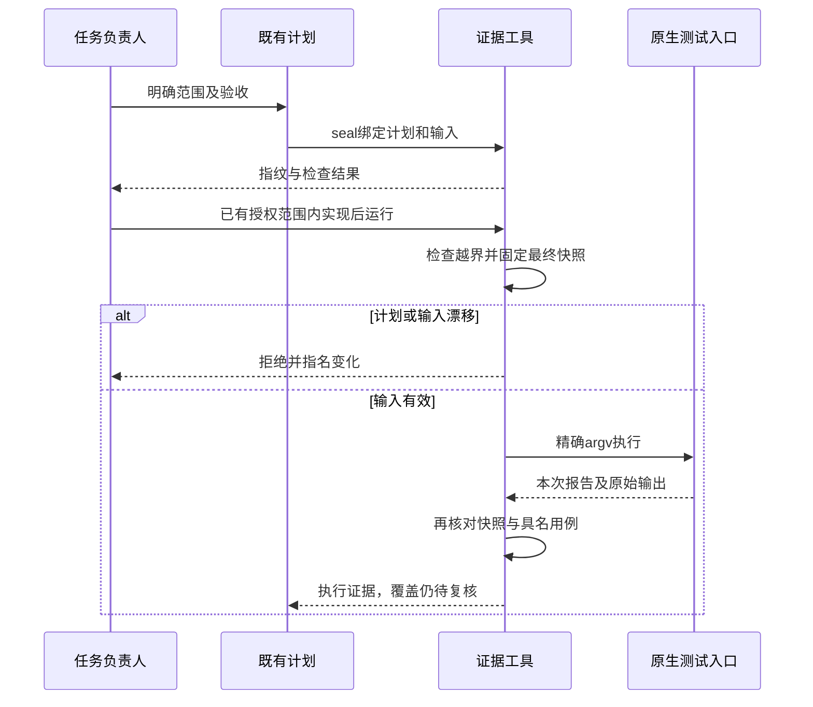
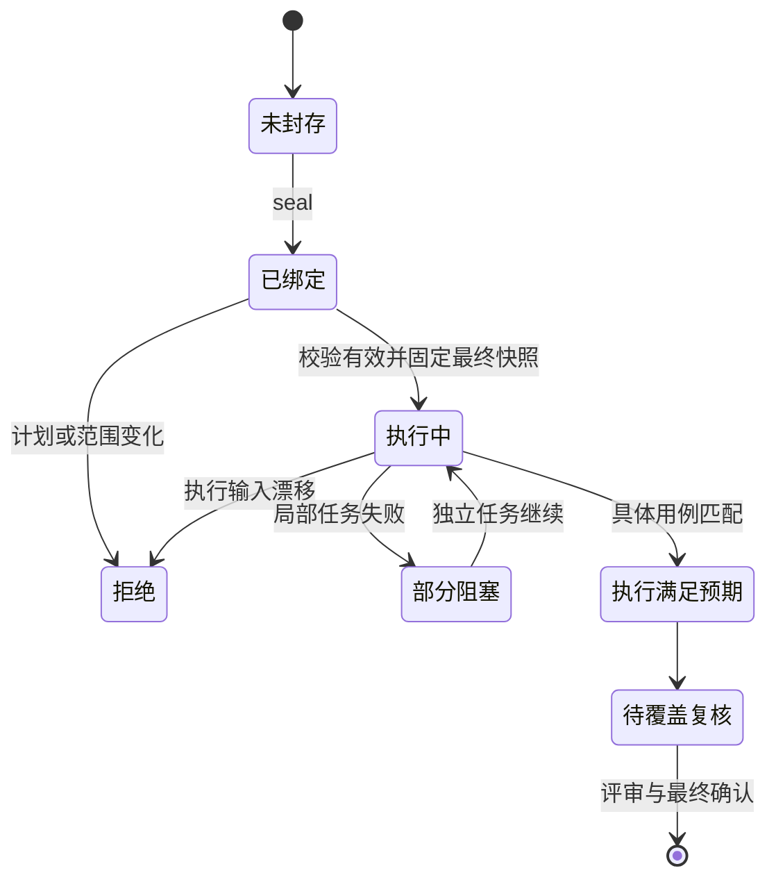

# 执行协议与证据工具设计

## 1. 先说结论

一个便携 Python 标准库工具、一份执行方法权威和两档文档流程。复用现有角色与计划/测试记录；不增加数据库、平台依赖或第二个模型循环。

## 2. 边界与职责

| 组件 | 负责 | 不负责 |
| --- | --- | --- |
| 执行协议 | 测试适用性、预检、选测、有效失败、覆盖复核及停止条件 | 运行模型与平台授权 |
| 证据工具 | 输入摘要、范围检查、显式命令执行、报告核对、补测映射、托管写入 | 批准计划或修改任务/Bug状态 |
| 现有计划和测试记录 | 状态、结果及原始证据索引 | 重复维护工具内部瞬态状态 |
| 独立评审 | 契约符合与断言/覆盖的质量判定 | 冒充实际执行证据 |

## 3. 命令与字段契约

统一入口为 `skills/agentflow/scripts/workflow.py`。模块拆为快照、原生报告、命令执行与托管写入；CLI只解析参数和结构化错误。

| 命令 | 请求字段 | 响应字段 |
| --- | --- | --- |
| seal | root、input、output | 计划引用、授权基线、任务与指纹 |
| verify | root、sealed、fingerprint | 计划未变、允许范围以外的输入未漂移 |
| run | 同 verify，另加 output 与 phase | 本次快照、逐任务/用例、原始stdout/stderr及覆盖待复核状态 |
| inventory | root、input | 文件、功能、用例和批次映射的结构检查结果 |
| managed-preview | target、content、output，可选成对标记 | 原内容及拟写内容绑定的单文件预览 |
| managed-apply | preview、fingerprint | 备份、实际写入和读回校验结果 |

执行说明字段：

| 字段 | 类型 | 规则 |
| --- | --- | --- |
| plan | string | 项目内普通Markdown文件，封存摘要；即使列在允许写范围也不得修改 |
| allowed_writes | string[] | 精确项目相对路径，禁止绝对路径、逃逸和符号链接 |
| tasks[].id | string | 非空唯一 |
| tasks[].depends_on | string[] | 必须存在且无环；失败仅阻塞真实依赖 |
| tasks[].argv | string[] | 非空参数数组，shell=False，不保存env值 |
| tasks[].cwd | string | 默认为项目根，项目内普通目录 |
| tasks[].timeout_seconds | number | 正且有界，不允许无限等待 |
| tasks[].kind | string | test或preflight；预检不可冒充行为测试 |
| tasks[].reporter | string | tap、junit、go、jest；exit仅适用于preflight |
| tasks[].cases | object[] | test任务非空；id及精确report_name唯一 |
| tasks[].report_path | string | 可选JUnit本次报告，必须本次生成，不接受旧文件 |
| phase | string | green默认；red只接受精确目标用例失败及非零命令状态，失败因果仍由评审核对 |

盘点字段：完整files分类（production/test/infrastructure/excluded，排除须理由）、features（真实入口、验收来源、生产文件、具名测试及各层不适用理由）、batches（功能集合、真实依赖）。计划测试可以尚未存在但路径必须受限；盘点结构合法不证明语义覆盖完整。

所有输出携带operation、status、error_kind、evidence与next_action。退出码0表示本操作满足约定，1为命令/断言失败，2为非法输入，3为拒绝或漂移，4为部分阻塞。run执行满足预期仍输出coverage_status=needs_review，不输出功能complete。

## 4. 两种快照与时序

授权基线绑定计划、精确命令、原始输入与允许写范围。实现可以改变允许路径；验证排除越界变化，再对最终代码建立执行快照。HEAD变化默认要求重新封存；记录原始提交和实际内容摘要。证据目录不得覆盖或隐藏已跟踪输入，原始输出不以哈希替代。

## 5. 异常矩阵

| 失败模式 | 检测 | 处理 | 重试方/次数 | 幂等条件 | 用户可见结果 |
| --- | --- | --- | --- | --- | --- |
| 计划/HEAD漂移或越界 | SHA与文件差集 | 拒绝旧指纹 | 操作者重新封存1次，不隐式重试 | 只读检查 | 点名变化，退出3 |
| 空/重复/跳过/损坏报告 | 原生解析及精确用例映射 | 不计通过 | 修复原因后新执行1次 | 新证据目录 | 原始输出和失败原因 |
| 命令超时 | 显式timeout | 终止任务并阻塞依赖 | 不自动重试 | 保留已发生输出 | 部分或失败，独立任务继续 |
| 共享预检失败 | depends_on | 阻止全部依赖者 | 环境恢复后新执行 | 不能重放不确定写入 | 阻塞指向共同前置 |
| 执行期文件改变 | 前后快照 | 当前证据失效，停止后续命令 | 核实后重新执行 | 无越界副作用 | 退出3 |
| 托管手改或过期预览 | 原内容/mode摘要 | 拒绝覆盖 | 新预览1次 | 原文件未变 | 保留用户内容 |
| 托管写失败 | 原子替换及读回 | 报告实际状态与备份 | 不盲目回滚用户新改动 | 仅当前内容仍匹配刚写入时恢复 | 具体路径和恢复信息 |

## 6. 安全与影响

不提供沙箱；同权限进程仍可篡改报告生成器，工具不能证明测试断言本身充分。拒绝路径逃逸、符号链接和未列命令，不自动登录、升级、发消息或发统计。托管仅保证单文件协议，不宣称跨文件事务或恶意并发原子锁。

本批没有前端或数据库。影响范围为运行规则、安装脚本与确定性检查；既有记录schema不另起一套状态枚举。新增仓库测试进入声明和保护集合，安装树由现有生成器交付。

## 7. 发布顺序与回滚

| 顺序 | 动作 | 回滚点 |
| --- | --- | --- |
| 1 | 文档契约与失败用例 | 保留基线，未运行实现不宣称完成 |
| 2 | 工具与方法收口 | 按文件差异撤销本批新改动，保留已发生证据 |
| 3 | 原生CLI与托管端到端验证、独立评审 | 失败不接受，限定修复后复审 |
| 4 | 本地版本声明与生成树重建 | 源面与生成树成组回退 |

本批不推送、不发布、不重装宿主。历史证据只追加，不为回滚删除。

## 8. 评审前自检

- [x] 字段、错误、状态、失败分支和回滚都有明确约定。
- [x] 证据工具不批准计划，也不建立新的状态权威。
- [x] 执行快照与授权基线分开，合法实现写入不被误拦。
- [x] 覆盖质量、宿主加载与机器输出的证据边界明确。
