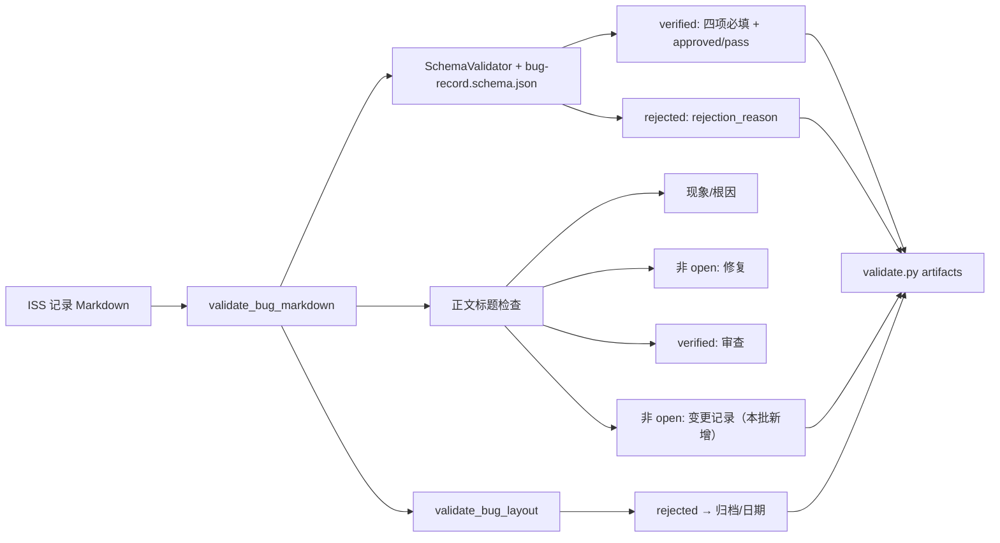
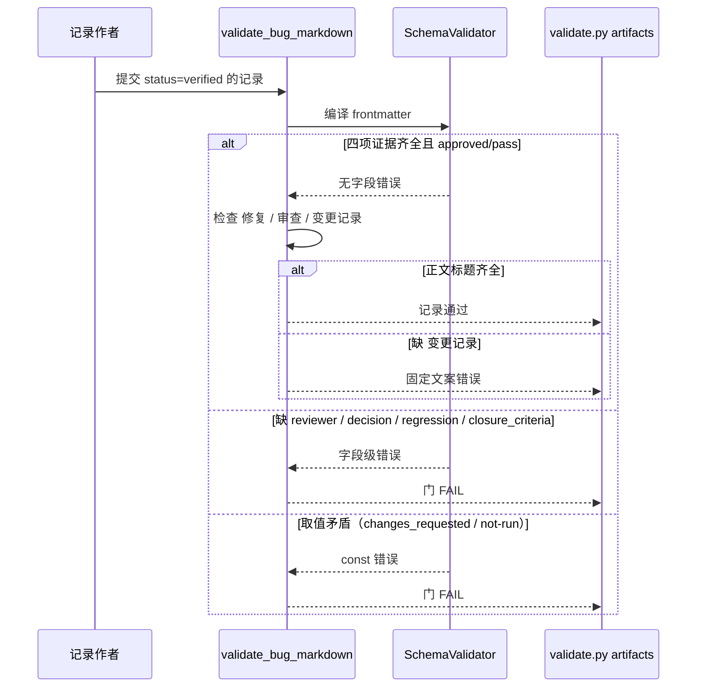
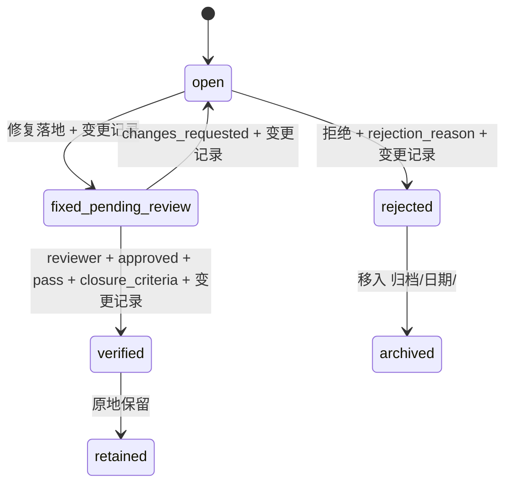

# 关闭证据门 — 后端技术方案（design/be）

## 0. 先说结论

不改 schema：`schemas/bug-record.schema.json` 自 0.13.0 起已按 `status` 强制 verified 的四项证据与 rejected 的拒绝原因，重复实现只会制造第二份真源。本批补三处缺口——(1) `docs/issues/README.md` 与模板仍写着「schema 不强制」，与门相反；(2) 非 open 记录的 `## 变更记录` 只有散文要求，`tools/lab/gate/records.py` 不检查；(3) `tests/test_gate_schema.py` 只钉了 `closure_criteria` 一个负例。改动集中在记录门与测试两个受保护文件，存量 66 条记录零误伤。

## 1. 设计方案

### 1.1 整体设计

#### 1.1.1 技术挑战

| 优先级 | 挑战 | 应对 |
| --- | --- | --- |
| P1 | 误判「门缺失」会写出重复条件 | 先读 schema 尾部与 0.13.0 提交历史，再用 `SchemaValidator` 跑四组负例确认现状 |
| P1 | 新增标题检查可能误伤历史记录 | 先扫描 49 条非 open 记录的 `## 变更记录` 在场率（100%），再落门 |
| P1 | 现有条件缺负例，改松无人发现 | 为四个字段、两个取值、rejected 理由各加一条负例，并保留合法正例 |
| P2 | 文档再次漂移 | 文档写明「已由门强制」并指向 schema 与记录门；`docs/issues/README.md` 保留单点真源，不复述字段列表 |

#### 1.1.2 技术架构

组件负责/不负责：

| 组件 | 负责 | 不负责 | 本批改动 |
| --- | --- | --- | --- |
| `schemas/bug-record.schema.json` | 字段形态、状态条件必填、取值约束 | 正文标题、文件位置 | 不改（条件已在） |
| `tools/lab/gate/records.py` | 正文标题、归档布局、时间顺序 | 字段类型（交给 schema） | 追加 `## 变更记录` |
| `tests/test_gate_schema.py` | 负例与正例回归 | 全仓扫描（交给 `validate.py`） | 追加六组用例 |
| `docs/issues/README.md` + 模板 | 解释契约、给出状态矩阵 | 执行校验 | 修正旧表述 |

#### 1.1.3 核心业务流程

##### 1.1.3.1 主链路逐步走

| 步骤 | 调用方→承接方 | 动作/输入输出 | 状态或数据变化 | 失败处理 | 观测点 |
| --- | --- | --- | --- | --- | --- |
| S1 | `validate.py artifacts` → `validate_bug_markdown` | 读 Markdown，拆 frontmatter 与正文 | 无 | 文件不可读 → 错误 | 错误路径 |
| S2 | `validate_bug_markdown` → `SchemaValidator` | frontmatter 对 schema 编译（含 0.13.0 起的 status 条件） | 无 | 字段缺失/取值矛盾 → 字段级错误 | `error.path` |
| S3 | `validate_bug_markdown` | 检查 `## 现象`、`## 根因`、`## 修复`、`## 审查`、`## 变更记录` | 无 | 缺标题 → 固定文案错误 | 标题名 |
| S4 | `validate.py artifacts` → `validate_bug_layout` | 校验文件名、id 唯一、归档日期 | 无 | 布局不符 → 错误 | 文件名/日期 |
| S5 | `validate.py artifacts` | 汇总所有记录 | 无 | 任一错误 → 门 FAIL | 汇总项数 |

##### 1.1.3.2 状态机或数据关系图

### 1.2 核心算法与关键逻辑

**状态条件判定（现状，不改）**：

- 触发条件：`validate_bug_markdown` 读取 frontmatter 后。
- 输入输出：frontmatter → 字段级错误列表。
- 判断顺序：先 `status` 枚举与基础必填，再 `allOf` 条件；`verified` 分支追加四项 `required` 与两个 `const`，`rejected` 分支追加 `rejection_reason`。
- 不变式：缺任一项或取值矛盾即 FAIL。
- 代码职责落点：`schemas/bug-record.schema.json` 的 `allOf` 尾部分支。

**正文流转记录判定（本批新增）**：

- 触发条件：`status != open`。
- 判断顺序：在既有 `## 修复`（非 open）与 `## 审查`（verified）之后追加 `## 变更记录` 检查。
- 失败文案：`body section '## 变更记录' is required once a record leaves open`。
- 代码职责落点：`tools/lab/gate/records.py` 的 `validate_bug_markdown`。

**文档一致性（本批修正）**：

- `docs/issues/README.md` 删除「当前 schema 尚不按状态强制该字段」，改为状态条件矩阵并指向 schema 与记录门。
- 模板的条件字段一览保持与矩阵一致；不新增第二份字段清单。

### 1.3 核心数据与存储设计

#### 1.3.1 数据怎么流转

记录是纯 Markdown，无数据库。状态跃迁时同一文件内三处变化：frontmatter 的 `status`/`updated_at`、正文 `## 变更记录` 追加一行、以及 `verified` 时补齐四项证据字段。归档只发生在 `rejected`：文件移动到 `docs/issues/归档/<recorded_at 日期>/`，frontmatter 不变。

#### 1.3.2 DDL

`N/A: 无数据库与迁移；记录契约由 JSON Schema 承担`。

#### 1.3.3 配置项与运行边界

`N/A: 无新增配置项；门由既有 validate.py 子项承载`。

#### 1.3.4 现有设施复用

| 设施 | 用法 | 改动 |
| --- | --- | --- |
| `SchemaValidator` + `schemas/*.schema.json` | 编译 frontmatter | 不改（条件已在 0.13.0 落地） |
| `validate_bug_markdown` / `validate_bug_layout` | 正文与布局检查 | 追加一条标题检查 |
| `validate.py artifacts` | 全量记录面入口 | 不改 |
| `tests/test_gate_schema.py` | 负例回归 | 追加六组用例 |

#### 1.3.5 数据设计核对

| 项 | 结论 | 载体 |
| --- | --- | --- |
| 存量 verified 是否满足四项 | 已覆盖：44/44 有 reviewer/review_decision/regression_status/closure_criteria；decision 全 approved，regression 全 pass | 扫描命令输出见 `testing/agentflow-关闭证据门/evidence/run-2026-10-28-001.md` |
| 存量 rejected | 不适用：当前 0 条 | `docs/issues/` 扫描 |
| 存量非 open 是否有 `## 变更记录` | 已覆盖：49/49 非 open 记录均有该节 | 同上 |
| schema 是否已有条件 | 已覆盖：`allOf` 尾部含 verified/rejected/fixed-pending-review 三分支（0.13.0，`861b6ef`） | `schemas/bug-record.schema.json` |

### 1.4 详细接口设计

#### 1.4.1 契约真源

本批无 HTTP/IDL 接口；契约真源是 `schemas/bug-record.schema.json` 与 `tools/lab/gate/records.py` 的 `validate_bug_markdown`。

#### 1.4.2 接口清单

| 接口 | 方法 | 变更类型 | 说明 |
| --- | --- | --- | --- |
| `validate_bug_markdown` | 函数 | 收紧 | 非 open 追加 `## 变更记录` |
| `SchemaValidator(BUG_RECORD_SCHEMA)` | 函数/类 | 不变 | 条件已在，本批只补负例 |

#### 1.4.3 关键接口契约

| 接口（函数与调用位置） | 请求字段 | 响应字段 | 错误语义 |
| --- | --- | --- | --- |
| `validate_bug_markdown(path)`（`tools/lab/gate/records.py`，由 `validate.py artifacts` 调用） | 记录文件路径 | `list[ValidationError]` | frontmatter 字段不符 → 字段路径错误；正文缺标题 → 固定文案错误；文件不可读 → setup 错误 |
| `validate_bug_layout(frontmatter, path, relative, seen_ids)`（同文件） | frontmatter、路径、相对路径、id 表 | `list[ValidationError]` | 文件名与 `bug_id` 不一致、归档日期不符、id 重复 → 点名错误；本批不改 |

#### 1.4.4 接口运行逻辑

主路径：读记录 → schema 编译 → 标题检查 → 布局检查 → 汇总。降级：无。重复与幂等：纯读校验，可重复执行，无副作用。状态冲突：`fixed-pending-review` 缺 `## 审查` 不算错误（该节只对 verified 强制），补门后仍可退回 open；`## 变更记录` 对所有非 open 强制，退回 open 不检查。

#### 1.4.5 错误、幂等与状态约束

| 场景 | 行为 |
| --- | --- |
| verified 缺 closure_criteria | schema `required` 报字段错（现状） |
| verified 的 review_decision 非 approved | schema `const` 报警（现状） |
| verified 的 regression_status 非 pass | schema `const` 报警（现状） |
| rejected 缺 rejection_reason | schema `required` 报字段错（现状） |
| 非 open 缺 `## 变更记录` | 正文检查报固定文案（本批新增） |
| rejected 留在根目录 | 既有布局检查报错（本批不改） |

## 2. 影响面评估

| 面 | 影响 | 依据 |
| --- | --- | --- |
| 存量记录 | 零误伤（66/66 预期 PASS） | 字段与标题在场率扫描 + 落门后 `validate.py artifacts` |
| 其他记录类型 | 无（只改 bug 正文检查与 bug 记录测试） | 改动文件隔离 |
| 门工具 | `validate.py artifacts` 变严；`validate.py all` 覆盖 | 命令输出 |
| 受保护路径 | 修改 `tools/lab/gate/records.py`、`tests/test_gate_schema.py` | 用户 2026-10-28 授权；独立评审待跑 |
| 下游项目 | Youc 已有自己的 `check-issue-docs.mjs`，不受影响 | 其门已独立实现 |

## 3. 评审前自检

- ☑ 已核实 schema 条件存在（0.13.0），本批不重复实现。
- ☑ 新门只使用存量 100% 满足的标题，`fix_revision` 显式不强制并登记 Q-01。
- ☑ 每条新门都有负例；合法正例与存量记录保持 PASS。
- ☑ 未改归档布局与状态枚举，未引入新状态。
- ☐ 独立评审（需求评审门 / 技术方案评审门）待跑。
