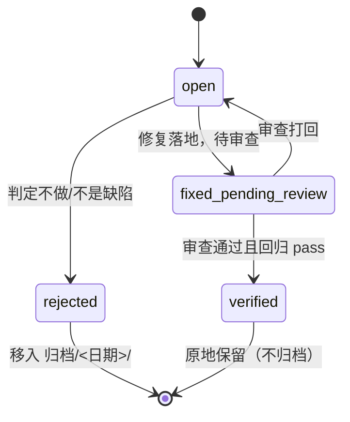

# 关闭证据门 — 后端需求补充（spec/be）

> 前置依赖/文档状态：需求评审门未跑（☐ 待独立评审）；冻结语义一句话——「verified 与 rejected 是必须带证据的关闭声明；schema 已在强制，本批补齐文档、流转记录与负例」。

## 0. Proposal 反审 checklist

| 不合规项 | 结论 | 处置 |
| --- | --- | --- |
| 目标是否都可判定完成 | 合规 | G1–G3 各有可执行判据，见 §5 与 `spec/qa/acceptance.md` §4 |
| 是否混入了未授权范围 | 合规 | 不改 schema、不动归档语义；不做事项在 proposal §1.3 逐条给理由 |
| 是否与既有契约冲突 | 合规 | 与 0.13.0 起的 schema 条件一致；本批是把文档与回归补齐，不新增状态 |
| 是否存在需要用户拍板才能推进的分支 | 合规 | 用户已选「允许改受保护门」；`fix_revision` 留为 Q-01 非阻塞 |
| 是否声称了未验证的疗效 | 合规 | `measurement: none`；只声称负例必红与存量零误伤，均有命令 |

## 1. 对象模型与口径

### 1.1 核心对象

| 对象 | 定义 | 关键字段 | 来源 |
| --- | --- | --- | --- |
| bug 记录 frontmatter | `docs/issues/ISS-<日期>-<slug>.md` 的 YAML 头 | `status`、`reviewer`、`review_decision`、`regression_status`、`closure_criteria`、`rejection_reason` | `schemas/bug-record.schema.json`（条件自 0.13.0 起已强制） |
| bug 记录正文 | 固定中文小节 | `## 现象`、`## 根因`、`## 修复`、`## 审查`、`## 变更记录` | `tools/lab/gate/records.py` |
| 记录门 | 编译 frontmatter 与正文的检查 | 字段条件、标题在场、归档布局 | `tools/lab/gate/records.py` |
| 契约文档 | 记录规则的散文载体 | 状态条件矩阵、流转记录要求 | `docs/issues/README.md`、`skills/agentflow/templates/issue/issue-template.md` |

### 1.2 状态机图

口径：`verified` 与 `rejected` 都是关闭态；区别只在归档位置与所需证据——`rejected` 必须有 `rejection_reason` 并移入 `归档/<recorded_at 日期>/`，`verified` 必须有审查与回归证据并原地保留。

## 2. 核心语义

| 语义 | 判定顺序 | 不变式 | 边界 |
| --- | --- | --- | --- |
| verified 必填（已有） | schema 条件 → 正文 `## 修复` / `## 审查` / `## 变更记录` | `reviewer`、`review_decision`、`regression_status`、`closure_criteria` 缺一即 FAIL | 存量 44 条 verified 全满足；不回改 |
| verified 取值（已有） | schema `const` | `review_decision` 只能 `approved`；`regression_status` 只能 `pass` | 其它值留给 `fixed-pending-review` |
| rejected 必填（已有） | schema 条件 | `rejection_reason` 非空 | 当前 0 条 rejected |
| 非 open 流转记录（本批新增） | 正文标题检查 | 必须有 `## 变更记录` | 49 条非 open 记录 100% 已有该节 |
| 归档布局（已有） | `validate_bug_layout` | `rejected` 必须在 `docs/issues/归档/<YYYY-MM-DD>/` | 日期目录 = `recorded_at` 日期；本批不改 |
| 文档一致（本批新增） | 人工 + 负例 | README 不得再声称「schema 不强制」 | 与 0.13.0 起行为一致 |

## 3. 冻结问题承接

| 编号 | 问题 | 工程口径 | 与建议值关系 | 关闭条件 |
| --- | --- | --- | --- | --- |
| Q-01 | 是否强制 `fix_revision` | 本批不强制；只在 README 保留散文要求 | 与建议「能强制就强制」不同，理由是无单一提交号的历史记录占 10/44 | 存量补齐载体后另开批次 |
| Q-02 | 是否自动校验文档与门一致 | 本批只修文档；不新增元检查 | 建议先观察漂移是否复发 | 复发一次后立项 |

## 4. 对前端的能力面

`N/A: 本批只改记录契约、门工具与文档，不新增任何 API 或前端能力`。

## 5. 验收补充

| 验收点 | 可测细化 | 判定方式 |
| --- | --- | --- |
| G1 文档与门一致 | README 不再含「schema 尚不按状态强制」；含 verified/rejected/变更记录三项要求 | `grep` 负命中 + 正命中 |
| G2 流转记录 | 非 open 缺 `## 变更记录` 即报错 | `unittest` 负例 |
| G3 回归齐全 | verified 四项缺失、取值矛盾、rejected 缺理由、流转记录缺失分别报错；正例通过 | `unittest` 负例 + 正例 |
