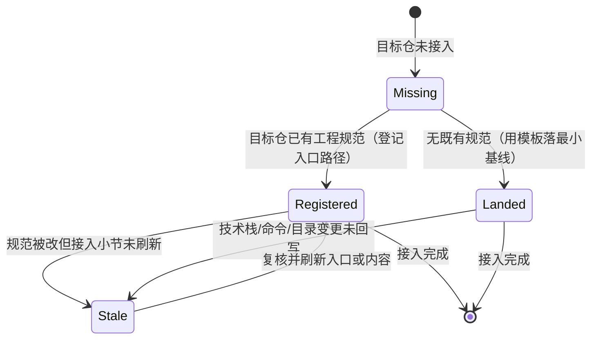
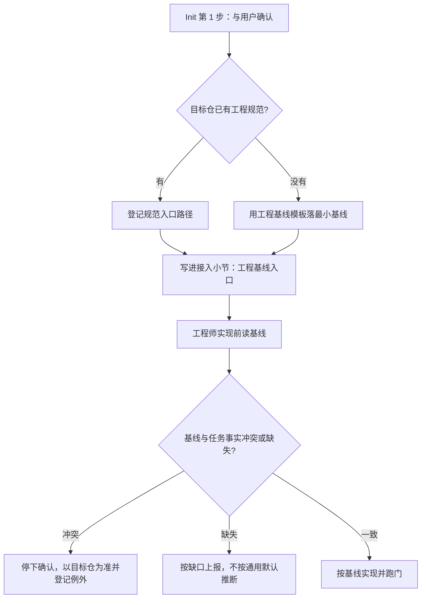
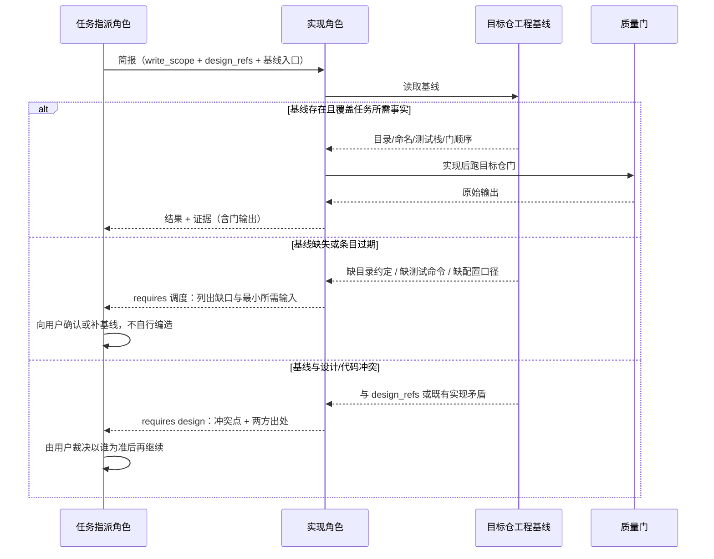

# 设计：工程基线吸收批

## 1. 决策表

| 决策 | 选项 | 选定 | 理由 |
| --- | --- | --- | --- |
| D1 工程基线模板位置 | A `templates/host/`（宿主级） / B `templates/engineering/`（目标仓级） / C 写进 `SKILL.md` 正文 | **B** | 宿主级模板承载跨仓全局规则，工程基线是单仓事实；写进 SKILL 会让入口文件继续膨胀 |
| D2 Init 接入方式 | A 只提供模板、不接 Init / B 接进 Init 并加一项 / C 所有接入仓强制落基线 | **B** | 只给模板没有入口，等于没有；强制落基线对小项目过重，允许「已有规范→只登记入口」 |
| D3 配置表形态 | A 保持三列 / B 扩成 12 列 / C 拆独立文档 | **B** | 配置的失败行为与可见性必须在设计时显式；拆文档会脱离 `design/be` 的评审面 |
| D4 原型可点性判定 | A 机器门 / B 人工自检 + 浏览器走查 | **B** | 语料实测脚本初筛 102 个问题页 / 1403 个死按钮、真实缺口 8 页；误报量大且单位不同，机器门会制造假红 |
| D5 测试维度落点 | A 只加进执行协议 / B 加进计划模板 + `test-planner` | **B** | 计划是测试设计的承载体，执行协议管运行；加在正确的一层 |
| D6 版本与生成树 | A 不升版 / B 升版并重建 `packaging/runtime` | **B** | 插件面新增模板与角色文字，安装快照必须与源面逐字节一致 |
| D7 FE 纪律落点 | A 新建 FE reference / B 角色 + `design/fe` + `spec/fe` + 工程基线 / C 只改角色 | **B** | 执行动作、设计场景、需求口径、项目事实分属四层，各管一段，避免第二套流程 |
| D8 项目 FE 约定 | A 复制 `IProps`/Tailwind/断点数值 / B 只进工程基线 / C 不记录 | **B** | 两处语料彼此冲突且只对一个仓成立；方法仓只留可跨仓判据 |

## 2. 工程基线状态

**不变式**：`Missing` 状态下不得以「按通用默认」开始实现；`Stale` 状态下实现前必须先复核，
复核不了的条目标为缺口上报，不沿用旧值。

## 3. 主流程

## 4. 失败分支时序

## 5. 字段级契约

本批不新增对外接口；下列契约约束模板与 Init 小节的必需字段（验收入口是同名证据文件）。

| 契约项 | 请求字段 | 响应字段 | 失败行为 |
| --- | --- | --- | --- |
| 工程基线模板（C01） | 十个固定小节（0–9）标题与 `<填>` 占位 | 目标仓的工程基线文件 | 缺小节 → 人工评审判不合格；本批不新增机器门 |
| Init 小节的基线入口（C02） | 「工程基线入口：<路径>」一行 | 接入小节正文 | 缺该行 → 接入不完整；由任务指派角色在派发前核对 |
| 配置项表（C03） | 12 列：键/代码字段、业务作用、类型与单位、默认与来源、必填条件、合法取值、可见性、覆盖顺序、生效与生命周期、失败行为、部署映射、验证 | `design/be` §1.3.3 表行 | 缺列、空填或把前端提示当服务端校验 → Design 评审退回 |
| 边界表（C04） | 7 列：限制项、适用对象、单位、上下界、特殊值、超限结果、权威来源 | `design/be` §1.3.3 第二张表 | 只写「有上限」不写对象/单位/超限结果 → 退回 |
| 字段与数据核对（C05） | 8 类核对项 × 结论（已覆盖/缺口/不适用+理由）× 载体 | `design/be` §1.3.5 表行 | 空表或全「已覆盖」无载体 → 退回 |
| 原型自检（C06） | P1–P5 五项，逐项勾选 | `prototype/README.md` 的交付前自检 | 无勾选或无证据 → 人工评审退回；插件不代验 |
| 计划覆盖方向（C07） | 11 个方向（原 8 + 并发与竞态、生命周期与清理、契约与兼容） | `testing/plan.md` 的覆盖方向自检表 | 缺行或空白 → 计划形态不合格 |

## 6. 影响面与回滚

| 改动 | 影响面 | 回滚 |
| --- | --- | --- |
| 新增 `templates/engineering/baseline.md` | 接入方与模板索引 | 删除文件与两处指针 |
| `SKILL.md` Init 五项→六项 | 所有新接入仓 | 恢复 Init 原文 |
| `templates/feature/design/be/backend.md` | 所有后端设计文档 | 恢复 1.3.3 三列表、删除 1.3.5 |
| `agents/backend-engineer.md` | 后端实现角色 | 删除新增纪律段 |
| `templates/feature/prototype/README.md` | 所有原型 | 删除 P1–P5 五项 |
| `references/document-chain.md` 原型节 | 文档链判据 | 删除新增指针句 |
| `templates/testing/plan.md`、`agents/test-planner.md` | 测试计划形态 | 删除三行与新增句 |
| 五份 manifest + `packaging/runtime` | 安装快照 | 恢复旧版本号并重建生成树 |

**回滚点**：本批改动已于 2026-10-28 并入 `main`（`d5b52ce`、`256ea64`），与另一会话的 id 改名同批提交；回滚须按 README「并发环境」节登记的本批文件清单逐个还原，不能用整提交回退。

## 8. 变更记录

| 日期 | 变更 | 原因 | 影响 |
| --- | --- | --- | --- |
| 2026-10-28 | 追加 M05（FE 实现纪律）与 G5；`plan_version` 1.0.0 → 1.1.0 | 用户指出第一轮只补后端与测试，FE 与 BE 不对称 | `frontend-engineer`、`design/fe`、`spec/fe`、工程基线；不触碰受保护面；需增量独立评审（T12） |

## 7. 分支策略

| 仓库 | 用途 | 基线 | 基线提交 | 开发分支 | 确认状态 | 确认依据 | 说明 |
| --- | --- | --- | --- | --- | --- | --- | --- |
| agentflows | 实施与测试 | main | c134d0b2 | feature-2026-10-28-评审欠账清偿 | 已确认 | 本批在当前分支上继续（用户 2026-10-28 指定范围后开始） | 分支上另有欠账修复批的提交 `153cd2b`；本批改动不与其混提，不推送、不合并、不重装 |
