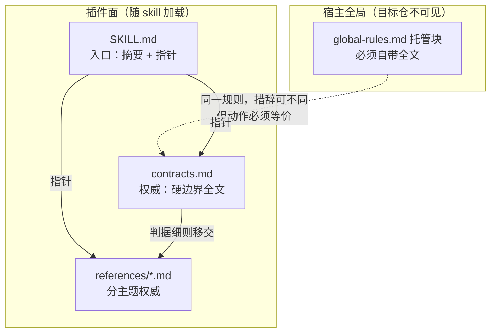
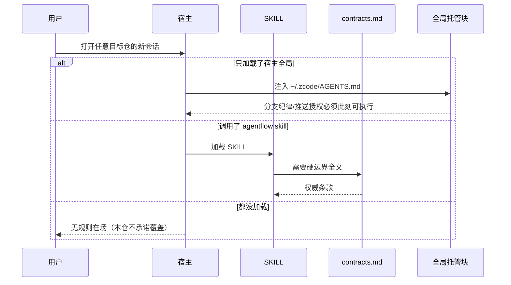
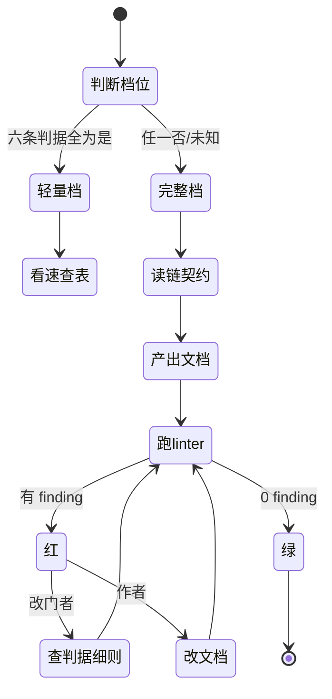

# 设计：表达面与角色治理批

## 1. 决策表

| 决策 | 选项 | 选定 | 理由 |
| --- | --- | --- | --- |
| D1 重复的处理方式 | A 全部删除 / B 指定权威 + 分级 / C 保持现状只加同步检查 | **B** | A 会让宿主全局文件断链（§3）；C 就是现在的问题 |
| D2 权威载体选谁 | A SKILL / B contracts / C hosts | **B `contracts.md`** | 它是硬边界的唯一声明处，被所有角色读取；SKILL 是入口不是权威 |
| D3 分支纪律的权威 | A contracts / B global-rules | **B `global-rules.md`** | 它要在「任何仓、任何会话」生效，而 contracts 只在调 skill 时加载（`hosts.md:15` 的原始设计意图） |
| D4 已裁撤能力说明 | A 各文件各写一处 / B 集中到 design-decisions §3 | **B** | 它是历史决策，不是现行规则；现行文档只需「当前不可用 + 去哪查」 |
| D5 大文档拆分 | A 拆判据 / B 拆契约 / C 不拆只加目录 | **A 拆判据** | 契约是所有人要读的，判据只有改门者读；按读者切分而不是按长度切 |
| D6 角色合并判据 | A 沿用「待议」/ B 实测三条件 / C 直接保持分立 | **B** | 有语料在盘（28 例），实测成本远低于继续悬空 |

## 2. 载体分层模型

**关键不变式**：`G → C` 这条是虚线，表示**两个独立权威**而非副本——它们服务不同加载场景，
允许措辞不同，但**动作必须等价**。等价的判据是 G1-AC-01/02（锚点在场 + 指针可解析），
不是逐字相同。

## 3. 为什么不能一刀切：三个加载场景

这条时序说明：**全局块与 contracts 是两个不同的失败域**。把全局块改成指针，等于让
「只加载了全局块的会话」失去规则；把 contracts 改成指针，等于让「读了 SKILL 但没读
references 的会话」失去硬边界。所以两者都必须自足，重复是**结构性必要**的。

真正可删的是**第三份**——`SKILL.md:131`。它与 `contracts.md` 在同一加载链路里，
且读者读到第 131 行时已经能跳转。

## 4. 拆分后 `document-chain.md` 的阅读路径

读者分流是这次拆分的依据：**作者只需要契约，改门者才需要判据**。

## 5. 字段级契约（载体归属表的结构）

归属表本身是本批的机器可核产物，其字段口径如下（供 G1-AC-01 的脚本读取）。

| 接口 | 请求字段 | 响应字段 | 失败行为 |
| --- | --- | --- | --- |
| 载体归属表行（规则/权威/自足/指针/处置） | `规则名`、`权威载体路径`、`自足载体路径`、`指针载体路径`、`锚点字符串` | 该行五列非空；权威路径存在；锚点在权威文件中命中 | 路径不存在或锚点未命中 → 脚本判红并打印该行 |
| 拆分标题对照（原/新） | 原文件 `##` 标题集合、新文件 `##` 标题集合 | 双向差集为空 | 差集非空 → 打印缺失标题清单 |
| FE/BE 裁决记录（三条件实测） | `不一致例数`、`分歧项数`、`合并稿行数` | 三个数值 + 「已裁决：合并/保持分立」 | 任一数值缺失 → 判「数据不足」并写明缺哪例 |

## 6. 影响面与回滚

| 改动 | 影响面 | 回滚 |
| --- | --- | --- |
| `SKILL.md:131` 压缩 | 所有读 SKILL 的会话 | 恢复原文一段（git） |
| `document-chain.md` 拆分 | `doc_chain.py`、`doc_chain_live`、所有引用该文件的 SKILL/references | 合并回单文件；需同步改 4 处引用 |
| `roles.md` 裁决结论 | 角色路由面 | 恢复「待议」段（不推荐，会重开悬案） |
| 三个角色文件加深度 | 宿主子代理行为（需重装才生效） | 恢复原文件 + 重装 |
| `contracts.md` 删重复段 | **受保护面，门变更** | 恢复原文；须先授权 |

**回滚点**：本批从 `feature-2026-10-28-表达面与角色治理` 分支基线开始，任何一步失败可回到
该分支起点（= 0.20.0 的 `e31699a`）。

## 7. 分支策略

| 仓库 | 用途 | 基线 | 基线提交 | 开发分支 | 确认状态 | 确认依据 | 说明 |
| --- | --- | --- | --- | --- | --- | --- | --- |
| agentflows | 实施与测试 | feature-2026-10-28-评测整改批 | e31699a | feature-2026-10-28-表达面与角色治理 | 已确认 | 用户 2026-10-28「可以，先成立独立批次吧」 | 不推送、不合并、不重装 |
