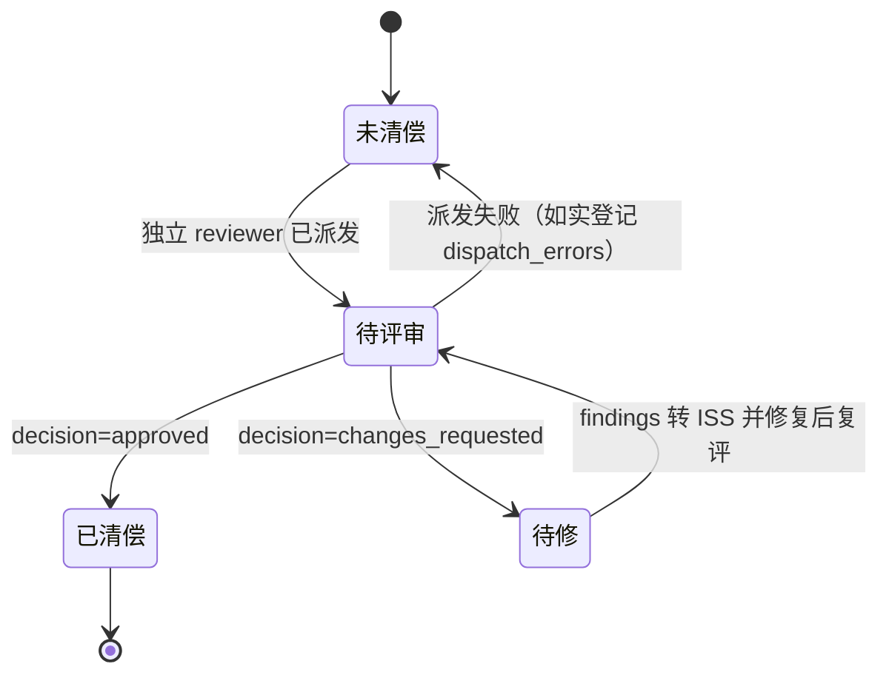
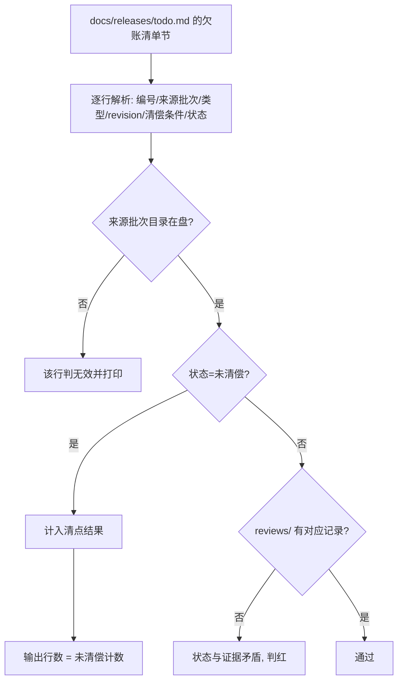
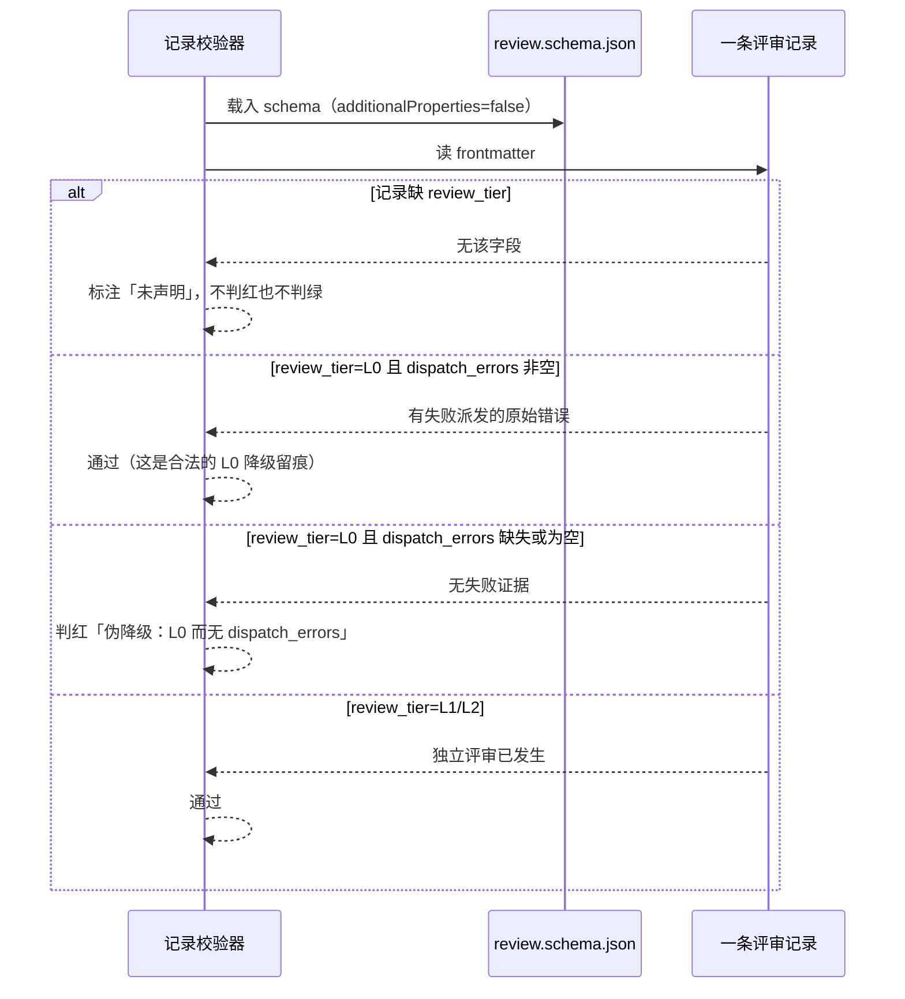

# 设计：评审欠账清偿批

## 1. 决策表

| 决策 | 选项 | 选定 | 理由 |
| --- | --- | --- | --- |
| D1 欠账清单放哪 | A 新建顶层目录 / B `docs/releases/` 加一节 / C 派生成视图 | **B** | 新建顶层目录需用户确认且本批只是索引；`todo.md` 已是在途批次的索引位。派生视图无可执行消费者，属过度设计 |
| D2 伪降级校验落在哪 | A 文档链新增 C 判据 / B 记录 schema + 记录校验器 / C 只写契约不校验 | **B** | 判断对象在 `reviews/` 的 frontmatter，不在文档链文本里；A 会把判据与对象分置两处（ISS-2026-061 的形态），C 就是现状 |
| D3 缺 `review_tier` 的存量记录 | A 判红 / B 判绿 / C 标注未声明、不红不绿 | **C** | 契约明写「未声明不得推定已过评审」；判红会一次打红全部既有记录，判绿等于默认 L2 |
| D4 五条 ISS 的清偿顺序 | A 全部推 verified / B 逐条判定、允许退回 open / C 只补字段不改状态 | **B** | A 是为了清账而伪造结论；C 会让欠账继续存在 |
| D5 受保护面动作时机 | A 与其余任务同批 / B 单列一条、需授权后才开工 | **B** | `schemas/` 与 `tools/lab/` 在 `protected-paths.txt` 内，未经授权不得改 |

## 2. 欠账清偿的状态模型

**关键不变式**：`未清偿 → 已清偿` 没有直达边。这条边缺失是刻意的——它挡住「自审后直接标已清偿」
这条捷径，正是本批要清的欠账形态。

## 3. 欠账清单的读取与清点

清点命令的契约是「输出行数等于清单未清偿行数」。选输出到 stdout 而不是退出码，
是因为退出码只能表达二值，而欠账数量本身是信息。

## 4. 伪降级校验的失败分支

## 5. 字段级契约（欠账清单行与校验器接口）

| 接口 | 请求字段 | 响应字段 | 失败行为 |
| --- | --- | --- | --- |
| 欠账清单行（`docs/releases/todo.md`） | `欠账编号`、`来源批次`、`欠账类型`、`被评审 revision`、`清偿条件`、`状态` | 六列非空；`来源批次` 路径在盘；`状态` ∈ {未清偿, 已清偿} | 任一不满足 → 清点脚本打印该行原文并计入无效行 |
| 清点命令 `python3.12 tools/lab/validate.py review_debt`（待实现） | 无参数；读仓内清单 | stdout 每行一个未清偿欠账；退出码 0 表示解析成功 | 清单不存在 → 退出码 1 并打印路径；清单存在但 0 行未清偿 → 退出码 0、输出为空 |
| 伪降级校验（记录校验器） | 评审记录 frontmatter 的 `review_tier`、`dispatch_errors` | 合规 ⇒ 无 finding；伪降级 ⇒ 一条 finding 指向该记录 | `review_tier` 值不在 {L0,L1,L2} → schema 层拒绝 |

**关于 `review_debt` 子命令**：它是可选的实现路径。若 T04 因受保护面未获授权，清点可以退回
「表驱动脚本放在批次 `testing/` 下」，此时 G2-AC-01 的判据改指该脚本；但 G2-AC-02 必须落在
记录校验器上，不能退。

## 6. 影响面评估

| 改动 | 影响面 | 回滚 |
| --- | --- | --- |
| `docs/releases/todo.md` 加欠账清单节 | 发布待办索引（人读） | 删除该节（git） |
| `schemas/review.schema.json` 两字段 + 一条 `allOf` | 全部评审记录校验；`reviews/` 既有记录 | 恢复 schema 原文；已写字段的记录需同批回退 |
| 记录校验器新增伪降级判据 | `validate.py artifacts`、`tests/` 相关用例 | 恢复校验器原文 |
| 五条 ISS frontmatter | 缺陷记录面、`validate.py artifacts` | 逐条恢复 frontmatter |
| 两批 `reviews/` 新增记录 | 批次内文档链材料（不受评审契约四项校验） | 删除记录文件 |

**受保护面清单（需逐项授权）**：`schemas/review.schema.json`、`tools/lab/gate/` 或 `tools/lab/validate.py`
中新增的判据、以及任何因此新增的 `tests/` 用例（`tests/` 条目需同时登记进
`validate.py` 的 `EXPECTED_TEST_FILES` 与 `protected-paths.txt`）。

## 7. 回滚点

- 本批基线：`main` 的 `c134d0b`（写文档时实测 HEAD）。
- 文档面改动（清单、两批 reviews）可随时整节回退，不影响门。
- schema 与校验器改动一旦推送即成为他人依赖，回滚需同批回退两者，不得只退其一。

## 8. 评审前自检

| 检查 | 结论 |
| --- | --- |
| 是否新增了表达面（新 C 判据号、新顶层目录） | 否；判据落在既有 schema 与校验器 |
| 是否覆盖「欠账清单解析失败」的分支 | 是（§5 失败行为列 + §3 判红边） |
| 是否覆盖「评审推翻既有修复」的分支 | 是（§2 状态机的 `待修` 边 + spec M-C-01） |
| 是否把受保护面动作混进普通任务 | 否，单列 T04 并标需授权 |
| 是否声称了未验证的疗效 | 否，全批 `measurement: none` |
