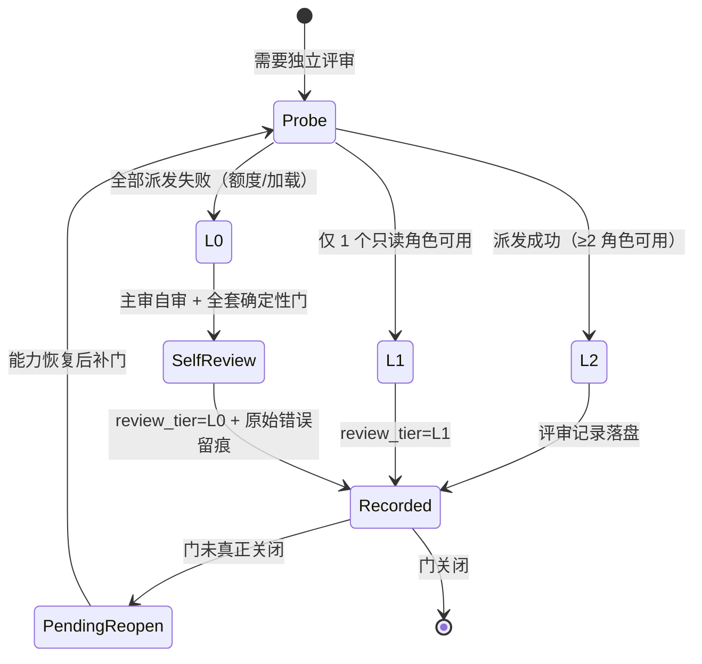
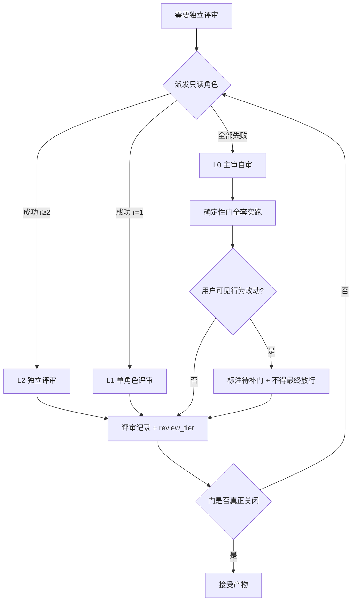
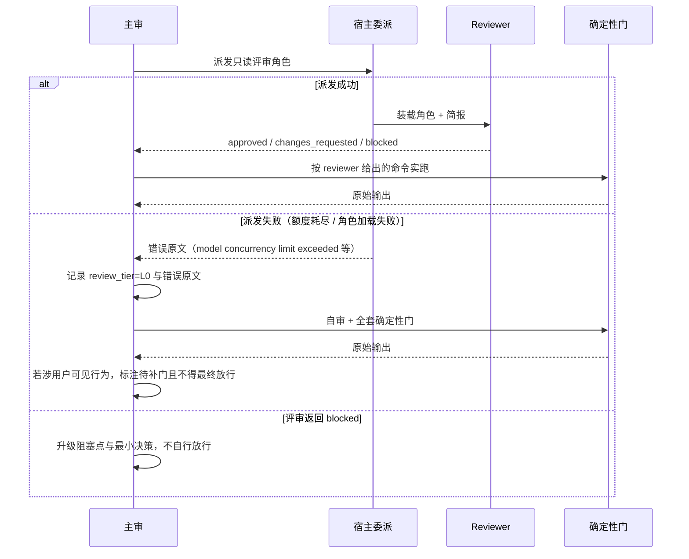

# 设计：评测整改批（工具与契约面）

## 1. 决策表

| 决策 | 选项 | 选定 | 理由 |
| --- | --- | --- | --- |
| D1 整改状态载体 | A 新建追踪文件 / B 审计表加列 / C 登记进 PENDING | **B** | 状态与发现同址，不会两处漂移；PENDING 只承载待拍板项 |
| D2 分级档位形态 | A 百分比覆盖率 / B 三档枚举 / C 布尔 has_review | **B** | 可判定、可复核；百分比无真源 |
| D3 分级协议落点 | A 新建 reference / B `contracts.md` 新节 / C SKILL 正文 | **B** | `contracts.md` 是硬边界的唯一权威，分级是边界的补充而非新机制 |
| D4 `.venv` 探测 | A 改 lint 为 SKIP / B 新增解释器探测 / C 只写文档 | **B** | 保持 fail-closed（G01 结论），只扩大「能找到工具」的路径 |
| D5 候选记录落点 | A `examples/` 合成 / B 批次 `improvement/` 真实 | **B** | 目标是给两份 schema 第一份**真实**消费者，合成例已在 G10 补齐 |

## 2. 评审分级状态机

**不变式**：`L0` 状态下不得对**用户可见行为改动**做最终放行；`Recorded` 转 `[*]` 前，
若 `review_tier ∈ {L0, L1}`，必须存在一条「补门」记录或显式的用户接受。

## 3. 主流程

## 4. 失败分支时序

## 5. 字段级契约

整改状态列与分级记录字段的契约如下（本批不新增对外接口，以下为记录字段口径）。

| 契约项 | 请求字段 | 响应字段 | 失败行为 |
| --- | --- | --- | --- |
| 审计发现表（C01） | `#`、`严重度`、`发现`、`位置`、`解锁条件`、`整改状态`、`fix_revision` | 表格行，7 列 | 缺列或空值 → 人工复核判不合格；本批不新增机器门（避免门变更扩容） |
| 分级记录（C02） | `review_tier`（L0/L1/L2）、`dispatch_errors[]`（失败原文） | 决策记录/episode 字段 | L0 且无 `dispatch_errors` → 视为伪降级，评审无效 |
| lint 解释器解析（C03） | `AGENTFLOW_LINT_PYTHON`（env，可选） | 实际使用的解释器路径 + lint 结果 | 未设且无 `.venv` → 原行为 FAIL，不新增放行 |

## 6. 影响面与回滚

| 改动 | 影响面 | 回滚 |
| --- | --- | --- |
| `contracts.md` 新增分级节 | 所有委派的评审纪律读取面 | 删除该节，恢复原文；无机器依赖 |
| `SKILL.md` 去重与引用 | 主流程第 8 步 | 恢复两处原文 |
| `document-chain.md` 判据速查 | 轻量档入口 | 删除速查块 |
| `roles.md` 裁决规则 | FE/BE 角色边界 | 删除规则段 |
| `validate.py` / `pre-push.sh` JSON 探测 | 门执行路径（受保护面） | 恢复原解释器选择逻辑 |
| 新增批次 `improvement/` 记录 | 改进环输入面 | 删除记录，schema 不受影响 |

**回滚点**：本批在分支上以单一提交序列交付，任一步失败可回到 `de80694`（0.19.3）。

## 7. 分支策略

| 仓库 | 用途 | 基线 | 基线提交 | 开发分支 | 确认状态 | 确认依据 | 说明 |
| --- | --- | --- | --- | --- | --- | --- | --- |
| agentflows | 实施与测试 | main | de806947d22665d347007b690d22136a1a442dca | feature-2026-10-28-评测整改批 | 已确认 | 用户在 2026-10-28 批准五批方案后由本次实施建分支 | 不推送、不合并、不重装 |
