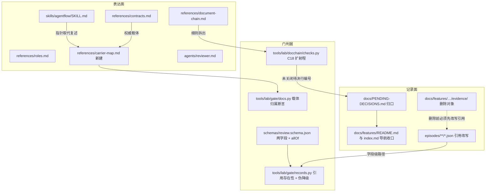
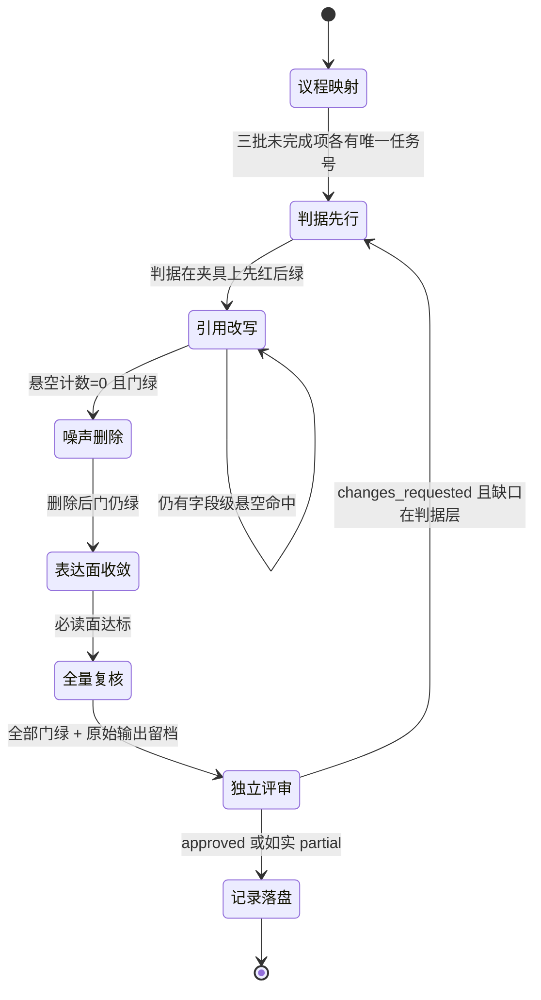
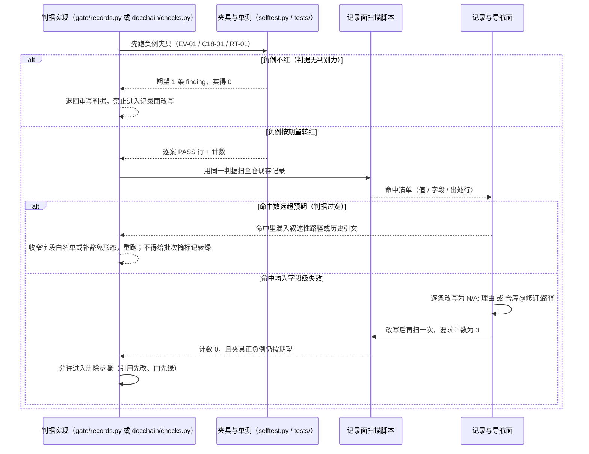

# 设计：全面修正与瘦身批

## 0. 先说结论

| 问题 | 结论 |
| --- | --- |
| 三批未完成任务怎么收 | 单批吸收：本批计划给每条未完成项一个唯一任务号，旧三批只留「未完成任务并入本批」一行指针 |
| 散落的待决项怎么归口 | 扩既有 C18 归属判据的射程，不新增判据号；链内台账保留但必须带拍板口编号 |
| 记录引用怎么可复核 | 对字段级路径值做存在性校验，两种豁免写法（`仓库@修订:路径` / `N/A: 理由`）；正文散文不判 |
| 必读面削到哪 | 只消副本、不设总量上限（2026-10-29 用户拍板 C）；削的是副本与版本史散文，判据细则拆到独立分册而不是删除 |
| 删除怎么不留悬空 | 引用先改 → 门确认绿 → 再删对象 → 门再确认绿；删除前跑保全快照 |

## 1. 决策表

| 决策 | 选项 | 选定 | 理由 |
| --- | --- | --- | --- |
| D1 议程归并形态 | A 新建单批吸收三批未完成任务 / B 扩写 GOV+DEBT 两批 / C 只登记不落地 | **A** | 同一收敛议程已挂在 10-25 / 评测整改 / GOV 三批上（F2），B 会让 10-25 批继续悬空、C 是第三次「只登记」。用户在 2026-10-29 的选项集中选 A |
| D2 待决项归口判据放哪 | A 新增 C27 判据号 / B 扩 C18 归属家族的射程 / C 只写文本条款 | **B** | 约束二明文「不加新门项」；C18 判的正是「未决问题必须有归属」，把「归属」从「挂批次承接表 / deferred」扩到「含未关闭待决行必须带拍板口编号」是同一件事的两半。C 已被本仓两次记录为反模式（声明了不被校验）。**射程实测**：打了 `agentflow 决策归属` 标记的批次当前有三个——`feature-2026-10-22`（`### 未决项` 0 行，不受影响）、`feature-2026-10-25`（§六 5 行未关闭 + 1 行事实闭合，正是 F1 的对象）与本批自身（`spec/checklist.md` 13 行，其中 8 行未确认且全部带条目编号）。判据落地实测：三批全绿，其中 10-25 是在 T03 补编号之后才转绿的。新射程会打红后者，而 T03 的归口动作恰好让它转绿：判据与修复互相验证，不是靠给存量摘标记转绿 |
| D3 链内台账与拍板口的关系 | A 废掉 `spec/checklist.md` 全部去拍板口 / B 保留两级、链内行必须带拍板口编号 / C 二者各写各的 | **B** | A 会让需求侧「阻塞什么、由谁关闭」的运行时信息挤进给 owner 看的清单，拍板口变成第二份 spec；C 就是 F1 的成因。B 的代价是每批立项多一步登记 |
| D4 引用存在性判据的对象范围 | A 全仓所有反引号路径 / B 仅字段级路径值（白名单）/ C 仅 episode | **B** | A 必然误伤历史引文与退役路径叙述（`AGENTS.md` 明文：围栏与行内代码在退役路径扫描里算引文；CHANGELOG 历史条目按原样保留），首轮误报会被当发现或被整体放行——两者都是本仓记录过的失败形态。C 漏掉评审记录与 issue frontmatter |
| D5 存量失效引用的处置 | A 批量删除含失效引用的记录 / B 逐条改写为两种豁免形态之一 / C 判据只对未来生效 | **B** | A 销毁证据；C 会让「已消失对象仍被当作现行事实」继续存在，且本批 G3-AC-04 无法达成。B 的成本是要逐条判断该引用当年指的是什么，这正是判据该问的问题 |
| D6 必读面上限 | A 追原 T24 的 ≤350 / B ≤450 / C 只消副本、不设总量上限 | **C（2026-10-29 用户拍板）** | A/B 都要靠删判据或压缩判据细则才能达标，违反 M-E-04「收敛不等于删判据」；C 把判据细则拆到 `document-chain-checks.md`、重复规则收成指针，行数只作观测值 |
| D7 载体归属表与核验脚本 | A 新增 `tools/lab/gov_carrier.py` 作为第 12 个门项 / B 表落 `skills/agentflow/references/carrier-map.md`，核验断言并入既有 `validate.py docs` 项 / C 表只作散文 | **B** | A 增加门项数，与约束二冲突且 `validate.py protected` 与 `EXPECTED_*` 清单都要跟着改；B 复用已经在扫描角色面与文档面的检查器，新增的只是断言。C 会重演「表写完即过期」 |
| D8 删除的执行顺序 | A 先删再补引用 / B 引用先改 → 门绿 → 删对象 → 门再绿 / C 只删无人引用的 | **B** | 中间态悬空正是 F4 描述的静默腐烂；A 会让「先删后补」在两次门跑之间被提交。C 等于什么都不删 |
| D9 字形映射单源收口点 | A 两份映射各自加注释互指 / B 单一定义 + 另一处导入 / C 合并两份判据 | **B** | A 是 2026-10-26 审核 G32 的现状（注释标注同步义务），正是本批要消灭的「用纪律对冲重复」；C 会改变两处消费方的语义 |
| D10 本批评审档位 | A 预设 L2 / B 由实施时的派发实测决定并留原始返回 | **B** | `contracts.md` 规定档位由派发调用是否返回这一二值事实决定，不得按成本偏好选档（M-D-03） |

## 2. 技术挑战

| 挑战 | 优先级 | 应对 |
| --- | --- | --- |
| 引用存在性判据一开就打出大批命中，容易被整体放行 | P0 | 判据只在字段白名单上生效（D4）；首轮命中先分类打印（现行事实 / 历史现场 / 已删对象），逐类给写法，不允许「先摘标记转绿」——`doc_chain.md` 明文禁止靠摘标记转绿 |
| 改写 episode 与「不能修改过去证据」的边界 | P0 | 只补标注字段与把已消失对象改写成 `N/A: 理由 + 出处`，不改当年 claims 的结论与判定；判据只承认这一形态（D5） |
| 必读面瘦身与「判据不能缩」同时成立 | P1 | 细则拆分到独立文件 + `--self-test` 用例数不降作为反向护栏（G5-AC-04） |
| 三批任务号与本批任务号一一映射，漏一条就是第二个真源 | P1 | `design/qa/testing.md` §2 的映射表逐行核对，映射缺失即 G1-AC-01 红 |
| 删除与并发改动共用工作树 | P1 | 删除前 `tools/dirty-guard.py snapshot --tar`，写完 `verify`，全绿后 `cleanup`（`AGENTS.md`「实验与恢复」） |

## 3. 架构：本批改动落在哪几层



**每张图只回答一个问题**：本图回答「本批改动分别落在表达面、门判据、记录面哪一层，以及层与层之间的
引用方向」。状态机在 §4，失败分支在 §5 时序图的 `alt`，字段级契约在 §7。

## 4. 本批执行的状态模型



**关键不变式**：`议程映射 → 噪声删除` 没有直达边。跳过「引用改写」直接删除，会在中间态留下
字段级悬空指针——那正是本批要消灭的形态，也是 `引用改写 → 引用改写` 这条自环存在的理由。

## 5. 主链路步骤表

| 步骤 | 调用方 → 承接方 | 动作与输入输出 | 状态与数据变化 | 失败处理 | 观测点 |
| --- | --- | --- | --- | --- | --- |
| S1 议程映射 | 本批计划 → 三批 README | 输入：三批任务表现存状态；输出：本批任务号 ↔ 原任务号映射表 | 三批状态节写指针；四处导航面同步 | 映射有漏项 → G1-AC-01 红，禁止继续 S6（避免边削边漏） | 映射表逐行 + 计数 |
| S2 判据先行 | 门实现 → 夹具与单测 | 输入：判据口径；输出：`--self-test` / `tests/` 正负例 | 判据从「散文」变「机器」 | 夹具不红 → 判据无判别力，退回重写；夹具恒红 → 判据过宽，收窄白名单 | 自测用例数不降；单测计数 |
| S3 引用改写 | 记录面 → 字段值 | 输入：S2 的扫描输出；输出：改写后的记录 + 豁免标注 | 悬空计数从 N 降到 0 | 某条无法判断当年所指 → 写 `N/A: 未能核实，出处见…`，不猜 | 改写前后计数各一次 |
| S4 噪声删除 | 删除脚本 → 文件系统 | 输入：S3 的绿状态；输出：证据件、重复导航、内部重复快照消失 | 记录面文件数下降 | 保全快照 `verify` 报红且非本次改写 → 停止删除并回查 | `find \| wc -l`、`du -sh` 前后 |
| S5 生成树重建 | `packaging/build_runtime.py` → `packaging/runtime/` | schema 与 references 源改动同步进快照 | 快照逐字节跟随源 | `manifests` 红 → 未重建，禁止进入 S6 | `validate.py manifests` 原文 |
| S6 表达面收敛 | 必读四件 → 权威载体表 | 按归属表削副本、留指针；版本史散文退场 | 副本处置逐行；行数仅观测 | 任一判据被削 → G5-AC-04 红；归属表核验不过 → 回退该处改写 | `wc -l` 逐文件 + `validate.py docs` |
| S7 全量复核 | 门 → 原始输出 | `validate.py all`、`doc_chain.py <本批>`、`--self-test`、`unittest` | 四项全绿并留档 | 任一项红 → 当轮修复，不在红门上继续 | 逐字输出 |
| S8 独立评审 | 实测档位 → `reviews/` | 先派两个只读探测定档，再派评审；记录含 `review_tier` 与派发原始返回 | 评审门关闭或转 `changes_requested` | 派发失败 → 如实登记 `dispatch_errors`（不冒充 L2），结论上限 `partial` | 评审记录 + 派发原始返回 |
| S9 记录落盘 | 本批 → 计划/验收/episode | 状态与证据两列最小 diff 回写；episode 落 `episodes/<日期>/` | 看板与承接表聚合一致 | 证据只存在于 `/tmp` → 按 C23 判红，改写为四种载体之一 | C22/C23 对本批实跑 PASS |

## 5.1 主链路的失败分支时序（判据上线这一段，S2 → S3）



## 6. 组件负责与不负责

| 组件 | 负责 | 明确不负责 |
| --- | --- | --- |
| `carrier-map.md` | 每条跨载体规则的**唯一权威载体**与指针形态 | 不复述规则正文；不做第二份流程 |
| `gate/docs.py` 的归属断言 | 表内每行：权威路径存在、锚点命中、指针可解析 | 不判断规则内容对不对（那是评审的职责） |
| `gate/records.py` 的引用断言 | 字段级路径值是否指向真实对象；豁免形态是否合规 | 不扫正文散文；不回改历史引文 |
| `schemas/review.schema.json` | `review_tier`/`dispatch_errors` 的字段与枚举、`allOf` 的伪降级约束 | 不判断评审本身是否可信 |
| `docchain/checks.py` 的 C18 扩射程 | 打标批次里「阻塞 + 未确认 + 属主为用户」的行必须带拍板口编号 | 不检查拍板口条目本身的措辞质量（由八列判据 C16 负责） |
| 本批计划任务表 | 三批未完成项的唯一编号与状态 | 不承载第二份进度叙述（进度权威在计划看板） |
| `docs/PENDING-DECISIONS.md` | 需要用户逐条回复的清单 | 不抄录链内运行时台账的细节列 |

## 7. 核心算法与字段级契约

### 7.1 引用存在性判据（伪代码）

实测前提（2026-10-29 对门代码的取证）：**episode JSON 的路径字段当前完全没有存在性校验**——
`evidence_ref` 在记录面命中 12 个文件 37 次、`tools/lab/` 内 0 次消费，
`schemas/episode.schema.json` 对该字段只声明 `minLength`。
Markdown 侧却早有等价机制：`tools/lab/gate/records.py:86` 的 `validate_body_references`
（被 records.py:56 与 :230、`gate/workspace.py:151`、`gate/testing.py:114` 与 :203 五处调用），
它要求命中路径 `is_file()` 且 `is_relative_to(ROOT)`（`:114-120`，堵 `../` 逃逸），
并用 `prose_without_quotations`（`:72`）豁免围栏与行内引文。
**所以本判据是把 Markdown 侧已有口径补到 episode 字段侧，不新增门项**——它随 `validate.py artifacts`
的既有走查 `gate/workspace.py:41 validate_workspace_artifacts()`（331 行 / CC 119，即 2026-10-26 审核
G31 点名的复杂度异常点）生效，与 C23 对计划证据列的要求同源。

```python
# tools/lab/gate/records.py 内新增；调用点接在 validate_episode_document()（:132）之后
EVIDENCE_PATH_FIELDS = ("evidence_ref", "ref", "path", "artifact")   # 单一定义处，不留第二份拷贝
REPO_RELATIVE = re.compile(r"^(docs|episodes|reviews|tools|skills|agents|schemas|examples)/\S+$")
NA_FORM = re.compile(r"^N/A:\s*\S")                                   # 裸 "N/A" 不放行
REPO_AT_REV = re.compile(r"^[\w.-]+@[0-9a-f]{7,40}:\S+")              # 仓限定写法

def episode_reference_findings(doc: Mapping, relative: Path) -> list[str]:
    findings = []
    for field in EVIDENCE_PATH_FIELDS:
        for value in iter_string_values(doc, field):        # 递归收集该字段的字符串值
            v = value.strip()
            if NA_FORM.match(v) or REPO_AT_REV.match(v):     # 两种诚实写法放行
                continue
            if REPO_RELATIVE.match(v) and not containment_ok(REPO_ROOT, v):
                findings.append(f"{relative} 的 {field} 指向不在盘上的仓内路径: {v}")
    return findings
```

不变式：① 只消费字段值，绝不扫 `signals` / `claims` 叙述文本（M-C-03）；② `N/A` 后必须有理由文本，
裸 `N/A` 不豁免（M-C-02）；③ 一个字段值里并列多条路径时逐条判定（`findall`，评审 P1-3），并复用既有 containment 判定（`is_file()` 与 `is_relative_to`，与散文侧、C23 同口径），不在新代码里长出第二套路径逃逸规则；
④ URL 与外部仓路径不属仓内相对形态直接跳过，个人绝对路径仍由 `validate_body_references:97` 判红——
两套判据不许各说各话。

### 7.2 伪降级判据（`allOf` + 校验器）

| 记录形态 | 期望 |
| --- | --- |
| 无 `review_tier` | schema 通过；校验器标注「未声明」，不红不绿（存量记录不被追溯打红） |
| `review_tier: L0` 且 `dispatch_errors` 为非空数组 | 通过（合法降级留痕） |
| `review_tier: L0` 且 `dispatch_errors` 缺席或 `[]` | **判红**：伪降级 |
| `review_tier: L1` 或 `L2` | 通过 |
| `review_tier` 取枚举外的值 | schema 层拒绝 |

**两条实现约束（实测得出，决定写法而不是风格）**：

1. `tools/lab/gate/schema.py` 已实现 `allOf`（`:170-171`）与 `if/then/else`（`:174-178`），
   `SUPPORTED_SCHEMA_KEYWORDS`（`:322-328`）已含这些关键字——**不必扩白名单**，一条 `allOf`
   能被现行子集校验器编译；`validate_schema_shape`（`:222-260`）仍要求 `additionalProperties: false`
   与 `required ⊆ properties`，新字段必须同时进这两处。
2. `tools/lab/gate/common.py:202-264` 的 frontmatter 解析器只支持扁平标量、`key:` + `  - item`
   块数组与内联 `[a, b]`，嵌套映射在 `:237` 直接报错。所以 `dispatch_errors` 只能是**字符串数组**；
   伪降级的语义判定必须落在 Python 校验器里（`allOf` 只保证形态），否则会长出
   「schema 约束在、门读不到」的第二套真源——正是本批 M-B/M-C 要消灭的形态。
3. `validate_review_markdown` 在 schema 报错时早退。**因此伪降级判定必须放在早退之前**（评审 P1-1）：allOf 与这条判据吃同一个形态，放在早退之后就是不可达代码，门只会报「$: missing required property」而不点名记录。

### 7.3 字段级接口契约

| 接口 | 请求字段 | 响应字段 | 失败行为 | 幂等/重试约束 |
| --- | --- | --- | --- | --- |
| 载体归属核验（并入 `validate.py docs`） | 无参数；读 `skills/agentflow/references/carrier-map.md` 表行（列：规则 / 权威载体 / 锚点或指针 / 副本处置） | 逐行打印命中原文 + 总行数 + finding 数 | 权威路径不存在、锚点在文件中缺失、指针 `agentflow:<role>` 不解析 → 各一条 finding，`docs` 项 FAIL | 只读，重复执行结果一致 |
| 引用存在性校验（`validate.py artifacts`） | 记录根下 episode JSON 与记录 frontmatter 的白名单字段 | finding 列表 | 命中即 FAIL；`N/A: 理由` 与 `仓库@修订:路径` 放行 | 只读；改写由记录面提交承担 |
| 伪降级校验（同一门项内） | 评审记录 frontmatter `review_tier` / `dispatch_errors` | 一条 finding 指向该记录 | 见 §7.2 表 | 只读 |
| 待决项归口（`doc_chain.py` 的目录模式与 `--repo` 模式共用同一实现；`--file` 模式走 `docchain/cli.py:52 lint_file()`，
不含批次入口，本判据因此对它不生效——这是既有分派的事实，见 §13 V-02） | 批次 README 标记 `agentflow 决策归属` + `spec/checklist.md` + `plan/*.md` 的 `### 未决项` + `docs/PENDING-DECISIONS.md` 的 `\| # \|` 表 | finding 列表 | 缺编号即红；行解析失败按「无法判定」红并打印原文；未打标批次不触发 | 只读 |
| 快照与核验 `tools/dirty-guard.py` | `snapshot <快照> --tar <仓外>` / `verify <快照>` / `cleanup <快照>` | 退出码 + 逐行差异 | `verify` 报红 → 停止删除；`cleanup` 无核验标记时拒绝删除 | 快照与归档必须落仓外，跑完即删 |

**存储设计**：本批不新增任何数据表、不做迁移；`N/A` 指本批无 DDL 对象，理由是本仓记录面是
Markdown + JSON 文件，判据只读文件树。

## 8. 影响面评估

| 改动 | 定级 | 兼容性分类 | 消费方清单与结论 |
| --- | --- | --- | --- |
| `schemas/review.schema.json` 增两字段 + 一条 `allOf` | L2 | 非破坏性（新字段可选，`additionalProperties: false` 下旧记录不新增字段仍通过） | `tools/lab/gate/records.py`、`reviews/**`、批次 `reviews/**`（不受评审契约约束，见 `reviews/README.md` 校验范围条）；结论：现存记录无该字段 → 标注「未声明」不红 |
| `tools/lab/gate/records.py` 新增两类判据 | L2 | 行为增强，可能新判红 | `validate.py artifacts`、`tests/test_gate_records.py`、宿主会话的门调用；结论：判据范围经 D4 收窄，误伤历史引文的风险由夹具负例钉住 |
| `tools/lab/docchain/checks.py` 扩 C18 射程 | L2 | 仅对打 `agentflow 决策归属` 标记的批次生效；存量未打标批次不受影响（历史不回改） | `doc_chain.py` 目录/`--repo`/`--file` 三条入口、`validate.py decision_gate`、`doc_chain.py --self-test`；结论：打标批次为 10-22 批、10-25 批与本批三个，需先核 10-22 批是否会被新判据打红 |
| `tools/lab/gate/docs.py` 新增归属表断言 | L2 | 新断言，可能判红 | `validate.py docs`、`skills/agentflow/references/carrier-map.md`；结论：表与本断言同批落地，不留「先有表后有检查」的空档 |
| `packaging/runtime/**` 重建 | L1 | 派生快照跟随源 | `marketplace.json` 的 `source: ./packaging/runtime`；结论：不重装时 `validate.py installed` 会报漂移，如实记录不冒充通过 |
| 记录与导航面改写（`index.md`、`docs/features/README.md`、`docs/PENDING-DECISIONS.md`、三批 README、`docs/releases/*`、`docs/host-platform-facts.md`） | L1 | 非破坏性 | 会话与人工阅读；结论：四处导航面一致性由 G1-AC-02 检查 |
| 证据件与重复快照删除 | L2 | 删除不可逆（git 历史可回溯，但工作树对象消失） | `episodes/**` 的 `evidence_ref`（L3 批 10 处）、批次 `testing/` 计划与运行记录的证据列、`docs/issues/**` 的引用；结论：先改写后删除，删除后全量门与 `doc_chain_live` 必须仍绿 |
| `skills/agentflow/**` 与 `agents/reviewer.md` 收敛 | L2 | 表达面收敛，不改变流程语义 | 宿主加载的安装快照、`references/roles.md` 与 `SKILL.md` 的交叉引用、`validate.py docs` 的 `agentflow:<role>` 解析；结论：引用全部保持可解析 |

**受保护面逐项清单（本批授权范围，门变更）**：`schemas/review.schema.json`、`schemas/test-plan.schema.json`、`schemas/test-run.schema.json`、`schemas/episode.schema.json`、`protected-paths.txt`、
`packaging/runtime/`（生成树，由 `packaging/build_runtime.py` 重建）、`tools/lab/gate/`、
`tools/lab/docchain/`、`tests/test_gate_records.py`、`skills/agentflow/references/contracts.md`（
本批已按 #14 A 补「定位即预算」条，见 D7 与 T23）。
不新增 `tests/` 文件——新用例并入既有被钉住的测试文件，避免同时改 `EXPECTED_TEST_FILES` 与
`protected-paths.txt` 两处清单。

## 9. 验证与灰度

- 无运行期灰度对象（本批不改安装面）。验证即四道确定性检查 + 一道独立评审：
  `validate.py all`、`doc_chain.py <本批>`、`doc_chain.py --self-test`、`unittest discover -s tests`、
  独立评审记录。
- 「先判据、后改写、再删除」的顺序本身是灰度：S3 之后门必须绿一次才允许 S4；S4 之后门再绿一次
  才允许 S6。两次绿之间任何红都停在原地，不继续下游步骤。

## 10. 失败模式与回滚

| 失败模式 | 触发信号 | 处置 |
| --- | --- | --- |
| 判据过宽，存量记录大批判红 | S3 首轮命中数远超字段级预期（如 >200） | 收窄白名单或补豁免形态，重跑；**不得**给批次摘标记转绿 |
| 判据无判别力（夹具不红） | `--self-test` 负例通过失败 | 退回 S2 重写判据，不进入 S3 |
| 删除后发现引用漏改 | S4 后的门绿但人工扫描仍有悬空 | 从 git 历史恢复被删对象（`git show`），补改写，再删；恢复必须重跑门才算数 |
| 必读面削到判据缺失 | `doc_chain_live` 或 `decision_gate` 红、`--self-test` 用例数下降 | 回退该处收敛（文档面可整节回退），细则移回 |
| 独立评审 `changes_requested` | 评审记录决策字段 | findings 一律转 ISS 记录，受影响的改动回到待修状态；不就地口头修复 |
| 派发能力在 S8 不可用 | 两次探测的原始错误 | 记录 `dispatch_errors`、档位 L0、结论上限 `partial`；不得自审冒充清偿 |

**回滚点**：本批基线 `main` 的 `6229a65`。文档面（导航、批次 README 指针、spec/design/plan）可整节
回退；判据与 schema 必须成对回退（schema 改而校验器不退 = 记录被新约束拒绝；校验器改而 schema 不退
= 判据读不到字段）；`packaging/runtime` 由重建脚本恢复字节，不手工编辑。

## 11. 问题定位预案

| 现象 | 首查 | 再看 | 判定 | 动作 |
| --- | --- | --- | --- | --- |
| `artifacts` 红且指向 episode | 命中的 `field` 与值 | 该值当年指的是盘上对象还是一次性 `/tmp` 现场 | 历史现场未标注 | 补 `N/A: 理由 + 出处` |
| `docs` 红在归属表 | 表内该行的权威路径 | 路径是否被本批收敛改名 | 表滞后于正文 | 先改表，再改断言，不反向放宽 |
| `decision_gate` 红在 C18 扩射程 | 批次是否打了 `agentflow 决策归属` | 该行是否真的「阻塞 + 未确认 + 属主为用户」 | 判据把非阻塞行算进去了 | 收窄判据并补夹具负例（非阻塞行不得红） |
| `manifests` 红 | 源与快照差异文件 | 是否忘了跑 `build_runtime.py` | 只改源未重建 | 重建，不手改快照 |
| 必读面行数不降 | 四文件逐文件行数 | 是否有内容被复制而非引用 | 副本仍在 | 回到归属表补该行指针 |

## 12. 监控与观测（本仓等价物）

本批无运行期日志，「观测点」即命令输出：S1–S9 每一步的计数（映射行数、自测用例数、悬空计数、
删除前后文件数与 `du -sh`、四文件行数、门的逐行 PASS）都要逐字进入计划证据列。
不屏蔽任何被声称成功的命令输出（`AGENTS.md` 硬边界 12 同款纪律）。

## 13. 待核实清单（本批已全部核实，逐条留结论与出处）

> 时效声明：下表结论取自基线 `6229a65`（实施前）。T04 落地后 V-01 的「无路径存在性校验」已作废，T08 落地后 V-03 的「两份拷贝」已作废，T06 落地后 V-02 的判据位置有新增——结论本身只描述基线，不得当作现行事实引用；实施后的真实锚点见计划 `## 分支策略` 节的落点校对表。

| 编号 | 核实的问题 | 结论（实测） | 承接任务 |
| --- | --- | --- | --- |
| V-01 | episode 从哪载入、有无路径校验 | `gate/workspace.py:41 validate_workspace_artifacts()` 走查五个记录根（`gate/common.py:117 LIVE_RECORD_ROOTS`），episode 分派在 `gate/workspace.py:176` 一带，`gate/records.py:137 validate_episode_document()` 只做 schema 校验 + stem==episode_id（`:144-148`）+ id 去重（`workspace.py:190-196`）；**无任何路径存在性校验**。不存在名为 `records` 的门项（`validate.py:316-328 ALL_CHECKS`、`:348-364` choices） | T04、T05 |
| V-02 | C18 的实现位置与打标批次读取方式；10-22 批是否会被新射程判红 | 标记常量在 `docchain/checks.py:719-721`（`DECISION/LEDGER/OWNERSHIP_MARKER`）；批次级 C22/C23 扇入 `:1283 batch_traceability_findings`，仓扫在 `:1302 repo_policy_findings`（对所有 `docs/features/*` 生效、不看标记）；`--file` 模式走 `docchain/cli.py:52 lint_file()`，只含文本形态与收口断言，**不含批次入口** | T06 |
| V-03 | 字形映射两份拷贝的位置与消费方 | 拷贝一 `gate/plan.py:47 PLAN_TASK_STATUSES` + `:50 PLAN_TASK_STATUS_MARKS`，消费于 `:137-143`；拷贝二 `docchain/constants.py:170 TASK_STATUS_ENUM` + `:176 TASK_STATUS_BARE`，消费于 C9（`checks.py:280/282`），同步义务注释写在 `constants.py:172-175`。另有四处零散字面量：`checks.py:396`、`:415`、`:997-999` | T08 |
| V-04 | `validate.py docs` 的断言集合与归属表断言插入点 | `gate/docs.py` 承载角色面与文档面断言；门项在 `ALL_CHECKS` 中已存在，新增断言不改变门项数 | T07 |
| V-05 | `doc_chain.py --self-test` 现有用例数与最大编号 | 实跑 **124/124**：123 次 `run_*_case` + `selftest.py:595` 一条手工 append；数字编号最大 111（1–111 缺 44/45/46/109/110，重复 12、42、43、99–105），最新一批改用前缀式 `C26-01…C26-08`（`selftest.py:964-979`）。地板 `MIN_DOC_CHAIN_SELF_TEST_CASES = 20`（`gate/common.py:140`），`gate/checks.py:188` 独立数 `PASS/FAIL <id>` 行且每案只许一行（2026-10-26 审核 G12 的修复） | T04–T06 |

**新增夹具的编号口径**（由 V-05 决定）：本批三组夹具沿用**前缀式**命名（`C18-01…`、`EV-01…`、
`RT-01…`），不再追加裸数字——`results` 长度由 `gate/checks.py:188` 的逐案行数独立核验，
前缀式可避免与历史重复编号继续纠缠。

## 14. 评审前自检

| 检查 | 结论 |
| --- | --- |
| 是否新增顶层目录或新文档类型 | 否；只新增一个批次目录（既有形态）与 `skills/agentflow/references/` 下一份表 |
| 是否新增门项 | 否；判据并入 `artifacts` / `docs` / `decision_gate` 三个既有项（约束二） |
| 是否覆盖「判据过宽」和「判据无判别力」两个相反分支 | 是（§2 挑战表 + §10 前两行 + §13 V-01/V-02） |
| 删除是否有前置引用改写与两次门绿 | 是（S3→S4，状态机无直达边） |
| 是否把受保护面动作混进普通任务 | 否；§8 逐项列出并单列 T04–T08 |
| 是否声称未验证的疗效 | 否；全批 `measurement: none` |
| 埋点与 UI 轨不适用是否写明 | 是（`spec/qa/acceptance.md` §0 与本文件 §7 的存储 N/A 各行由理由支撑） |
