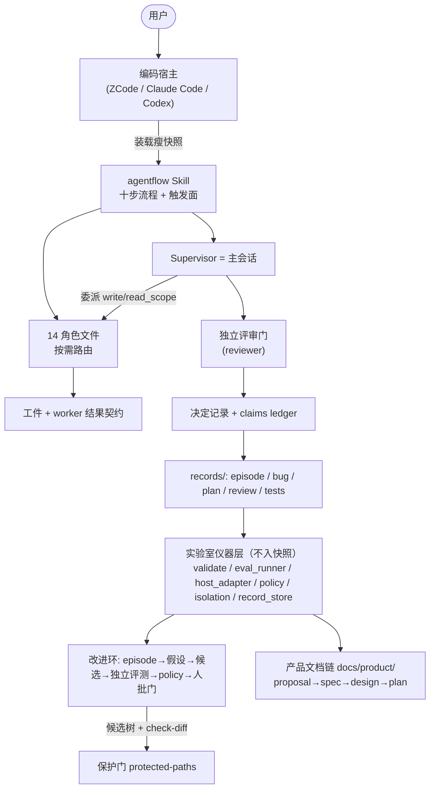
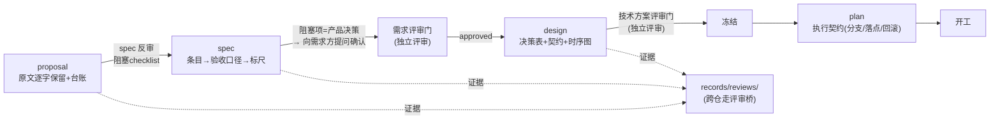

# Agentflow 总体技术设计（design）

> 适用阶段：`design/`。前置依赖：`proposal/proposal.md`、`spec/method-spec.md`（含反审
> checklist，阻塞项已全关）。实施仓：本仓库。
> 契约：`spec/method-spec.md` 是行为承诺的唯一依据；本文回答"技术上如何承接、怎么验证、
> 影响面多大"。文档状态：**待技术方案评审**。
> 图纪律：每张图只回答一个问题。

## 0. 关键决策速览

| # | 决策点 | 结论 | 一句话理由 | 详见 |
| --- | --- | --- | --- | --- |
| D1 | 做产品还是做运行时 | 只做方法，宿主是运行时 | LangGraph/CrewAI/Dify 管循环已被做好；本产品管协作纪律、证据编译、改自己时不能改评分规则 | PLAN-PRODUCT-001 架构结论 |
| D2 | 产品载体 | 宿主插件（Skill + 角色文件 + manifest），不绑死单一宿主 | 方法写一次；用户留在成熟宿主里 | `docs/agent-product-boundary.md` |
| D3 | 自迭代形态 | 受治理的人工闭环，不是自动学习系统 | 执行者发现并生成候选，独立评测验证，人按预声明门槛发布 | `docs/self-improvement-design.md` |
| D4 | 评判门归属 | 保护门清单单点声明（`protected-paths.txt`），候选不可触碰 | 工具改自己时不能改评分规则；门变更=人工评审 | spec S8 |
| D5 | 记录形态 | 九类记录各有 schema，落盘即过编译门 | 摘要不算验证；不可复现的检查视同没跑 | spec S6 |
| D6 | 计划形态 | Markdown 融合契约（信封 + 看板任务表 + 机器断言） | 人读性与机器校验合一；plan 是执行契约不是改码授权 | `records/plans/README.md` |
| D7 | 失败语义 | crash/timeout/empty 三类成文，编排层不做保底 | 降级=结果降级+丢弃在途；产品级 fallback 归异常矩阵 | spec S5 |
| D8 | 打包 | 瘦快照：`build_runtime.py` 生成，marketplace 源指向生成树 | 用户装的不是整仓死重；运行时面与实验室控制面分开 | spec S9 |
| D9 | 版本事实源 | 五份 manifest + CHANGELOG 唯一；文档禁复述版本号 | 版本散文化曾三次漂移，守卫检查执行 | spec S9、`validate.py docs` |
| D10 | 评测仪器 | 公开套件（AF-xxx）+ 业务切片（种子确定性评分）；`--case-ids` 子集失败即停 | 第一次闭环不必等业务 18 次；噪声底先行 | PLAN-LOOP-SMOKE-001 |
| D11 | 度量效度 | 被测树含 seeds 即 fail-closed；authoritative 运行强制隔离参数 | 种子泄漏=考试漏题；不可信基线不如不测 | spec S10 |
| D12 | 文档链吸收 | 方法增加 proposal→spec→design→plan 交付链（对外生成 + 对内自举），**推翻**早期"只吸收评审判据、不建模板体系"的取舍 | 只有评审判据没有生成契约时，文档质量靠当次会话自觉——与方法的其余部分治理哲学不一致；用户 2026-09-20 拍板补链 | spec S11/S13；本文件 §1.4 |
| D13 | 文档链门禁 | spec 反审 proposal（阻塞清单）、design 冻结前独立评审、plan 前置=design 冻结 | 链条带门才不是仪式；复用评审桥落证据 | `references/document-chain.md` |
| D14 | 诚实声明 | 角色分离≠环境隔离等边界如实入文；measurement: none 合法 | 强度声明与证据等级一致是审计前提 | spec S15 |

## 1. 设计方案

### 1.1 技术挑战

| 优先级 | 技术挑战 | 应对 |
| --- | --- | --- |
| P0 | 工具改自己时可能松掉评分规则（candidate 改 schema/评测/守卫） | 保护门 + `check-diff` 对冻结父 revision 比对 + `validate.py protected` 守清单覆盖（D4） |
| P0 | 独立评测的效度：基线与候选同树对贴、种子泄漏、宿主不可信端点 | digest 相同拒判（D10）、seeds fail-closed（D11）、证书按宿主发（S12） |
| P0 | 方法声明与宿主实态漂移：源码编辑≠宿主行为 | 瘦快照 + `installed` 逐文件比对（D8）；宿主事实只入 `host-platform-facts.md` 且带复验方法 |
| P1 | 记录一旦分散即不可检索，证据随会话消失 | 九类记录 + FTS5 读侧 + episode 会话内强制落盘（D5） |
| P1 | 文档链只有评审没有生成契约，质量靠自觉 | D12 补生成契约 + D13 门禁；内部链自举（本目录即样例） |
| P2 | 多宿主行为差异（浏览器主会话专属、工具白名单语义不同） | 宿主差异如实分宿主记录；证书不跨宿主外推（S12/S15） |

### 1.2 技术架构

方法层与仪器层分离：宿主只装载方法层的瘦快照；仪器层留在仓库里做确定性验证与自迭代。

**图 1：模块关系**

| 组件 | 职责 | 不负责 |
| --- | --- | --- |
| Skill（SKILL.md） | 触发、十步骨架、门禁接线 | 具体角色指令（在角色文件） |
| 角色文件（agents/*.md） | 单角色能力、产物归属、工具白名单 | 跨角色编排（在 Skill/Supervisor） |
| Supervisor（主会话） | 收口、委派、集成、决定、失败分类 | 替评审者下结论；豁免自己参与的评审门 |
| records/ | 证据落盘与检索 | 承载产品叙事（在 docs/） |
| 实验室（tools/lab/） | 编译门、评测、隔离、策略、检索 | 进入宿主瘦快照 |
| docs/product/ | 产品四层文档链 | 取代 records（执行契约仍在 plans） |
| 保护门（protected-paths.txt） | 候选禁区单点声明 | 保护"怎么干活"的角色提示词（那是改进环的对象） |

### 1.3 文档链与角色/记录的接线

**图：文档链门禁流（回答：一个阶段什么时候才算走完、谁开的门）**

| 链层 | 谁产出 | 谁把关 | 证据落点 |
| --- | --- | --- | --- |
| proposal | Supervisor 与用户收口（原文逐字保留） | spec 反审（blocking checklist） | 目标链目录 |
| spec | Supervisor 或 plan-architect 起；承接口登记缺口 | 需求评审门（独立评审，文档模式） | `records/reviews/`（跨仓）或目标仓约定 |
| design | 相应角色（跨层时 technical-director 定边界） | 技术方案评审门（独立评审） | 同上 |
| plan | plan-architect（只写不改码） | plan 前置门=design 冻结 | `records/plans/`（本仓）或目标仓计划契约 |

### 1.4 本批改动与影响面评估

| 改动 | 落点 | 影响面 | 回滚 |
| --- | --- | --- | --- |
| 产品文档链建立 | `docs/product/`（新增 5 文件） | 纯新增；旧设计文档不迁移不改写，引用不断 | 删目录即回滚，无外部引用 |
| 文档交付链契约 | `skills/agentflow/references/document-chain.md`（新增） | 新 reference；宿主装载面 +1 文件 | 删文件 + 还原 SKILL.md 接线 |
| SKILL 接线 | `skills/agentflow/SKILL.md`（+1 节，触发描述 +1 句） | 方法触发面变化：文档交付类任务开始走链 | 还原该节 |
| 重装 | `packaging/runtime` 重新生成 + marketplace 刷新 + 重装 | 宿主行为在重装后切换 | 不适用（幂等构建） |

**不改动**：`agents/*.md`（角色面零变化）、`schemas/` 与一切保护门路径、`tools/lab/`、
`records/`（不新增计划记录——本批以本链代替，理由见 §1.3 门禁设计）。

### 2. 验证与灰度

1. 确定性面：`python3 tools/lab/validate.py all` 9 项全绿（docs 检查覆盖新文件的 schema
   引用与角色引用）。
2. 安装面：`build_runtime.py` 重新生成 → marketplace 刷新 → 重装 → `validate.py installed`
   逐文件 PASS。
3. 自举验证：本链自身走一遍 S13 的验收口径（出处可溯、引用不断）。
4. 独立评审：需求评审门 + 技术方案评审门各一轮，文档模式，记录落 `records/reviews/`。
   **未过门前本链状态是"成稿待评审"，不得当作已冻结引用。**
5. 注入演练（S5 缺口）：crash/timeout 语义在 `/tmp` 一次性副本上做故障注入，证据落台账
   （不阻塞本设计评审，列为待建标尺）。

### 3. 失败模式与回滚

| 失败模式 | 检测 | 处置 |
| --- | --- | --- |
| 链条跳门（spec 未反审就出 design） | 评审门检查反审 checklist 存在性与关闭状态 | 退回补反审；记录跳门事实 |
| 链条与旧设计文档结论冲突 | 需求/技术评审对照旧文档 | 裁决后按 aiwork 翻案格式留推翻记录，旧文档补注记 |
| 文档链被误当冻结引用 | 门禁语义（README）+ 评审记录缺失 | 评审通过前一律"成稿待评审" |
| 瘦快照与源码漂移 | `validate.py installed` FAIL | 重跑构建 + 刷新 + 重装（幂等） |
