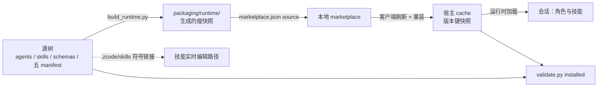

# Agentflow 项目结构体系

> 本文是仓库的**结构地图**：目录怎么排、分成哪几个面、东西放在哪、怎么安装与校验。
> 「怎么干活」（流程、角色、门的使用）见 [system-guide.md](system-guide.md)；角色契约见
> [agent-roles.md](agent-roles.md) 与 [contracts.md](../skills/agentflow/references/contracts.md)；
> 宿主平台事实见 [host-platform-facts.md](host-platform-facts.md)。
>
> 维护纪律：结构发生变化时同步更新本文与 [index.md](../index.md)。

## 1. 五个面

| 面 | 包含 | 谁消费 | 关键纪律 |
| --- | --- | --- | --- |
| 插件面（交付） | `agents/`、`skills/`、五份 manifest、宿主包装、`packaging/runtime/`（生成树） | 宿主（Codex / Claude Code / ZCode）从**安装快照**加载 | frontmatter 是宿主规范字段；角色/技能改动重装后才生效 |
| 实验室面（工具） | `tools/lab/`、`tests/`、`schemas/`、`evals/`、`mock/`、`examples/` | 人、Supervisor、评测 runner | 多数在保护区内，改动 = 门变更，需人审 |
| 记录面（证据） | 六活区（`issues/` `episodes/` `plans/` `improvements/` `releases/` `reviews/`）+ `features/` 批次 + `_archive/` 冻结 | 人读 + 机器校验 | 写完就编：schema 与跨文档不变量校验，FAIL 即编译错误 |
| 文档面（说明） | `README.md`、`AGENTS.md`、`index.md`、`docs/` | 人 + 入仓的 agent | 新增/移动/删除文档必须同步 `index.md`；断链与退役路径有机器扫描 |
| 发布与安装链 | `packaging/` → `marketplace.json` → 宿主 cache | 宿主 | 版本只在五份 manifest 与 `CHANGELOG.md` 声明 |

日常读法（两轨）：小修与零星事项走 `issues/`，成批 / 跨层工作立 `features/<批次>/`（README + proposal + spec + design + plan）；其余活区与机制在后台支撑。

## 2. 目录结构（物理）

```text
agentflows/
├── README.md                 产品门面（对外一页）
├── AGENTS.md                 仓库纪律（任何 agent 入仓先读）
├── index.md                  全仓唯一文档索引
├── CHANGELOG.md              版本发布史（版本真源之一）
├── protected-paths.txt       候选禁区清单（门的单点声明）
├── plugin.json               主 manifest
├── marketplace.json          本地 marketplace（source → packaging/runtime）
├── .zcode-plugin/plugin.json     ZCode 宿主包装
├── .claude-plugin/plugin.json    Claude Code 宿主包装
├── .codex-plugin/plugin.json     Codex 宿主包装（含 interface 展示字段）
├── agents/                   14 个角色文件（.md：frontmatter + 中文角色契约）
├── skills/
│   ├── agentflow/            开发工作流 Skill
│   │   ├── SKILL.md
│   │   ├── agents/openai.yaml      Codex 侧展示字段
│   │   ├── references/            4 份：contracts / roles / document-chain / document-chain-templates
│   │   ├── templates/             18 份：文档链模板（feature 的 proposal/spec/design/plan、issue、releases、index）
│   │   └── scripts/check-write-scope.sh   硬边界 14 的写范围对照脚本
│   └── improve/              自迭代 Skill
│       ├── SKILL.md
│       ├── agents/openai.yaml
│       └── references/            6 份：evidence-and-release + 5 个 JSON Schema（含改进环 gate 契约）
├── packaging/                build_runtime.py + README.md + runtime/（生成树，本地）
├── tools/lab/                实验室工具（9 个工具 + README.md + adapter-protocol.md）
├── schemas/                  9 个记录契约 Schema + README.md
├── tests/                    2 个受保护测试（门工具的钉子）
├── evals/                    评测套件
│   ├── public/               15 个公开回归用例（AF-NNN.json + inputs/）
│   └── business/             3 个业务切片（BT-NNN.json + inputs/ + seeds/）
├── mock/                     样板 fixture（issues / plans / episodes / reviews）
├── examples/                 正反例（issues / plans / testing / policy / evaluation-results / invalid）
├── issues/                   缺陷与事项（ISS-2026-NNN 平铺） + recurrence/ 类台账（同类缺陷的复发记录） + 归档/ 被拒记录
├── episodes/                 按日期的任务级决策记录（EP-*.json）
├── plans/                    版本化执行计划（PLAN-*.md 看板）+ 待拍板事项（PENDING-DECISIONS.md）
├── improvements/             改进环工件：candidates / evaluations / comparisons
├── releases/                 发布记录（JSON）+ todo.md / pending-test.md 工作文件
├── reviews/                  对外文档二次评审落点
├── features/                 批次留档（feature-YYYY-MM-DD-主题/：README + proposal + spec + design + plan，含 testing/）
├── docs/
│   ├── system-guide.md       体系使用指南（怎么干活）
│   ├── agent-roles.md        角色与协作协议
│   ├── host-platform-facts.md 宿主平台事实台账（证据 + 适用范围）
│   ├── iteration-log.md      迭代台账（逐批留档）
│   ├── product/              产品文档链（proposal → spec → design，门禁勾选见其 README）
│   └── 4 份设计记录：host-native-plugin-design / self-improvement-design /
│       agent-product-boundary / spec-fact-check-design
└── _archive/                 三级冻结（audit-2026-09 / handoff-2026-10 / records-2026-10）
```

## 3. 插件面：交付给宿主的东西

- **`agents/`（14 个角色）**：Supervisor 由当前会话担任，不设角色文件；文件为
  frontend/backend engineer、technical director、reviewer、bug investigator/fixer/recorder、
  plan architect、test planner/executor、feedback analyst、candidate engineer、evaluator、
  release governor。路由与产物归属见 [roles.md](../skills/agentflow/references/roles.md)。
- **`skills/agentflow/`**：开发工作流 Skill——绑定宿主、路由角色、跑测试链路与文档交付链；
  契约文本在 `references/`，可抄的骨架在 `templates/`（[模板清单](../skills/agentflow/templates/README.md)）。
- **`skills/improve/`**：自迭代 Skill——证据分诊 → 候选 → 对照 → 发布决策；规则书与 schema 在
  `references/`（[证据与发布规则](../skills/improve/references/evidence-and-release.md)）。
- **五份 manifest**：`plugin.json`、`marketplace.json`、`.zcode-plugin/`、`.claude-plugin/`、
  `.codex-plugin/` 的各 `plugin.json`——名字与版本由 `validate.py manifests` 强制一致。
- **语言约定**：宿主规范字段（frontmatter 的 `name`/`description`/`tools` 等）保留英文原样；
  正文与人读面为中文。
- **首次接入**：在目标项目首次使用时，由 [SKILL.md](../skills/agentflow/SKILL.md) 的「首次接入（Init）」节把项目侧约定（语言、术语禁忌、分支纪律、检查命令）写入目标仓 `AGENTS.md`；本仓自身的规则见 [AGENTS.md](../AGENTS.md)。

## 4. 安装与同步链路



- 角色文件从**安装快照**加载：改 `agents/` 后必须 重建 runtime → 刷新 marketplace → 重装，
  再跑 `installed` 对照（[packaging/README.md](../packaging/README.md)）；技能有 `.zcode/skills/`
  符号链接的实时编辑路径。
- `validate.py installed` 报"没有源码版本的快照"属预期漂移，不是回归。

## 5. 实验室面：门与工具

`tools/lab/` 九个工具（均在保护区内，改动需人审；[工具说明](../tools/lab/README.md)）：

| 工具 | 职责 |
| --- | --- |
| `validate.py` | 全套确定性检查（schema/examples/evals/artifacts/mock/protected/manifests/docs/tests/doc_chain）+ `installed`/`report`/`recurrence` |
| `doc_chain.py` | 文档链 linter（结构/质量/表达纪律）+ 判别自测 |
| `isolation.py` | 候选禁区 `check-diff`（对照冻结父 revision） |
| `policy.py` | 确定性发布建议（promote / revise / reject） |
| `eval_runner.py` | 基线/候选对照运行器（`run`/`compare`，支持 `--case-ids` 子集） |
| `host_adapter.py` | 宿主适配协议（Claude/Codex 路径与隔离） |
| `seed_grader.py` | 业务切片确定性评分（对照埋入种子） |
| `artifact_digest.py` | 产物摘要（冻结与对照用） |
| `record_store.py` | 记录的一次性 FTS5 只读索引（源文件始终权威） |

- **保护区**在 [`protected-paths.txt`](../protected-paths.txt) 单点声明：evaluator/governor 角色、
  `tools/lab/`、`tests/` 两个受保护测试、`schemas/`、`evals/`、`skills/improve/references/` 等；
  `validate.py protected` 保证清单覆盖完整。
- **`tests/`**：逐文件受保护；新增测试须同时进 `validate.py` 的 `EXPECTED_TEST_FILES` 与
  `protected-paths.txt`。
- **`schemas/`**：9 个记录契约（bug/plan/review/recurrence/test-plan/test-run/
  evaluation-result/comparison/adapter-case-result），[说明](../schemas/README.md)。
- **`evals/`**：公开回归用例（工作流决策与权限边界）+ 业务切片（种子缺陷文档评审），
  [总览](../evals/README.md)；`mock/` 与 `examples/` 是合并编译的样板与正反例。

## 6. 记录面：写什么、放哪、谁校验

| 活区 | 内容 | 关键约定 |
| --- | --- | --- |
| `issues/` | 缺陷与事项，平铺 `ISS-<YYYY>-<NNN>-<slug>.md`；`recurrence/` 类台账；`归档/` 被拒记录 | 章节字面量 `## 现象`/`## 根因`/`## 修复`；[看板与规则](../issues/README.md) |
| `episodes/` | 按日期 `<EP-id>.json` 任务级决策 | material 改动一律写；`review_roundtrips` 必填；[说明](../episodes/README.md) |
| `plans/` | 版本化执行计划（人读看板 + 机器断言）+ `PENDING-DECISIONS.md`（待拍板事项） | 状态枚举 `☐/◐/☑/⚠/—`；回写只动状态与证据两列；[形态](../plans/README.md) |
| `improvements/` | `candidates/`、`evaluations/`、`comparisons/` | 文件名即身份；进入下一角色前先过 schema 校验；[说明](../improvements/README.md) |
| `releases/` | 发布记录 JSON + `todo.md`（待办与索引）/ `pending-test.md`（待验收） | 发布记录与 `CHANGELOG.md` 联动；[说明](../releases/README.md) |
| `reviews/` | 对外文档二次评审落点 | 目录锚在 feature 不是日期；逐字快照进 `archive/`；[说明](../reviews/README.md) |
| `features/` | 批次留档：README + proposal/spec/design/plan + testing/ | 文档链走 [document-chain.md](../skills/agentflow/references/document-chain.md) 的质量门 |
| `_archive/` | 冻结历史（三级冻结） | 冻结不是删除，不改写；[规则](../_archive/README.md) |

命名与状态速查：`ISS-<YYYY>-<NNN>`（缺陷与事项同一编号家族）、`EP-*`、`PLAN-*`、`RL-*`
（评测比较）、`AF-NNN` / `BT-NNN`（评测用例）；bug 记录状态 `open → fixed-pending-review →
verified`，或 `rejected` 入档。语言：机器层英文 ASCII（键、枚举、路径），人读层中文。

## 7. 文档面与维护纪律

- [README.md](../README.md) 是产品门面；[AGENTS.md](../AGENTS.md) 是入仓先读的仓库纪律；
  [index.md](../index.md) 是唯一文档索引。
- 文档新增/移动/删除：**同一次改动内**更新 `index.md`；新增顶层目录或新文档类型须先经用户确认。
- 相对链接必须可解析、散文不出现退役路径、版本号只活在五份 manifest 与 `CHANGELOG.md`
  （`validate.py docs` 机器强制）。
- 设计、指南与事实都在 `docs/`：[产品链](product/README.md)（proposal → spec → design，含门禁勾选）、
  [使用指南](system-guide.md)、[角色协议](agent-roles.md)、[宿主事实](host-platform-facts.md)、
  [迭代台账](iteration-log.md)。

## 8. 本地生成物与忽略物（不入库）

- `packaging/runtime/`——`build_runtime.py` 生成的安装面瘦快照（gitignored）。
- `.zcode/`——工作区技能符号链接（`skills/` 的实时编辑路径）与本地会话计划（gitignored）。
- `.commandcode/`、`.agentflow-records.sqlite3`——本地工具配置与可重建的 FTS5 索引（gitignored）。
- 实验与故障注入只在 `/tmp` 一次性副本上做，不在真实树（[AGENTS.md](../AGENTS.md) 纪律）。

## 9. 当前进度去哪里看

- 计划与拍板：`plans/`（在册计划；「等用户拍板」单点清单 `plans/PENDING-DECISIONS.md`）；批次进展：`features/<批次>/plan/` 与批次 README。
- 缺陷与事项看板：`issues/README.md`；复发档位：`validate.py recurrence`。
- 待办与待验收：`releases/todo.md`、`releases/pending-test.md`；发布史与版本：`CHANGELOG.md` 与 `releases/`；任务级决策：`episodes/`。
