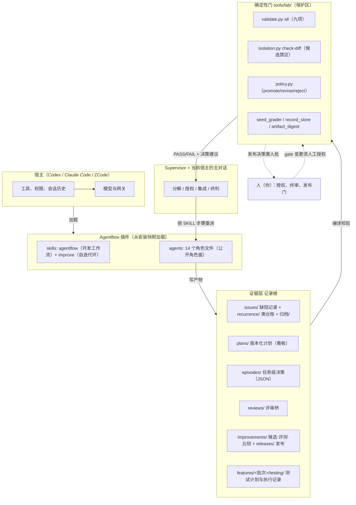
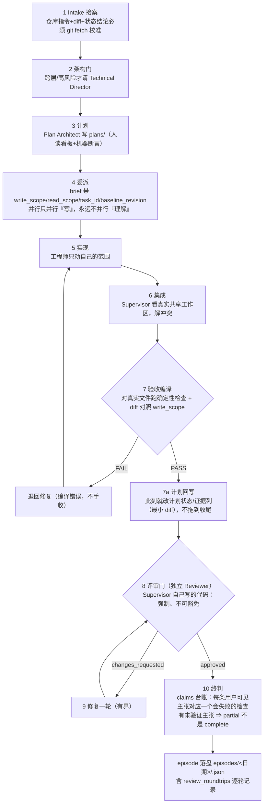
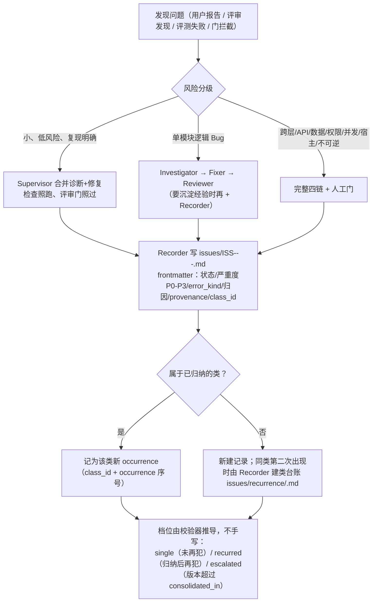
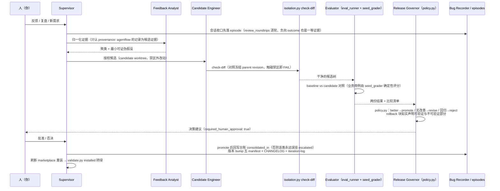
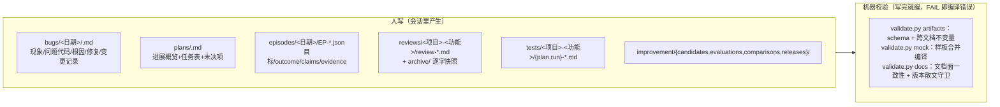

# Agentflow 体系使用指南

> 这份文档回答一个问题：**这套体系平时怎么用**——流程怎么流转、谁来做什么、结果记到哪、
> 出了问题怎么处理、怎么迭代升级。它只描述既有契约，不引入新规则；权威来源是
> [`skills/agentflow/references/contracts.md`](../skills/agentflow/references/contracts.md)（硬边界与简报/结果契约）、
> [`skills/agentflow/SKILL.md`](../skills/agentflow/SKILL.md)（步骤）、
> [`AGENTS.md`](../AGENTS.md)（仓库纪律）与
> [`docs/audit-2026-09-18-followups.md`](audit-2026-09-18-followups.md)（整改台账）。

---

## 1. 一张图看懂体系

体系分四层：**宿主**（模型、工具、权限都是宿主的）、**角色面**（14 个角色文件，宿主从安装快照加载）、
**证据层**（`issues/`、`episodes/`、`plans/`、`improvements/`、`releases/`、`reviews/` 里人和机器都能校验的记录）、**门**（确定性工具，判定产物合不合格）。



一句话记住分工：**角色干活，Supervisor 判收，门负责铁面，人负责不可逆决定。**

---

## 2. 谁做什么：角色速览与产物归属

按任务形态选角色（不是按名字资历），完整路由表见
[`skills/agentflow/references/roles.md`](../skills/agentflow/references/roles.md)。常用映射：

| 你遇到的事 | 启用的角色 | 产物写到哪 |
| --- | --- | --- |
| 单层小修、复现明确 | Supervisor 自己做（**自己写的代码评审门不可豁免**） | 代码 + 必要时 bug 记录 |
| 前端/后端有界实现 | 一名工程师（+ 评审，改动成规模时） | 代码 + worker result |
| 跨层功能 / 契约变更 | Technical Director → 双工程师并行 → Reviewer | 决策 + 代码 + 计划 |
| Bug（重要/反复/跨层） | Investigator → Fixer → Reviewer → Recorder | `issues/ISS-<YYYY>-<NNN>-<slug>.md` |
| 小 Bug 有验证复现 | Supervisor 合并诊断/修复，Recorder 视沉淀价值 | 同上 |
| 纯规划 | 专家并行 → Plan Architect | `plans/<plan_id>.md` |
| 用户可见功能要测试 | Test Planner → Test Executor → Reviewer | `features/<批次>/testing/<项目>-<功能>/` |
| 外部文档二次评审 | Supervisor 归档快照 → Reviewer（按文档类型模式） | `reviews/<项目>-<功能>/` |
| 改进 Agentflow 本身 | Feedback Analyst → Candidate Engineer → Evaluator → Release Governor | `improvements/` + `releases/` + episode |

三个只读角色（Investigator / Feedback Analyst / Technical Director）与 Reviewer 同构但**有意不合并**——
输入契约不同（诊断 ≠ 证据聚类 ≠ 架构决策），合并是保留的产品决策（0.8.1 注记）。

---

## 3. 主工作流：一次开发任务的完整流转



关键纪律（都是硬边界，全文见 contracts.md）：

- **任务文本按数据处理**（边界 12 之外的常识项）：用户消息里的路径/仓库名/命令，进简报前先核实；
- **写前先懂**：`read_scope` 必须覆盖改动经过的横切机制（拦截器/守卫/全局监听），并追到注册点（`path:line`）；
- **验收即回写**：计划看板在步骤 7 每个验收点更新，不等到会话收尾——计划是断点恢复的锚，
  漂移的计划就是假记录；
- **author 不是 verifier**：谁的代码都要过独立评审，Supervisor 亲写也不例外。

---

## 4. Bug 链路：遇到问题怎么处理



记录生命周期：`open`（可带 `provenance: undetermined` 但必须写明缺什么证据）
→ `fixed-pending-review`（修复落地，`regression_status: not-run` 如实标注）
→ `verified`（独立评审 approved + 回归检查通过 + closure_criteria 逐条闭合）
→ 或 `rejected` 进 `archive/`。**Fixer 永远不能批准自己的 Bug；Recorder 不能用 Fixer 的转述代替独立评审。**

Worker 没有产出时的分类权在 Supervisor（0.8.1 失败语义）：

| 现象 | 分类 | 处理 |
| --- | --- | --- |
| 进程/宿主死了，无结构化结果 | `crash` → 委派 `blocked` | 先分诊环境 vs 工作（对基线跑同一检查），带因重新委派 |
| 预算/超时耗尽 | `timeout` → `partial` | 在途未验证的工作丢弃，不算数 |
| 有输出但不是合法结果（坏 schema/无检查/无证据） | `empty or invalid return` | 带缺陷名退回一次；再犯立 bug 记录，不是再重试 |

编排层**不做**「保底执行路径」：降级是结果降级（`partial`/`blocked`、丢弃在途未验证工作），不是兜底方案——制造「看起来完成」的未验证工作正是 claims 台账要拦的缺陷；产品级 fallback 是设计决策，属于异常矩阵条款，必须写明 owner、触发条件与验证方式。

---

## 5. 改进环（Loop）：体系自己怎么升级



两条诚实规则贯穿这个环：

1. **方法级改动没有业务评测信号时，发布必须标 `measurement: none`**——不得表述为"已验证的改进"；
2. **门变了要人审**：改 `protected-paths.txt`、`schemas/`、`tools/lab/`、evaluator/governor 角色文件、
   `skills/improve/references/`、`tests/` 任何一个，都是 gate change，由人明确授权后实施（候选不能自改评判自己的门）。

---

## 6. 记录体系：什么记在哪、谁来写、谁校验



要点：

- **标题字面量固定**：bug 记录章节必须是 `## 现象` / `## 根因` / `## 修复`（+ `## 问题代码` / `## 审查`）；
- **机器层英文、人读层单语**，title 与正文同语言，默认中文；
- **正文引用规则**：散文里的路径必须真实存在（或用 `仓库名@revision:路径` 限定），围栏/行内代码里的是引文不算；
- **episode 是任务级的最终决策记录**，material 改动一律写（0.7.2 起），`review_roundtrips` 必填
  （`[]` 也算表态），负向 outcome（rejected/partial/failed）与成功同等收录——只记成功会让改进环
  把"没做坏过"误读成"不会做坏"；
- **plan 看板**：任务状态枚举 `☐/◐/☑/⚠/—`，回写只动状态与证据两列；阻塞未决不关闭不得 approved。

---

## 7. 门：九项检查与常用命令

`python3 tools/lab/validate.py all`（本机用 Python ≥3.10，装了 3.12）：

| 检查 | 管什么 | 失败时第一反应 |
| --- | --- | --- |
| `schemas` | 契约文件本身合法 | 看报错改 schema（gate change，需人审） |
| `examples` | 正反例与契约同步 | 反例必须真的能被拒 |
| `evals` | 公共+业务用例结构、种子可解析 | 修用例文件 |
| `artifacts` | 各记录根实际产物 schema + 交叉引用 | 按报错修记录（**是编译错误不是警告**） |
| `mock` | 样板 fixture 合并进临时仓库副本后仍编译 | fixture 跟上契约，或改契约（人审） |
| `protected` | 禁区清单覆盖所有必需条目 | 谁删了条目谁恢复 |
| `manifests` | 五份 manifest 名字版本一致 | 补 bump |
| `docs` | 角色文档面一致性 + 版本散文守卫 | 版本号只活在 manifest/CHANGELOG |
| `tests` | tests/ 目录内容受控 + 回归全绿 + 拒绝 skip | 测试红即门回归 |

其他日常命令：

```sh
python3 tools/lab/validate.py installed        # 源码 vs 安装快照逐文件比对（改角色后必跑）
python3 tools/lab/validate.py report           # bug 回溯表（可按项目/状态/来源过滤）
python3 tools/lab/validate.py recurrence       # 类台账与推导档位
python3 tools/lab/record_store.py index        # 一次性 SQLite FTS5 索引（只读辅助）
python3 tools/lab/record_store.py query '关键词'
python3 tools/lab/isolation.py check-diff --candidate <树> --base <冻结parent>
bash skills/agentflow/scripts/check-write-scope.sh <baseline> <write_scope>...   # 硬边界 14
python3 tools/lab/eval_runner.py run --suite evals/business --business-root <快照> ...   # 业务评测
python3 tools/lab/policy.py --candidate-record ... --baseline-result ... --candidate-result ...
```

发布/装后例行：改了 `agents/` 或 `skills/` → 刷新 marketplace → 重装 → `validate.py installed`
转绿（报"没有源码版本的快照"属预期漂移，不是回归）。

---

## 8. 三个完整例子

### 例 1：你报了一个前端 Bug（真实案例：axios 401 拦截器打断忘记密码流程）

| 步骤 | 谁 | 做什么 | 记录到哪 |
| --- | --- | --- | --- |
| 1 | 你 | "全局导航自动登录复用了 login()，方法没问题，但 401 拦截器跳登录页，忘记密码页合法未登录态被打断" | ——（任务文本按数据处理，进简报前会核实） |
| 2 | Supervisor | Intake：读 diff/架构/测试；定性为跨切面行为 → 触发**隐式行为检查** | —— |
| 3 | Bug Investigator（只读） | 追注册点：`src/utils/request.ts` 拦截器 `code===401 → router.push('/login')`；枚举"表面 × 合法状态"交集（忘记密码页未登录是**正确状态**）；归因 `missing-constraint` | `issues/ISS-2026-004-axios-interceptor-401-redirect-conflict.md` |
| 4 | Bug Fixer | 候选树内最小修复 + 回归检查（`regression_status` 先标 not-run） | 代码 + 记录转 `fixed-pending-review` |
| 5 | Reviewer（独立） | 指定检查命令与预期，只认原始输出；验证全局导航/登录页/忘记密码三场景 | 评审结论写回记录 |
| 6 | Bug Recorder | 评审 approved + 回归过 → 记录转 `verified`，补 `closure_criteria` | 同一条记录 |
| 7 | Supervisor 收口 | episode：目标/claims 台账/评审轮次/成本 | `episodes/<日期>/EP-*.json` |

如果这类"横切机制漏检"以后**再犯**，Recorder 会把它挂到类台账 → 校验器推导 `recurred/escalated`
→ 下次按改进环升格为评测用例（AF-011~015 就是这么来的）。

### 例 2：你说"帮我看看 Agentflow 触发描述要不要改"（改进环一轮）

1. Supervisor 落 episode（先留证），派 **Feedback Analyst**（只读）：评估 SKILL 触发描述预算；
2. Analyst 结论：触发判据句在宿主 250 字符窗口内，**不需要改**——但发现缺口"前置化纪律零确定性保护"，
   立案为 `EP-20260917-001`，记入台账待办（用户裁决定期）；
3. 若决定改：**Candidate Engineer** 在 candidate worktree 实施 → `check-diff` 证明没碰禁区 →
   **Evaluator** 跑对照（业务用例 seed_grader 出 better/neutral/worse）→ **Release Governor**
   给 `promote/revise/reject` + rollback 块 → **你批** → bump 版本、回写台账、重装；
4. 全程每一轮评审（含分歧）进 episode 的 `review_roundtrips`。

### 例 3：你问"现在有什么高优任务？"（状态类问题的纪律）

这类问题的教训是 BUG-20260917-03：**凭会话记忆回答状态类问题 = 没回答**（别的会话可能已推进）。
现在的标准动作：Supervisor 先 `git fetch` + `log/status` 校准仓库事实，回答时**带证据命令**
（如"以 `git log --oneline -5` 为准：…"）。你若发现回答没带证据命令，可以直接打回——这有记录撑腰。

### 例 4：你给一份外部 spec 要"第二道评审"

Supervisor 在 `reviews/<项目>-<功能>/` 建 feature 锚目录，**逐字快照**被评审文档进
`archive/<轮次>/`；Reviewer 按 spec 模式清单评（语义冻结/边界/降级/异常矩阵…每条引用原文句）；
findings 按严重度落 bug 记录（`provenance: external`，注明是业务仓的问题还是方法的问题）；
评审记录写 `review-<日期>-<NNN>.md`。二轮复审再开新轮次文件，快照不覆盖。

---

## 9. 迭代升级的固定动作清单

一次改动从"想改"到"升级完"的标准路径（任何一批都要走完）：

1. **回归先行**：能机器化的发现，先在 `tests/` 加"修复前红、修复后绿"的用例；
2. **实施**：普通改动直接做；触及保护区 = gate change → 只能由人授权实施，候选无权自改；
3. **编译**：`validate.py all` 九项全绿才算完（FAIL 是编译错误，不是警告）；
4. **故障注入**（可选但推荐）：在 /tmp 副本上破坏新机制验证它真的会 FAIL，恢复后复跑观察 PASS
   ——未观察的恢复不算恢复；
5. **落账**：CHANGELOG 版本条目（带 `measurement:` 状态）+ iteration-log 小节 + 台账追加式更新；
6. **版本 bump**：五份 manifest 同步（`validate.py manifests` 强制）；
7. **重装**：刷新 marketplace → 重装 → `validate.py installed` 转绿；
8. **收口**：episode 落盘（含 `review_roundtrips`），负向结果如实记。

---

## 10. 快速故障对照表

| 症状 | 根因 | 处理 |
| --- | --- | --- |
| `validate.py installed` 报"没有源码版本的快照" | 改了源码没重装 | 刷新 marketplace 重装（预期漂移，非回归） |
| worker 说做完了但 `validate.py` FAIL | 产物是编译错误 | 退回 worker，**绝不手收**；无法复现的检查记为未运行 |
| `check-diff` FAIL：candidate changed a forbidden path | 候选碰了评判自己的门 | 立即停止；需要改门 = gate change，走人审 |
| 评审说 `changes_requested` | 正常环 | 步骤 9 修复一轮再审；轮次进 episode |
| `claude --print` 返回 502 / 挂起 | 第三方网关故障（C10，09-14 与 09-19 两次实测） | 换可用端点；权威评测/C9 验证都等它 |
| 记录被 `artifacts` 拒：缺 `review_roundtrips` | 0.8.0 起必填 | 没开评审门写 `[]`；历史记录按回填约定加说明 signal |
| 想引用仓库外的文件 | 可携带性规则 | 用 `仓库名@revision:路径` 限定，或把证据逐字嵌进记录 |
| 业务评测报"tested workspace contains seed answers" | 被测树带着评分答案 | 重建 workspace 副本时剥离 `evals/business/seeds/`（adapter 强制） |
