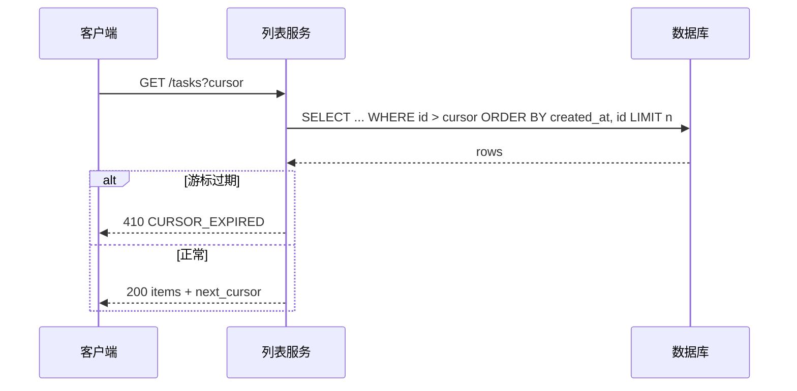
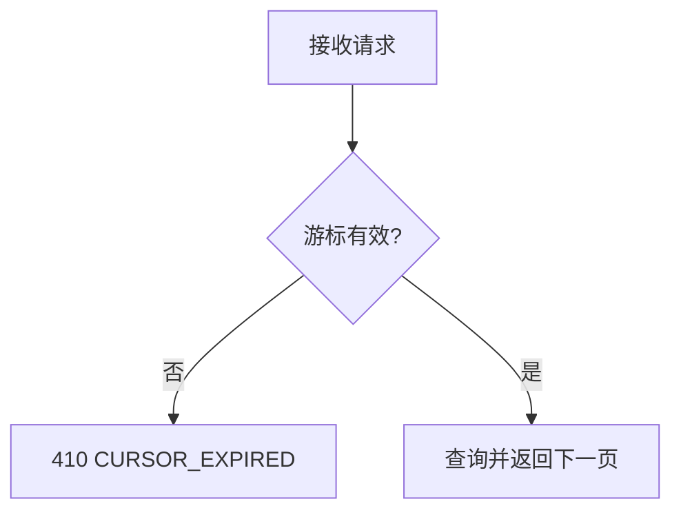
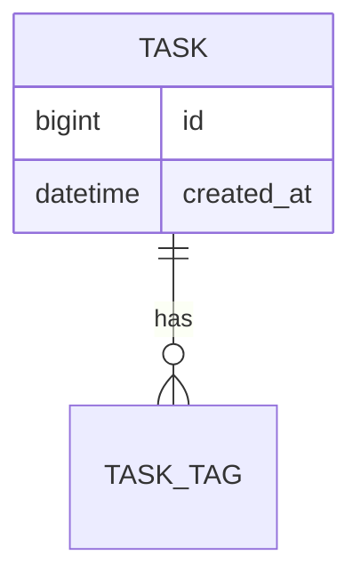

# feature-demo 后端设计

## 1. 先说结论

| 问题 | 结论 |
| --- | --- |
| 分页怎么切 | 游标分页，游标 = base64(id + 排序键) |
| 排序怎么稳 | 主排序键 created_at，次级键 id，避免同秒漂移 |
| 游标多久失效 | 10 分钟，过期返回 410 `CURSOR_EXPIRED` |

## 2. 关键决策速览

| # | 决策 | 结论 |
| --- | --- | --- |
| D1 | 游标编码 | base64 封装，不暴露内部字段 |
| D2 | 游标有效期 | 10 分钟，服务端校验签发时间 |
| D3 | 空列表形态 | 返回 `[]`，不返回 null |

## 3. 接口契约

| 接口 | 请求字段 | 响应字段 |
| --- | --- | --- |
| A1 | cursor(string,N) · pageSize(int,Y) · filter(object,N) | items(array) · next_cursor(string) |

## 4. 关键链路时序

## 5. 流程

## 6. 数据形态

## 7. 待核实清单

| # | 事项 | 影响 |
| --- | --- | --- |
| V-1 | 现有列表索引是否覆盖 created_at+id 联合排序 | T02 |

## 8. 影响面评估

- 接口 A1 的响应新增 `next_cursor`：老客户端忽略该字段，不破坏兼容。
- 排序语义变更：原按 created_at 单键排序的结果顺序可能微调，需在发布说明里声明。

## 9. 评审前自检

- 契约表字段与 spec §2 一致。
- 时序图覆盖过期与正常两条分支。
- 影响面评估列出兼容性与排序语义两项。
