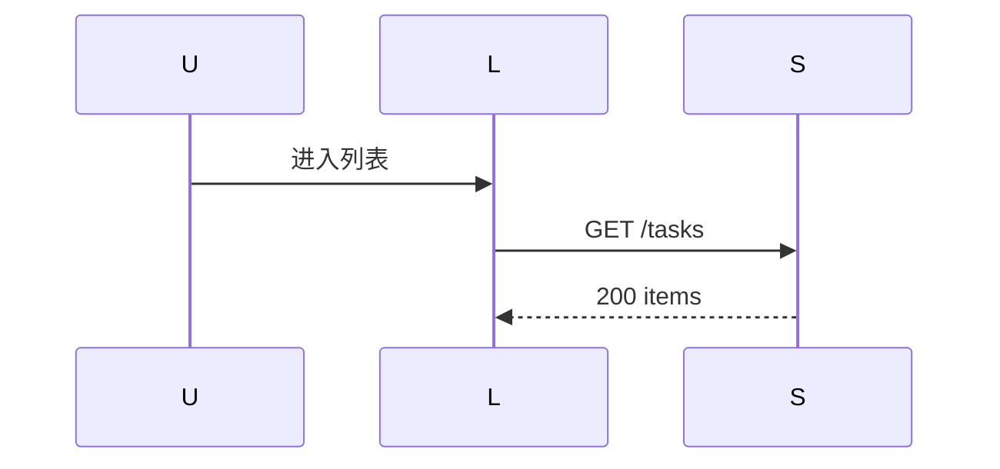
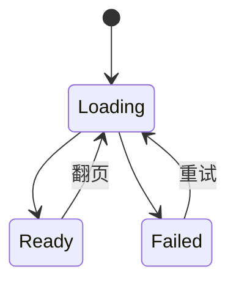

# feature-demo 前端设计

## 1. 先说结论

首屏一次请求 + 游标翻页；失败保留上一页数据并给重试入口，不整页刷新。

## 2. 接口调用与异常矩阵

A1 调用见下表。

| 接口 | 成功 | 失败/异常 |
| --- | --- | --- |
| A1 | 200，渲染 items 并保存 next_cursor | 410：清空游标回到第一页并提示；5xx：保留上一页 + 重试入口 |

## 3. 流程


## 4. 时序



## 5. 状态



## 6. 线框

```text
┌─列表──────────────┐
│ 骨架屏 / 任务卡片 │
│ 任务卡片           │
└───────────────────┘
```

```text
┌─失败态────────────┐
│ ⚠ 加载失败         │
│ [ 重试 ]           │
└───────────────────┘
```

## 7. data-testid 可测性清单

| 元素 | testid |
| --- | --- |
| 列表容器 | data-testid="task-list" |
| 重试按钮 | data-testid="task-retry" |
| 空态文案 | data-testid="task-empty" |

## 8. 影响面评估

- 列表组件新增失败态分支；筛选器交互按 proposal R3 不变。
- 首屏请求数由 2 降为 1，筛选器初始化请求合并进列表请求。

## 9. 评审前自检

- 异常矩阵覆盖 410 与 5xx 两类失败。
- 线框覆盖加载态与失败态。
- data-testid 清单覆盖三个断言点。
