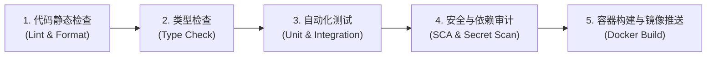

# 持续集成与部署（CI/CD）工程模板

> 用法：目标仓接入自动化构建与质量门禁时，按本模板配置 GitHub Actions 或 GitLab CI。
> 关联规范：落实 [`security.md`](../../references/standards/security.md) 依赖检查、[`execution.md`](../../references/execution.md) 确定性测试与 [`git-commits.md`](../../references/standards/git-commits.md) 提交约束（标准分册在目标仓落点见 `.agentflow/standards/`）。

## 0. 流水线阶段与质量门禁（Pipeline Stages）

标准 CI/CD 流水线必须包含以下顺序阶段，前置失败必须中断后续阶段：



---

## 1. GitHub Actions 模板 (`.github/workflows/ci.yml`)

复制到目标仓 `.github/workflows/ci.yml`：

```yaml
name: CI / CD Quality Gate

on:
  push:
    branches: [main, master, "feature-*", "release_*"]
  pull_request:
    branches: [main, master]

concurrency:
  group: ${{ github.workflow }}-${{ github.ref }}
  cancel-in-progress: true

jobs:
  # ==========================================
  # 阶段 1 & 2: Lint, Format 与 Type Check
  # ==========================================
  lint-and-types:
    name: Code Quality & Types
    runs-on: ubuntu-latest
    steps:
      - uses: actions/checkout@v4

      - name: Setup Node.js
        uses: actions/setup-node@v4
        with:
          node-version: 22
          cache: "npm"

      - name: Install Dependencies
        run: npm ci

      - name: Code Linter
        run: npm run lint

      - name: Type Check
        run: npm run typecheck

  # ==========================================
  # 阶段 3: 自动化测试
  # ==========================================
  test:
    name: Automated Tests
    runs-on: ubuntu-latest
    needs: [lint-and-types]
    steps:
      - uses: actions/checkout@v4

      - name: Setup Node.js
        uses: actions/setup-node@v4
        with:
          node-version: 22
          cache: "npm"

      - name: Install Dependencies
        run: npm ci

      - name: Run Unit & Integration Tests
        run: npm test -- --coverage

  # ==========================================
  # 阶段 4: 安全与依赖审计 (SCA)
  # ==========================================
  security-audit:
    name: Security & Dependency Scan
    runs-on: ubuntu-latest
    needs: [lint-and-types]
    steps:
      - uses: actions/checkout@v4

      - name: Dependency Vulnerability Audit
        run: npm audit --audit-level=high

      - name: Secret Scan (TruffleHog)
        uses: trufflesecurity/trufflehog@main
        with:
          path: ./
          base: ${{ github.event.repository.default_branch }}
          head: HEAD

  # ==========================================
  # 阶段 5: 容器构建 (仅在主干或 Release 分支构建)
  # ==========================================
  build-container:
    name: Container Build
    runs-on: ubuntu-latest
    needs: [test, security-audit]
    if: github.ref == 'refs/heads/main' || startsWith(github.ref, 'refs/heads/release_')
    steps:
      - uses: actions/checkout@v4

      - name: Set up Docker Buildx
        uses: docker/setup-buildx-action@v3

      - name: Build Container Image
        uses: docker/build-push-action@v5
        with:
          context: .
          push: false
          tags: ${{ github.repository }}:${{ github.sha }}
          cache-from: type=gha
          cache-to: type=gha,mode=max
```

---

## 2. GitLab CI 模板 (`.gitlab-ci.yml`)

复制到目标仓 `.gitlab-ci.yml`：

```yaml
stages:
  - lint
  - test
  - security
  - build

variables:
  DOCKER_DRIVER: overlay2

default:
  image: node:22-alpine
  before_script:
    - npm ci --cache .npm --prefer-offline
  cache:
    key: ${CI_COMMIT_REF_SLUG}
    paths:
      - .npm/

lint-job:
  stage: lint
  script:
    - npm run lint
    - npm run typecheck

test-job:
  stage: test
  script:
    - npm test -- --coverage
  artifacts:
    reports:
      coverage_report:
        coverage_format: cobertura
        path: coverage/cobertura-coverage.xml

security-audit:
  stage: security
  script:
    - npm audit --audit-level=high

docker-build:
  stage: build
  image: docker:27-cli
  services:
    - docker:27-dind
  before_script: []
  script:
    - docker build -t $CI_REGISTRY_IMAGE:$CI_COMMIT_SHA .
  only:
    - main
    - tags
```

---

## 3. 企业级发布与容器云流水线对接插槽（Enterprise Release Slots）

在接入企业内网发布体系或标准 Kubernetes 集群（如原生 K8s、ArgoCD、GitLab Agent、自建发布平台等）时，遵循以下解耦与安全接入原则：

### 3.1 凭据隔离与非对称注入（MUST）
- **严禁凭据入库**：发布平台的 API Token、集群 Kubeconfig、证书、AK/SK 必须通过 CI/CD 平台的受保护环境变量（如 GitHub Secrets `ENTERPRISE_DEPLOY_TOKEN`、GitLab CI Protected Variables）在运行时注入。
- **环境隔离**：生产环境（Prod）发布步骤必须配置手动审批门禁（Manual Approval）与受限环境分支（如仅限 `release_prod_*` 分支触发）。

### 3.2 示例：GitHub Actions 企业发布 Job 插槽

在 `.github/workflows/ci.yml` 的 `build-container` 阶段之后挂载发布 Job：

```yaml
  # ==========================================
  # 阶段 6: 容器云与生产发布对接插槽
  # ==========================================
  deploy-enterprise:
    name: Deploy to Production K8s / Cloud
    runs-on: [self-hosted, enterprise-runner] # 优先使用专用受控构建机，隔离外部公网
    needs: [build-container]
    if: startsWith(github.ref, 'refs/heads/release_prod_')
    environment: production
    steps:
      - uses: actions/checkout@v4

      - name: Deploy via Standard Kubernetes / CD CLI
        env:
          KUBECONFIG_DATA: ${{ secrets.PROD_KUBECONFIG }}
          APP_ID: "app-payment-service"
          IMAGE_TAG: ${{ github.sha }}
        run: |
          echo "Starting production deployment for $APP_ID with image tag $IMAGE_TAG..."
          # 1. 优先使用 kubectl / helm 执行滚动更新
          if command -v kubectl &>/dev/null && [ -n "$KUBECONFIG_DATA" ]; then
            mkdir -p ~/.kube && echo "$KUBECONFIG_DATA" | base64 -d > ~/.kube/config
            kubectl set image deployment/"$APP_ID" "$APP_ID"="${{ github.repository }}:$IMAGE_TAG" -n prod
            kubectl rollout status deployment/"$APP_ID" -n prod --timeout=300s
          else
            echo "WARN: Standard kubectl not configured. Calling secured deployment webhook..."
            # 2. 备选方案：通过受保护的内网 Webhook 触发发布流水线
            curl -sS -X POST "${{ secrets.DEPLOY_WEBHOOK_URL }}" \
              -H "Authorization: Bearer ${{ secrets.ENTERPRISE_DEPLOY_TOKEN }}" \
              -H "Content-Type: application/json" \
              -d "{\"appId\": \"$APP_ID\", \"image\": \"$IMAGE_TAG\", \"ref\": \"${{ github.ref_name }}\"}"
          fi

      - name: Verify Health Check Post-Deploy
        run: |
          echo "Verifying application health..."
          # 3. 轮询健康检查端点，确保就绪探针成功，超时则自动报警
          for i in {1..30}; do
            STATUS=$(curl -s -o /dev/null -w "%{http_code}" https://api.prod.example.com/api/health || true)
            if [ "$STATUS" = "200" ]; then
              echo "Deployment verified successfully!"
              exit 0
            fi
            sleep 5
          done
          echo "ERROR: Health check failed after deployment."
          exit 1
```

