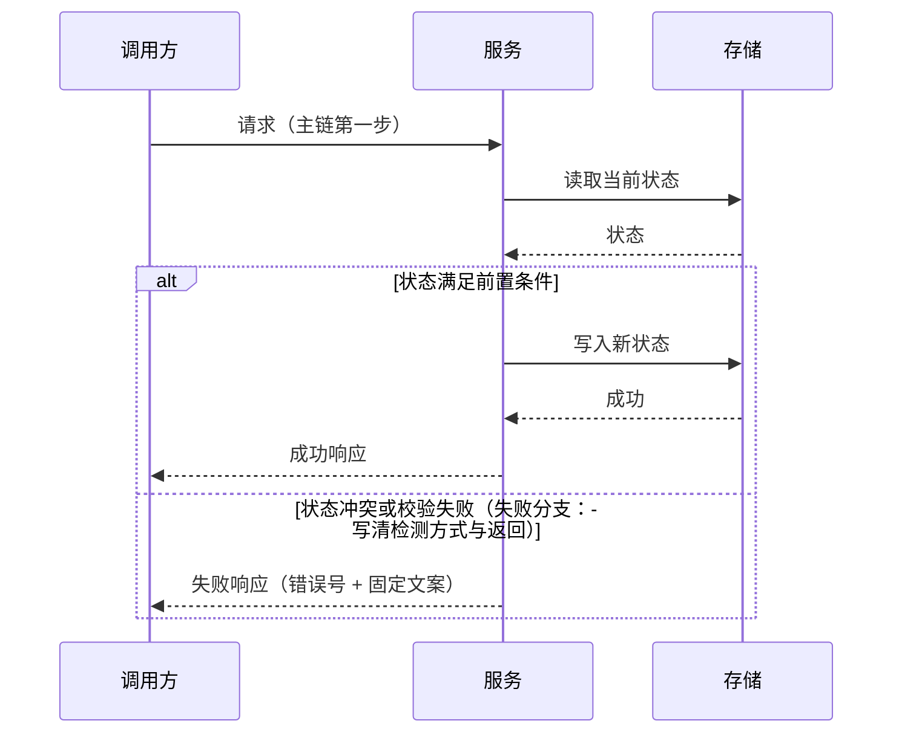
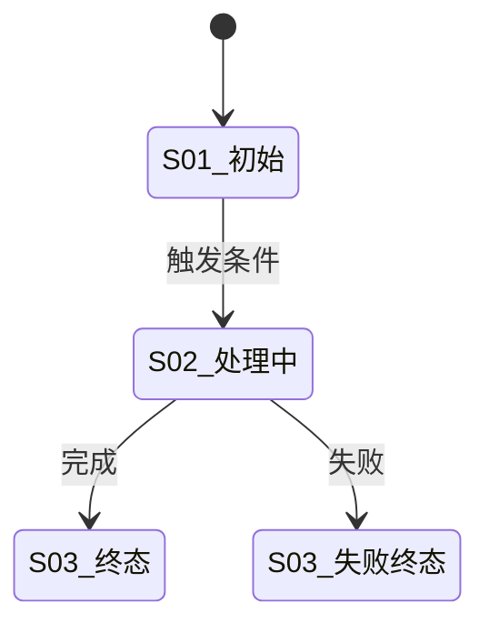

# <feature> — 后端技术方案（design/be）
> 前置输入/实施仓/契约基准（已核实的路由、账本、迁移纪律）/文档状态/影响面：见 §1.6
## 0. 先说结论
<填：| 问题 | 结论 | 速览表，结论含禁令；回滚一行>
| 问题 | 结论 | 禁令/注意 |
| --- | --- | --- |
| （填写） | （填写） | （填写） |

## 1. 设计方案
### 1.1 整体设计
#### 1.1.1 技术挑战 <填：| 优先级 | 挑战 | 应对 |>
| 优先级 | 技术挑战 | 应对 |
| --- | --- | --- |
| （填写） | （填写） | （填写） |

#### 1.1.2 技术架构 <填：mermaid 架构图（每图回答一个问题）+ 组件负责/不负责表 + 归属树>

| 组件 | 负责 | 不负责 |
| --- | --- | --- |
| （填写） | （填写） | （填写） |

#### 1.1.3 核心业务流程
##### 1.1.3.1 主链路逐步走 <填：S 步骤表——步骤|调用方→承接方|动作/输入输出|状态或数据变化|失败处理|观测点>
| 步骤 | 调用方→承接方 | 动作/输入输出 | 状态或数据变化 | 失败处理 | 观测点 |
| --- | --- | --- | --- | --- | --- |
| S1 | （填写） | （填写） | （填写） | （填写） | （填写） |

<填：主链与失败分支的时序图。`alt` 块是 linter 的硬性要求——失败分支必须落在图里，
不只在步骤表的文字里。下面两条是形态占位，替换成真实参与者与消息。>

##### 1.1.3.2 状态机或数据关系图 <填：核心对象的状态流转用 stateDiagram；表间关系用 erDiagram。两者至少给一张，图与下文 §1.3.2 的 DDL 一致>

### 1.2 核心算法与关键逻辑 <填：每条核心逻辑一个 #### 小节，小节内 **加粗标签** 分段（触发条件/输入输出/判断顺序/不变式/代码职责落点）+ 语言级伪代码；宽表格塞列是不合格形态>
### 1.3 核心数据与存储设计
#### 1.3.1 数据怎么流转 <填：一行数据的一生——落库时点逐条（创建/声明/终态/删除各写哪些表哪些字段+为什么），置于 DDL 之前；给出理解钥匙（如「定义表=现在、实例表=当时」）>
#### 1.3.2 DDL <填：新增表字段级 SQL（类型/空性/默认/注释/索引）+ 迁移命名 + 回滚；无 DDL 则结论表逐项"无"并给理由>
#### 1.3.3 配置项与运行边界 <填：新增或修改配置时逐项填；没有新增写「无新增配置」并给理由；前端提示不替代服务端校验，数据库列容量不代替业务校验>
| 键与代码字段 | 业务作用 | 类型与单位 | 默认与来源 | 必填条件 | 合法取值 | 可见性 | 覆盖顺序 | 生效与生命周期 | 失败行为 | 部署映射 | 验证 |
| --- | --- | --- | --- | --- | --- | --- | --- | --- | --- | --- | --- |
| <ENV / Config 字段 / 运营键> | <影响哪个入口、步骤、能力> | <bool/枚举/整数/duration/URL；字节/字符/秒> | <默认值或「无默认」+ 定义位置> | <哪个进程或能力开启时必须配> | <批准来源；负值/零/空串/缺省分别说明> | <服务端秘密/服务端普通/浏览器公开> | <运行 ENV/文件/构建变量的实际优先级> | <重启/热更新；进行中的任务是否用快照> | <拒绝启动/拒绝写入/关闭能力/明确降级> | <服务名、模板、入口脚本、消费点> | <检查用例或人工步骤> |

**运行边界**（超时、重试、限流、缓存、锁、连接池、大小上限）<填：每项一行；标注请求/用户/进程/集群范围>
| 限制项 | 适用对象 | 单位 | 上下界 | 特殊值 | 超限结果 | 权威来源 |
| --- | --- | --- | --- | --- | --- | --- |
| <超时/重试/并发/文件大小> | <请求/用户/进程/集群> | <秒/字节/个> | <下限–上限> | <0/空/负值> | <拒绝/截断/降级> | <产品/容量/安全依据> |

#### 1.3.4 现有设施复用 <填：| 设施 | 用法 | 改动 |>
#### 1.3.5 数据设计核对 <填：逐项写「已覆盖 / 缺口 / 不适用 + 理由」并给出载体；空表或全「已覆盖」无载体视为未完成>
| 核对项 | 结论 | 载体（DDL / 接口契约 / 测试 / 评审） |
| --- | --- | --- |
| 字段类型、空值、默认、单位、范围、精度与敏感性 | <填写> | <填写> |
| 字符长度与字节长度不混用 | <填写> | <填写> |
| 时间点与自然日期、时区、秒/毫秒区分 | <填写> | <填写> |
| 枚举、JSON、快照与汇总投影的职责 | <填写> | <填写> |
| 索引与查询组合匹配，分页稳定 | <填写> | <填写> |
| 列表查询无 N+1 或无界扫描，批查有规模与部分失败语义 | <填写> | <填写> |
| 并发更新有事务、锁或 CAS 方案，幂等回放有处理 | <填写> | <填写> |
| 迁移有命名、回填与回滚，并在真实库上验收 | <填写> | <填写> |
### 1.4 详细接口设计
#### 1.4.1 契约真源 <填：先核实再落笔——现网响应包裹、错误号体系（errcode 表/errno 门禁测试）、鉴权、openapi/IDL 位置；自造包裹或错误码表即缺陷；「以谁为准」的裁决规则在此声明一次，不做逐行指针>
#### 1.4.2 接口清单 <填：| 接口（方法+路径直写，禁自造编号） | 方法 | 变更类型 | 说明 |；可加"现有接口不要调"反向表>
#### 1.4.3 关键接口契约 <填：统一响应包裹（jsonc 带注释）→ 接口按用户旅程分组（每组一句场景话）→ 每接口一个 jsonc 代码块（请求行/每字段行尾注释含类型必填限制/响应示例/失败行=HTTP+错误号+中文含义）→ 公共对象用结构体+行尾注释（枚举全在注释里）；另保留一张「请求字段/响应字段」表头的契约总览表作速查锚点——下表只是导航，字段级契约的形态基线是上面的逐接口代码块，别把字段塞进本表>
| 接口（方法+路径） | 请求字段 | 响应字段 | 错误语义 |
| --- | --- | --- | --- |
| （填写，如 `POST /api/xxx`） | （逐一列出，含类型与必填） | （逐一列出，含类型与可空性） | （HTTP + 错误号 + 固定文案） |
#### 1.4.4 接口运行逻辑 <填：按场景散文——正常主路径/降级/重复与幂等/状态冲突>
#### 1.4.5 错误、幂等与状态约束 <填：错误号分配表（| 错误号 | HTTP | 常量 | 固定文案 | 客户端动作 |）+ | 场景 | 行为 |>
### 1.5 外部依赖改动需求 <填：| 依赖 | 改动 | 强度 |>；埋点为客户端上报、无服务端改动时写
`埋点：无服务端改动（事件契约见 design/fe §1.7）`；自建采集时补接收接口、落表与回滚
### 1.6 兼容性思考 & 影响面评估
<填：定级 L0–L3（附依据）/ 变更兼容性分类 / 影响面 checklist / 消费方清单与结论>
#### 1.6.1 影响等级量表
| 等级 | 定义 | 典型场景 | 发布要求 |
| --- | --- | --- | --- |
| L0 无影响 | 纯内部重构，对外契约/数据语义/行为均无变化 | 日志优化、无感性能 | 常规 CR+自测 |
| L1 低 | 仅非破坏性变更，老调用方可忽略或自然兼容 | 新增可选字段、新 endpoint | 更新 changelog；关键路径回归 |
| L2 中 | 潜在破坏或需协同发布 | 枚举新增/收紧校验、默认行为变化、可回滚迁移 | 灰度+提前通知消费方；联调与契约对比 |
| L3 高 | 明确破坏或不可逆 | 删/改字段或类型、改语义、删 endpoint、不可逆迁移 | 新版本或 deprecation 窗口；多方 sign-off；回滚/迁移方案必填 |

**定级原则**：取本次变更中最高等级；存在 L3 时须同步完善 §1.5 外部依赖、§3.2 回滚、§3.3 灰度。

#### 1.6.2 变更兼容性分类
| 类型 | 例子 | 处理 |
| --- | --- | --- |
| 非破坏性 | 新增可选字段、新 endpoint | 留当前版本 |
| 潜在破坏性 | 新枚举、校验收紧、状态码变化 | 审查各消费方解析逻辑，必要时协同发布 |
| 破坏性 | 删字段、optional→required、改类型/路径、改鉴权 | 新版本或 deprecation；禁止静默上线 |
| 静默破坏性 | 默认排序/分页/精度/语义变化 | 按 L2/L3；重点 payload 对比与回归 |

#### 1.6.3 影响面 Checklist 维度
| 维度 | 检查项 | 例子 |
| --- | --- | --- |
| 接口契约 | 路径/字段/required/错误码/鉴权/分页幂等键 | （填写） |
| 运行行为 | 同输入结果/默认值/超时重试/回调 | （填写） |
| 数据与存储 | 表/索引/历史兼容/双写回填 | （填写） |
| 缓存与配置 | key/TTL/开关默认值 | （填写） |
| 上下游 | **直接调用方、本模块依赖的下游、间接下游**三类都要列；强弱依赖标注/发布顺序/IDL tag | （填写） |
| 监控运维 | 指标/日志/回滚后一致 | （填写） |

**间接下游是强制覆盖类，不是可选项。** 报表、T+1 统计、离线任务、搜索索引、第三方对接这类
不改代码也会读到新数据形态的消费方，最容易漏，也最容易出事——典型后果是「T+1 报表统计口径
错了」「搜索索引构建任务读到新格式数据失败」。消费方清单只写「上下游」一个词视为未完成。

**HTTP 200 仍可能破坏业务逻辑**：字段还在但类型/语义/默认行为已变的接口，仍返回 200，
消费方要到对账或线上才暴露——这类必须按**潜在或静默破坏性**处理，不得因为状态码没变就归为
非破坏性。

#### 1.6.4 强弱依赖与结论
| 类型 | 定义 | 本模块处理 |
| --- | --- | --- |
| 强依赖 | 不可用则核心功能不可用/结论错误/无法安全上线 | 纳入发布窗口+sign-off；失败阻塞或明确回滚 |
| 弱依赖 | 异常时可降级/异步补偿/兜底 | 声明降级策略；不阻塞主发布 |

**结论项（必填）**：向后兼容发布（是/否/有条件）；强依赖方是否全部已确认（是/否，未确认列出）；是否需要版本边界/deprecation（是/否，窗口与通知方式）；与 §3.2 回滚/§3.3 灰度的关联（简述）。

#### 1.6.5 按等级升高的评审门
| 定级 | 放行条件（不满足不得进入下一阶段） |
| --- | --- |
| L0 / L1 | 方案内自洽即可；§1.6.4 结论项已填 |
| L2 | 消费方清单中**强依赖方须已确认**，缓解措施可执行；须灰度 |
| L3 | 须**多方 sign-off**；§1.5 外部依赖、§3.2 回滚、§3.3 灰度已联动；**未通过不得进入 plan/** |

**何时必填本节**：迭代/重构（改既有契约或数据）→ 必填完整走；纯新增、无存量契约 → 可简写，
但等级与结论两项仍必须给；纯内部重构 → 须写明定级依据（凭什么判 L0）。

## 3. 稳定性方案
<填：级别 / 异常策略表 / 上线顺序 / 回滚表 / Checklist / 灰度 / 监控告警（编号+阈值+key）/ 观测点清单 / 问题定位预案（现象→首查→日志→原因→动作）>
### 3.1 上线顺序与异常策略 <填：| 顺序 | 动作 | 判据 |；异常策略表逐场景一行>
### 3.2 回滚 <填：| 步骤 | 回滚动作 | 数据后果 |；不可回退点单列>
### 3.3 灰度与开关 <填：| 开关 | 默认值 | 放量方式 | 回滚方式 |>
### 3.4 监控告警与问题定位 <填：告警编号+阈值+指标 key；定位预案「现象→首查→日志→原因→动作」>

## 4. Design 评审前自检 <填：☑/☐ 逐项；未核实项挂 V 清单>
- ☐ 主链路含失败分支的时序图与步骤表一致（见 §1.1.3.1）
- ☐ 状态机或 ER 图与 DDL 一致（见 §1.1.3.2 / §1.3.2）
- ☐ 字段级 DDL、接口契约、错误号表齐备（见 §1.3.2 / §1.4）
- ☐ 字段与数据核对表逐项有结论与载体，无空项（见 §1.3.5）
- ☐ 新增配置项逐项有默认、覆盖顺序、生效方式与失败行为（见 §1.3.3）
- ☐ 影响面定级 L0–L3 有依据，消费方清单有结论（见 §1.6）
- ☐ 回滚点与发布顺序逐条配对（见 §3）
