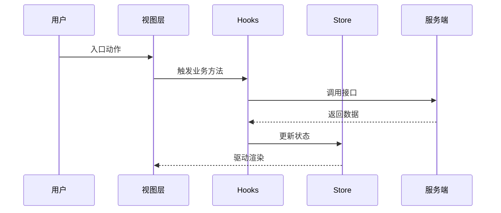
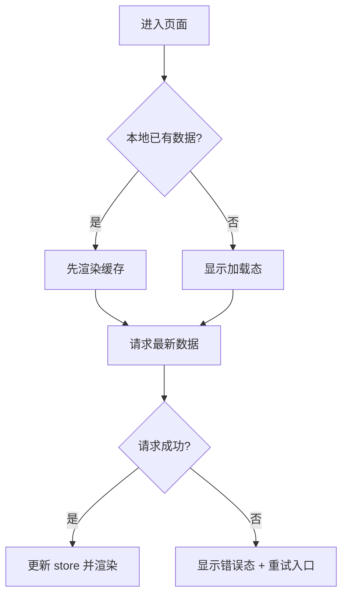
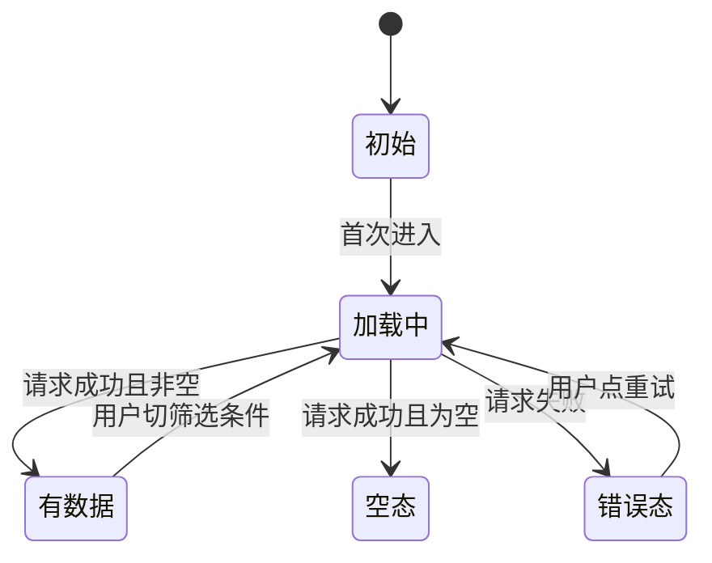

# <feature> — 前端技术方案（design/fe）
> 前置输入（spec/fe、design/be §1.4）/实施仓与目标 app（未核实挂 V）/分层约定/文档状态/影响面定级
## 图目录 <填：所列必须逐张兑现>
## 1. 设计方案
### 1.1 整体设计
#### 1.1.1 技术挑战 <填：表>
| 优先级 | 技术挑战 | 应对 |
| --- | --- | --- |
| （填写） | （填写） | （填写） |

#### 1.1.2 技术架构 <填：分层职责表（视图/hooks/store 各自边界）+ 能力域矩阵（视图/hooks/store/外部能力/文件/对应Spec）+ 组件关系树 + **文件落点表（每文件精确路径，新增/修改）**>
| 能力域 | 视图层职责 | Hooks 职责 | Store 职责 | 外部能力 | 文件/目录 | 对应 Spec/AC |
| --- | --- | --- | --- | --- | --- | --- |
| （填写） | （填写） | （填写） | （填写） | （填写） | （填写） | （填写） |

#### 1.1.3 核心业务流程 <填：S 步骤表（视图层状态/hooks 编排/store 读写/服务端调用/数据流转/成功异常去向/观测点）+ 时序图>
| 步骤 | 触发方/前置 | 视图层状态/行为 | Hooks 编排 | Store 读写 | 服务端调用 | 数据流转 | 成功/异常去向 | 观测点 |
| --- | --- | --- | --- | --- | --- | --- | --- | --- |
| S1 | （填写） | （填写） | （填写） | （填写） | （填写） | （填写） | （填写） | （填写） |



#### 1.1.4 复用边界 <填：业务组件 vs 公共组件；**data-testid 清单（testid|节点|出现条件）**>
> 组件库与主题以 `design/ui` §0.1「视觉来源与基线」为准：不得自选第二套 UI 框架，不得凭空写
> token 值或截图取色；需要偏离基线时在 design/ui 记差异项，本文件只引用、不另立来源。
| testid | 节点 | 出现条件 |
| --- | --- | --- |
| （填写） | （填写） | （填写） |

#### 1.1.5 线框与状态图
<填：涉及页面、布局、样式或交互时，计划前优先提供可直开的 `prototype/index.html`（骨架见
`templates/feature/prototype/`），从真实页面代码、组件库、主题与 token 复用视觉基线；新 feature 沿用旧页面时
记录上游原型路径与 revision。只有结构问题尚未收敛时可先用文本线框，计划前需补成产品视觉预览。标注每个区块
承担什么、可点击元素挂哪个 testid、视觉出处与本期差异；注释不要遮盖产品预览。记录用户确认人与结论；未确认时
不冻结设计，不进入计划或实现。>
| 形态 | 载体 | 覆盖范围 | 标注去向 |
| --- | --- | --- | --- |
| 线框 1 | `prototype/index.html` 的 P1 页 / 下方代码块 | （填写） | 下方标注表行 ①–④ |
| 线框 2 | `prototype/index.html` 的 P2 页 / 下方代码块 | （填写） | 下方标注表行 ①–④ |

**标注表**（一条一行，写结论不写感受；每条给出可判定的取舍依据）
| # | 区块 | 承担什么 | 挂的 testid | 结论（为什么这样放） |
| --- | --- | --- | --- | --- |
| ① | （填写） | （填写） | （填写） | （填写） |

> 原型真源声明（只声明一处）：<填：页面与交互以 `prototype/index.html` 为准，本表承载区域、testid、基线出处与
> 用户确认结论；若启用 `design/ui`，视觉细节以 `design/ui §0.1/§1/§2` 为准。文档冲突先解决结论再同步 HTML，
> 不要维护多份原型。>

```text
┌─列表页──────────────────────┐
│ [筛选栏            ]        │
├─────────────────────────────┤
│ ┌─卡片────────────────────┐ │
│ │ 标题        [主操作]    │ │
│ │ 状态标签                │ │
│ └─────────────────────────┘ │
│ ┌─空态占位────────────────┐ │
│ │ 无数据 + 引导按钮       │ │
│ └─────────────────────────┘ │
└─────────────────────────────┘
```

```text
┌─弹窗────────────────────────┐
│ 标题                    [×] │
├─────────────────────────────┤
│ 字段区（逐字段 + 校验提示） │
│                             │
├─────────────────────────────┤
│           [取消] [确定]     │
└─────────────────────────────┘
```

<填：核心交互的流程图（flowchart）——用户动作、判断分支与去向；一图回答一个问题。>


<填：核心对象的视图层状态图（stateDiagram）——让「加载中 / 空 / 有数据 / 错误」这类状态
与迁移条件成为可读的一张图，而不是散在散文里。>


### 1.2 核心算法与关键逻辑 <填：下表仅作逻辑索引，不代替详情；每条核心逻辑在下方各有一个 #### 小节，小节内按触发条件/输入输出/判断顺序/不变式/代码职责落点分段，并附语言级伪代码；竞态/防重/失效绑定必须说明。宽表格不能代替详细推演。>
| 逻辑/能力 | 触发条件 | 实现落点 | 输入/输出 | 状态变化/外部调用 | 判断顺序/伪代码摘要 | 不变式 |
| --- | --- | --- | --- | --- | --- | --- |
| （填写） | （填写） | （填写） | （填写） | （填写） | （填写） | （填写） |

### 1.3 核心数据与缓存（前端视角） <填：核心数据/DTO→VM/共享状态/localStorage 有无/去重>
| 类型 | 说明 |
| --- | --- |
| 核心业务数据 | （填写） |
| DTO→Model/ViewModel | （填写） |
| 共享状态口径 | （填写） |
| localStorage/sessionStorage/Cookie | Key/结构/过期/迁移（无则删行） |

### 1.4 详细接口设计
#### 1.4.1 服务端接口 <填：| 能力 | 接口 | 方法 | 请求关键字段 | 响应关键字段 |；表头注一行：契约真源与裁决规则声明一次（见 1.4 节首），不做逐行「契约以谁为准」列>
| 能力 | 接口 | 方法 | 请求关键字段 | 响应关键字段 |
| --- | --- | --- | --- | --- |
| （填写） | （填写） | （填写） | （填写） | （填写） |

#### 1.4.2 客户端 Bridge <填：有无>
#### 1.4.3 数据映射与字段处理 <填：| 服务端字段 | 前端模型 | UI 展示 | 可空默认 | 非法枚举 |>
| 服务端字段 | 前端模型 | UI 展示 | 可空/默认 | 非法枚举处理 |
| --- | --- | --- | --- | --- |
| （填写） | （填写） | （填写） | （填写） | （填写） |

#### 1.4.4 主要 TypeScript 契约 <填：interface/type 全量>
#### 1.4.5 错误、重试与并发控制 <填：表；乐观更新回滚时序图>
| 场景 | 前端表现 | 处理策略 |
| --- | --- | --- |
| 错误码映射 | （填写） | （填写） |
| 请求超时 | （填写） | （填写） |
| 防重复提交 | （填写） | （填写） |
| 并发/晚到响应 | （填写） | （填写） |

#### 1.4.6 Mock/联调/接口未就绪方案
### 1.5 兼容性思考 / ### 1.6 灰度开关 <填：老后端降级、无本地迁移>

### 1.7 埋点事件契约
> 前置输入：proposal §6.2 的埋点决策（新增/复用/N/A）与 spec/fe §4 的埋点口径。本节是**事件级真源**：
> 事件名、触发点、触发时机、参数都在这里定一次，spec/fe 只保留业务口径，不复制参数表。
> proposal 决策为「N/A」时本节写 `N/A: 理由`（与 spec/fe §4、design/qa 三处一致）。
> 契约来源（写一次）：<填：埋点 SDK/上报通道与公共参数取自哪个既有文档或代码，注册点在 `path:line`>

#### 1.7.1 上报通道与公共参数
| 项 | 结论 | 出处 |
| --- | --- | --- |
| 上报方式（实时 / 批量 / 队列） | （填写） | （填写） |
| SDK 初始化与注册点 | （填写，`path:line`） | （填写） |
| 失败重试与上限 | （填写） | （填写） |
| 采样与开关 | （填写：默认值、灰度键） | （填写） |

| 公共参数 | 类型 | 必含 | 取值来源 | 备注 |
| --- | --- | --- | --- | --- |
| （填写，如页面标识/来源/实验位/设备与版本） | string | 是/否 | （填写） | （填写） |

#### 1.7.2 事件清单
<填：一行一个事件；事件名用业务语义的英文下划线命名并全小写（例：`export_started`）。
**阶段不再编进事件名**——阶段只由下一列的阶段字段表达，因此 `export_clicked`、`*_view`、`*_result`
一律不合格：两个地方都编码阶段，早晚会漂移。同一动作只有一个事件，成功与失败用参数区分。>
| 事件 ID | 事件名 | 阶段（展示/点击/发送/结果） | 触发点（页面 + 控件 + testid） | 代码落点 | 触发时机（前置条件 / 去重 / 节流） | 参数个数 | 对应 spec/fe 编号 |
| --- | --- | --- | --- | --- | --- | --- | --- |
| EV-01 | （填写） | （填写） | （填写） | （填写，`path:line`，未核实挂 V） | （填写） | （填写） | E-01 |

> 四个阶段不是四种事件，是**同一个动作的四段**：触达后端的动作要把点击与结果之间的「发送」
> 单独落一行（在请求发出前一刻上报），否则「点了没发出去」和「发出去了失败」混成一个数。
> 成功与失败是它的参数取值，不再是阶段：结果阶段只留这一个事件，不按成功与失败拆成两行、两个事件。
> 本期不适用的阶段写在表下：`不适用：<阶段> — 理由`（多为「发送」：纯前端动作不触达后端）。
> 表上不写不等于声明过。

#### 1.7.3 逐事件参数表
<填：每个事件一个 #### 小节，字段级逐行列——**不要把所有事件的参数塞进一张宽表**。>
##### EV-01 <事件名>
| 参数名 | 类型 | 必填 | 取值域/枚举 | 取值来源 | 说明 |
| --- | --- | --- | --- | --- | --- |
| （填写） | string/number/boolean | 是/否 | （填写） | （填写） | （填写） |

#### 1.7.4 去重、时序与失败降级
| 场景 | 处理 |
| --- | --- |
| 同一动作连点/重渲染导致重复上报 | （填写：去重键与窗口） |
| 事件与主流程的先后 | （填写：先发后跳 / 跳转后再发，失败是否阻塞） |
| 上报失败或 SDK 未就绪 | （填写：丢弃/入队/静默，主流程不受影响） |
| 关键事件缺失时的补报或兜底 | （填写） |

#### 1.7.5 隐私与合规
| 项 | 结论 |
| --- | --- |
| 禁止上报的字段（个人信息、凭据、自由文本） | （填写，逐项列） |
| 需要脱敏/哈希的字段与方式 | （填写） |
| 用户关闭采集时的行为 | （填写） |

#### 1.7.6 可验证性
<填：每个事件至少一条会失败的检查——payload 字段可由单测验证；事件发送顺序、双端上报与去重须提供端到端路径证据或网络日志。只写“手工看过”不算验证。>
| 事件 ID | 验证方式 | 断言什么 | 归属任务/用例 |
| --- | --- | --- | --- |
| EV-01 | （填写） | （填写） | （填写） |

## 2. 稳定性方案 <填：级别/异常/上线/回滚/Checklist/灰度/监控排障表>
| 场景 | 应对方式 |
| --- | --- |
| 前端渲染/动态展示异常 | （填写） |
| 关键依赖不可用 | （填写） |
| 客户端 Bridge 异常 | （填写） |

**监控排障表**
| 用户现象/告警 | 首查步骤 | 日志/指标 | 可能原因 | 处理动作 |
| --- | --- | --- | --- | --- |
| （填写） | S* | （填写） | （填写） | （填写） |

## 4. Design 评审前自检
- ☐ 每条 P0 主链路已写清调用顺序、失败出口与观测点（见 1.1.3）
- ☐ 核心逻辑已说明触发条件、输入输出、判断顺序/伪代码、不变式（见 1.2）
- ☐ 服务端/Bridge/数据映射/TS 契约已说明（见 1.4）
- ☐ 错误码、重试、超时、并发、降级策略明确（见 1.4.5/2）
- ☐ 关键路径验证方式与可接受降级已明确
- ☐ 线框可直开（`prototype/index.html` 或 ≥2 张文本线框），标注表逐条有结论与 testid（见 1.1.5）
- ☐ 埋点逐事件字段级：事件名、触发点、触发时机、参数、隐私与失败降级齐备，且每个事件有会失败的验证方式（见 1.7）
- ☐ 埋点三处口径一致：proposal §6.2 决策 → spec/fe §4 口径 → 本节事件契约（新增/复用/N/A 不得互相矛盾）
