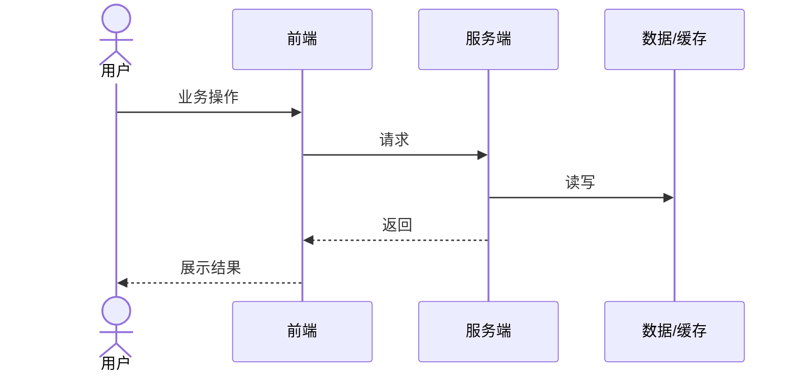

# <feature> — 测试与验证方案（design/qa）
> 前置输入：spec/qa 各 AC。本模板用「验证用例」作通用名称，编号形如 `TC-<模块号>-<序号>`
> （如 `TC-01-03`；用例 id 形态与来源列写法见 `references/test-records.md` 的契约节）；目标仓有自己的用例编号规则时，
> 在此处声明一行并全文替换本名称，不要另起一套代号。
## 1. 前置门禁与环境
<填：可测性门禁（testid 覆盖确认、阻塞提测项）>
| 检查项 | 期望事实 | 当前结论 | 阻塞提测 |
| --- | --- | --- | --- |
| 可操作元素挂载 testid | 用户可点击/输入/切换的元素 DOM 均有 data-testid | 已具备/缺失/不适用 | 是/否 |
| 值全局唯一且稳定 | 同文档内同值节点数=1；不随多语言/动态文案变化 | （填写） | 是/否 |
| 埋点可观测 | payload 可单测；事件顺序、双端上报与去重用端到端路径证据或网络日志验证（见 design/fe §1.7.6 与 telemetry.md） | 已具备/缺失/不适用 | 是/否 |

| 测试环境 | 用途 | 提供入口 | 必须就绪阶段 | 未就绪影响 |
| --- | --- | --- | --- | --- |
| 环境与版本 | （填写） | （填写） | 设计评审前/提测前 | （填写） |
| 账号与权限 | 普通/特殊角色/未登录 | （填写） | （填写） | （填写） |
| 测试数据 | 关键状态/边界/历史数据 | （填写） | （填写） | （填写） |
| 日志与监控 | 判断结果与定位 | （填写） | （填写） | （填写） |

## 2. 模块 × 验证类型矩阵
<填：| 模块 | 验证用例编号 | 验证类型(功能/边界/并发/兼容) | 执行端 |>
执行端取值：`Ego Light`（默认，ego-browser 命令行）/ `API`（命令行）/ `Runner`（目标项目自带 e2e 套件）/
`宿主浏览器`（仅 Ego 覆盖不了的交互，由主任务对话执行——兜底，不是目标）。
| 模块 | 验证用例编号 | 验证类型 | 执行端 |
| --- | --- | --- | --- |
| M01 | （填写） | 功能/边界/并发/兼容 | Ego Light/API |

## 2.1 入口矩阵（有用户可见功能时必填；纯后端写 `N/A — 纯接口`）

<填：按「入口」枚举，不按「页面」枚举。同一功能经弹窗、整页跳转、深链、回调页进入是不同入口，
必须各占一行——ISS-2026-050 的弹窗入口就是被「登录页」这一行掩盖的。入口类型取值：
`按钮` / `弹窗（含 iframe）` / `整页跳转` / `深链` / `回调页` / `脚本` / `纯接口`。>

**本表判「穷举」，不判「进度」**：「覆盖判据」列写该入口必须满足的最低覆盖要求（如「≥1 条
`browser` 级用例」），**不写具体 TC 编号**——具体用例是 `testing/plan-*.md` 注册表的职责，
两处都列 TC 编号会形成反向重复（改一处必漏另一处）。覆盖是否达成由 `check_records.py` 结合
注册表判定，不靠本表自报。

| 功能 | 入口 | 入口类型 | 覆盖判据（最低要求） | 未覆盖理由 / 阻塞 |
| --- | --- | --- | --- | --- |
| （功能点） | （具体入口，如「登录页弹窗」） | 弹窗（含 iframe） | ≥1 条 browser 级用例 | （不适用或暂不覆盖时必填；N/A 写理由） |

## 2.2 证据层级与断言独立性

<填：逐条 AC 或关键断言写两件事——期望值从哪来、最低要用哪一层证据。用户可见入口的
`最低证据层级` 只能是 `browser` 或 `manual`；`api` 证据不能关闭 e2e 用例。期望值写
「实现常量」即循环自证（测试与实现共享同一盲区），评审必须退回。>

**本表不写「关联用例」列**：用例与 AC 的对应关系由 `testing/plan-*.md` 注册表「来源」列唯一承载。
本表只定标准（期望值来源 + 最低层级），plan 逐条遵守。

| AC / 关键断言 | 期望值来源 | 最低证据层级 | 循环自证风险 |
| --- | --- | --- | --- |
| （AC 编号或断言） | spec 条文 / 用户确认 / 实现常量（红） | browser / api / file / manual | 有/无；有则写为什么 |

## 2.3 掩盖条件（会让用例假通过的环境状态）

<填：旧数据、遗留 cookie/缓存、构建期内联值、功能开关四类至少逐类判定。写清「哪条用例会被
它骗过」与「怎么清除或复位」；无法清除的写 `不可清除 — <原因>` 并升级为发布风险。>

| 掩盖源 | 具体形态 | 会让哪条用例假通过 | 清除 / 复位方式 | 责任角色 |
| --- | --- | --- | --- | --- |
| 旧数据 | （如人工灌回的配置行、历史账号） | TC-<模块号>-<序号> | （重建/清卷/换库） | （填写） |
| 遗留 cookie / 缓存 | （如上一轮登录态、旧 JS bundle） | （填写） | （清 cookie / 硬刷新 / 换 profile） | （填写） |
| 构建期内联值 | （如 `NEXT_PUBLIC_*` 冻结进产物） | （填写） | （重建镜像 / 校验产物值） | （填写） |
| 功能开关 | （填写） | （填写） | （切换并记录值） | （填写） |

## 3. 核心流程测试设计
<填：mermaid 流程 + 分支覆盖说明>

| 分支 | 覆盖说明 | 关联验证用例 |
| --- | --- | --- |
| 成功主路径 | （填写） | （填写） |
| 明确失败 | （填写） | （填写） |
| 结果未知/超时重试 | （填写） | （填写） |

## 4. 边界与异常覆盖
<填：边界矩阵，输入→结果>
| 类型 | 条件/触发 | 正确结果 | 关联 AC |
| --- | --- | --- | --- |
| 状态与时间 | （填写） | （填写） | （填写） |
| 数据与组合 | 空值/越界/非法枚举 | （填写） | （填写） |
| 下游异常 | 超时/失败/部分成功 | （填写） | （填写） |
| 埋点 | 上报失败 / SDK 未就绪 / 关键参数缺失 | 主流程不受影响，事件缺失可被监控发现 | （填写） |

## 5. Bug 回归用例设计（本期含缺陷修复时必填；无则整节写 `N/A: 本期无缺陷修复`）
<填：本期承接的每条缺陷（`ISS-<YYYY-MM-DD>-<slug>`）至少一条回归用例。预期写**修复后的可观察行为**
（不是缺陷现象——现象由复现轮 fail 行的「实际结果」承载）；回归轮 pass 是 bug 记录
`regression_status: pass` 与状态前进的证据，bug 状态回写由主任务 / 记录角色执行，
回归 fail 不前进。联动规则见 `skills/agentflow/references/test-records.md`>
| 关联 ISS | 缺陷功能点 | 回归用例编号 | 预期（修复后可观察行为） | 复现序列出处 |
| --- | --- | --- | --- | --- |
| ISS-<YYYY-MM-DD>-<slug> | <缺陷所在功能点> | TC-<模块号>-<序号> | <修复后应观察到的行为> | <investigator 诊断中的 Ego 操作序列 / run-* 轮次> |

## 6. 测试准备（数据来源策略：真实优先，Mock 逐项声明）
能从真实接口/环境取到的数据一律用真实数据（真实 origin + 注入账号 + 真实接口返回）；只有真实
拿不到的环节（外部第三方、计费动作、不可构造状态）才 Mock，且逐项写明对象与理由——禁止全链路
Mock。计划未声明 Mock 的环节拿不到真实数据就标 blocked，不许静默降级。UI 自动化默认 Ego Light
（`ego-browser`），不新写 Playwright spec。

**浏览器用例的操作序列要可重放。** 每条 `browser` / `manual` 层的用例，其 Ego Light 操作序列以
**进仓脚本**形式落在 `testing/<项目>-<功能>/scripts/ego-<用例ID>.mjs`（不是 `scratch/`——那里是
一次性草稿、可随时丢弃）。`run-*.md` 的结果行引用该脚本路径，下次改一行前端就能直接重跑同一套
序列，而不是现场重写。脚本里不带凭据与环境值（运行时注入），元素用 testid/别名定位。
| 准备项 | 具体内容 | 使用哪些验证用例 | 准备/复位方式 | 未就绪处理 |
| --- | --- | --- | --- | --- |
| 真实数据与环境 | （真实接口/账号/库状态） | （填写） | 准备/复位 | （标 blocked，不转 Mock） |
| Mock（仅真实不可得项） | <Mock 对象 + 理由> | （填写） | 启用/复位 | （填写） |
| 配置与开关 | （填写） | （填写） | 启用/回滚 | （填写） |

## 7. 验证命令
<填：| 命令 | 覆盖什么 |；按目标仓 scripts 与构建入口核实后再写>
| 命令 | 覆盖什么 |
| --- | --- |
| （填写） | （填写） |

## 8. 发布判断条件
| 判断项 | 必须满足 | 不满足时 |
| --- | --- | --- |
| 核心验证用例 | P0/P1 已通过 | 阻塞发布 |
| 未运行项 | P0/P1 的 `not-run` 为 0；其余 `not-run` 逐条写明阻塞与解除条件 | 阻塞发布；不得用「后续补」换发布 |
| 严重缺陷 | （允许遗留等级与前提） | （填写） |
| 回滚/降级 | 开关/版本回退/数据恢复 | （填写） |

## 9. 自检清单
- ☐ 每个范围内 AC 至少由一个覆盖项承接
- ☐ 入口矩阵按入口枚举完整：每个用户可见功能的按钮 / 弹窗（含 iframe）/ 整页跳转 / 深链 / 回调页 / 脚本 / 纯接口都有覆盖或 `N/A — 理由`
- ☐ 每条 AC 的期望值来源已写明；无「实现常量」来源的循环自证
- ☐ 用户可见入口的最低证据层级为 `browser` 或 `manual`；没有用 `api` 证据关闭 e2e 用例
- ☐ 掩盖条件四类（旧数据 / 遗留 cookie 或缓存 / 构建期内联值 / 功能开关）逐类判定并写明复位方式
- ☐ 资金/权限/安全/幂等/数据一致性风险均有验证用例
- ☐ 阻塞提测项已关闭或可追溯
- ☐ 验证命令与入口已明确
- ☐ 数据来源已声明（真实优先，Mock 逐项给了对象与理由，无全链路 Mock）
- ☐ 本期每个埋点事件至少一条可断言的用例（payload 含事件名与关键参数），N/A 时写明理由
- ☐ 本期含缺陷修复时，每条 ISS 至少一条回归用例，预期为修复后行为且复现序列出处可查
