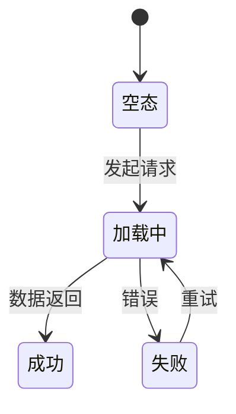

# <feature> — 前端规格书（spec/fe）
> 前置依赖/文档状态；原文已就近附低保真的不复述线框
> 定位：spec 是**需求事实唯一权威**——前端规格只允许引用或展开 proposal 与本文，不得另行新增业务事实；
> 待确认问题统一登记到 `spec/checklist.md`（不在本文件另开一套），关完才能进 design。
## 0. 需求提案不合规项（反审 checklist）
<填：#|Proposal 原文与反审缺口|关联 Q 编号|工程建议|反审状态；此表记审查结论，问题确认状态只在 spec/checklist.md 维护>
| # | Proposal 原文与反审缺口 | 关联 Q 编号 | 工程建议 | 反审状态 |
| --- | --- | --- | --- | --- |
| R-01 | （引用原文并说明缺口） | （无或 Q-01） | （填写） | 待修订/已闭合 |

## 1. 页面与组件规格
### 1.1 <页面/状态两态>
<填：展示项、交互层级表（哪些不冒泡）、排序口径>
| 模块 | 展示条件 | 用户动作 | 排序/优先级 |
| --- | --- | --- | --- |
| （填写） | （填写） | （填写） | （填写） |

### 1.2 <弹窗/表单>
<填：入口与初始态、字段与校验表、隐藏字段>
| 字段 | 类型 | 校验规则 | 初始态 | 隐藏条件 |
| --- | --- | --- | --- | --- |
| （填写） | （填写） | （填写） | （填写） | （填写） |

## 2. 状态与数据
<填：数据拉取策略、状态机、错误兜底>

| 状态 | 展示 | 错误兜底 |
| --- | --- | --- |
| （填写） | （填写） | （填写） |

### 2.1 前端行为口径
<填：只写用户可观察的前端行为，不写组件内部实现；每行给出依据或写「无 — <理由>」>
| 类别 | 可观察要求 | 依据 |
| --- | --- | --- |
| 数据刷新与去重 | 哪些操作触发刷新；重复提交、重复请求如何被抑制 | （填写） |
| 并发与晚到响应 | 参数变化或快速切换后，旧响应不得覆盖新结果 | （填写） |
| 身份与权限 | 登出/切账号/权限不足时哪些数据清空、哪些入口隐藏 | （填写） |
| 字段空值语义 | 省略/null/空串/零值/空数组分别展示与提交什么 | （填写） |
| 键盘与可访问性 | 主路径可用键盘完成；焦点、名称与错误提示可被辅助技术感知 | （填写） |
| 媒体与下载 | 预览/下载走授权入口；受限资源不进入公开链接 | （填写） |

## 3. API 依赖
<填：指向 spec/be 能力面；字段契约后置回填的注明回填处>
- 依赖能力：（填写，关联 spec/be §4 能力面）

## 4. 埋点口径
<填：把 proposal §6.2 的粗粒度清单收敛成可验收的草案——本节管「埋哪些业务动作、要拿到什么信息」，
事件名/参数/触发时机与代码落点由 design/fe 的埋点事件契约细化，本节不重复。proposal 结论为
「N/A」时本节写 N/A: 理由（与 proposal、design/qa 三处一致）。>
| # | 阶段（展示/点击/发送/结果） | 业务动作（白话） | 触发点（页面/控件） | 触发时机 | 要收集的信息 | 关联 AC/指标 | 本期 |
| --- | --- | --- | --- | --- | --- | --- | --- | --- |
| E-01 | 展示 | （填写） | （填写） | （填写） | （填写） | （填写） | 是/否 |
| E-02 | 点击 | （填写） | （填写） | （填写） | （填写） | （填写） | 是/否 |
| E-03 | 发送 | （填写：请求发出前一刻） | （填写） | （填写） | （填写） | （填写） | 是/否 |
| E-04 | 结果 | （填写：成功与失败两端都要有） | （填写） | （填写） | （填写） | （填写） | 是/否 |

> 四阶段词表（展示/点击/发送/结果）、「发送」段的归因口径、缺段声明方式与命名红线，唯一正文见
> [`references/telemetry.md`](../../../../references/telemetry.md) 的「四阶段闭环」与「字段与命名」节，
> 与 [`design/fe` §1.7.2](../../design/fe/frontend.md) 用同一套词表，不自造第五个阶段词。链内三条硬口径：
> 本期不适用的阶段在表下写一行 `不适用：<阶段> — 理由`（删掉行不等于声明）；成功与失败是同一事件的
> 参数，不拆成两个事件、也不是两个阶段。

**复用与不埋**
| 结论 | 事件/信息 | 理由（含既有口径出处） |
| --- | --- | --- |
| 复用 | （既有事件名） | （哪个文档/表定义，字段是否够用） |
| 不埋 | （动作/信息） | （填写） |

**埋点的验收口径**（写不出下面三条的，说明本节还没到可验收程度）：
- 事件在哪一步之后一定会发出：<填：动作 + 成功/失败分支各自的处理>
- 参数里必须出现哪些字段：<填：业务关键字段，不含个人信息>
- 埋点失败时主流程如何：<填：默认不影响主流程，写清降级方式>

## 5. 降级规则
<填：服务不可用/老后端/无数据时逐条（"宁可不给入口"类决策写这里）>
| 场景 | 决策 | 兜底表现 |
| --- | --- | --- |
| 服务不可用 | （填写） | （填写） |
| 无数据 | （填写） | （填写） |
