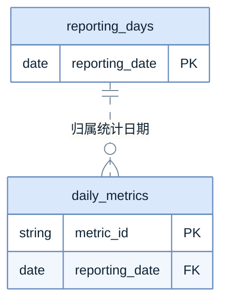

# ER 图模板（正文内嵌 mermaid，涉及新表或改表时必须出）

> 用法：复制到设计正文的数据关系小节。
> 只画表、主键、外键与关系。每条关系标基数，多对多画出中间表，依赖的既有表标注「既有」。

## 正例

**范围**：本例为目标设计。日历表每个统计日期一条记录，每条日指标必须归属到一个日期。

**怎么读**：`reporting_days.reporting_date` 是主键。同一天允许有多条 `daily_metrics`，各自有不同的 `metric_id`。新增或改动指标的日期须通过已登记日期的外键约束。核对样例时，同一天添加第二条指标应允许，使用未登记日期应拒绝。若项目只有业务键关联，则在实际图中说明执行检查的责任方和没有物理外键的边界。

## 写法要点

| 要点 | 做法 | 反例 |
| --- | --- | --- |
| 只画必要字段 | 主键和外键，其余进正文表格 | 把三十个字段全列进实体框 |
| 基数必须标 | `||--o{`、`||--||`、`}o--o{` 明确标 1:1 / 1:N / M:N | 画了线不标基数，读不出有没有中间表 |
| 多对多出中间表 | 两个一对多指向中间表 | 两个实体画一条多对多线了事 |
| 只画本批 | 新增表正常画；既有表灰底标「既有」 | 把全库几十张表全画一遍 |
| 不上图的内容 | 索引、字符集、默认值、排序规则 | 在实体框里写字符集和默认值 |

## 与正文的分工

图给结构，表给判据。ER 图下方必须跟一段「怎么读」，点明**哪两张表靠什么字段对齐**、**哪些关联是逻辑关联而非外键**——后者最容易在实现时被误加成物理外键，然后在大表上引发锁与迁移风险。

## 交付前自检

- [ ] 每条关系都标了基数
- [ ] 多对多已画出中间表
- [ ] 只画本次新增或改动的表，既有表已标「既有」
- [ ] 索引、字符集、默认值没有上图（已在正文表格里）
- [ ] `accTitle` + `accDescr` 已写
- [ ] 实体不超过 15 个（超了就拆成「本批新增」与「涉及既有」两张）
- [ ] 图后紧跟「怎么读」，点明对齐字段与逻辑关联
