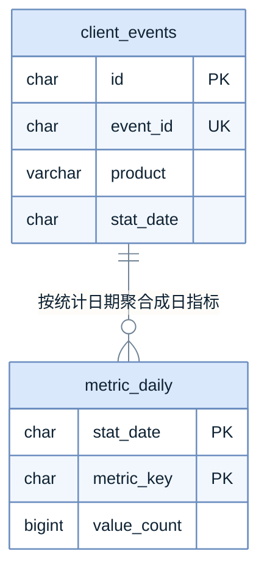

# ER 图模板（正文内嵌 mermaid，涉及新表或改表时必须出）

> 用法：复制到设计正文的数据关系小节。
> 硬要求：只画表、主键、外键与关系；每条关系标基数；多对多必须画出中间表；只画本次新增或改动的表。

## 正例

**怎么读**：`client_events` 是明细，`metric_daily` 是聚合——两者**靠统计日期这个业务键对齐，不是物理外键**，删明细不会级联删聚合。`event_id` 上的唯一键是幂等写入的唯一依据，不落在聚合表里。上图演示「逻辑关联也画成线」的形态：线表示读路径，不表示约束。

## 写法要点

| 要点 | 做法 | 反例 |
| --- | --- | --- |
| 只画必要字段 | 主键、外键、关键状态字段；其余进正文表格 | 把三十个字段全列进实体框 |
| 基数必须标 | `||--o{`、`||--||`、`}o--o{` 明确标 1:1 / 1:N / M:N | 画了线不标基数，读不出有没有中间表 |
| 多对多出中间表 | 两个一对多指向中间表 | 两个实体画一条多对多线了事 |
| 只画本批 | 新增表正常画；既有表灰底标「既有」 | 把全库几十张表全画一遍 |
| 不上图的内容 | 索引、字符集、默认值、排序规则 | 在实体框里写字符集和默认值 |

## 与正文的分工

图给结构，表给判据。ER 图下方必须跟一段「怎么读」，点明**哪两张表靠什么字段对齐**、**哪些关联是逻辑关联而非外键**——后者最容易在实现时被误加成物理外键，然后在大表上引发锁与迁移风险。

## 交付前自检

- [ ] 每条关系都标了基数
- [ ] 多对多已画出中间表
- [ ] 只画本次新增或改动的表，既有表已标「既有」
- [ ] 索引、字符集、默认值没有上图（已在正文表格里）
- [ ] `accTitle` + `accDescr` 已写
- [ ] 实体不超过 15 个（超了就拆成「本批新增」与「涉及既有」两张）
- [ ] 图后紧跟「怎么读」，点明对齐字段与逻辑关联
