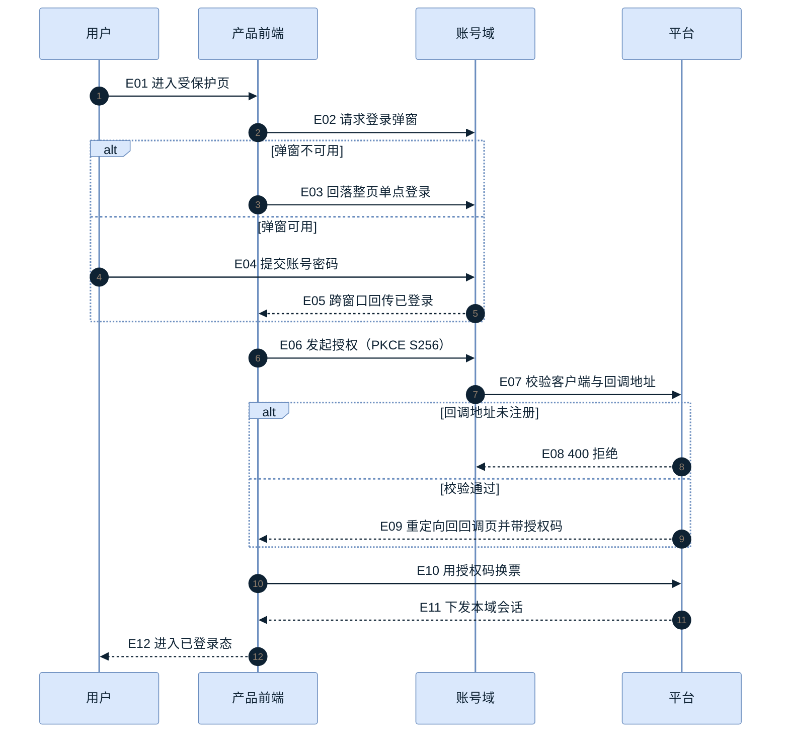

# 时序图模板（正文内嵌 mermaid）

> 用法：复制到设计正文。硬要求：`autonumber` + 事件号连续 + 紧跟一段「怎么读」 + 失败分支不得省略。
> 目标仓有图示规范时，以该规范为准；本模板只保证形态与门禁项不缺。

## 正例

**怎么读**：E01–E05 是「拿到账号域会话」，E06–E11 是「换成产品域会话」——**这两段不能合并理解**，产品域会话只由 E10–E11 产生，E05 之后直接刷新必然 401。E08 是唯一的静默失败点（用户侧只表现为「点了没反应」），验收必须能单独观察；E03 是弹窗被拦时的兜底，必须能单独触发。

## 写法要点

| 要点 | 做法 | 反例 |
| --- | --- | --- |
| 主干用业务语言 | `E06 发起授权` | 写成一长串查询参数，撑爆箭头 |
| 接口细节挂箭头 | `E10 用授权码换票` | 把字段表画成一串框 |
| 分支必须显式 | `alt 失败条件 / else 正常` | 只画 happy path，失败写「略」 |
| 事件号稳定 | 新增分支用续号，不改旧号 | 插入后重排全部编号（用例引用全断） |
| 怎么读要点名 | 「哪几条分支要能独立观察」 | 「本图展示了登录流程」（等于没说） |
| 无障碍字段 | 每块都写 `accTitle` / `accDescr` | 省略——多数门禁直接判红 |

## 分支片段怎么选

| 片段 | 何时用 | 例 |
| --- | --- | --- |
| `par … and … end` | 两支**同时发生** | 两个端同时刷新会话 |
| `critical … option … end` | 这段**必须发生**，否则整体失败 | 换票后写本地会话 |
| `break` | 命中即**整段终止** | 校验失败直接返回，不再走后续 |

## 与验收的连接

- 用例或脚本里引用事件号（「覆盖 E09–E11」），而不是「见登录时序图」。
- 失败分支必须对应用例里的一条断言与一份证据；无断言的分支说明图里画多了，删掉它。

## 交付前自检

- [ ] `autonumber` 已开
- [ ] 事件号连续、无重复
- [ ] 每个 `alt` 都有明确失败条件与结果
- [ ] 块后紧跟「怎么读」，点名分支
- [ ] `accTitle` + `accDescr` 已写
- [ ] 节点不超过 15、单箭头文字不超过 60 字
- [ ] 若已有同主题彩图，本块应删除
