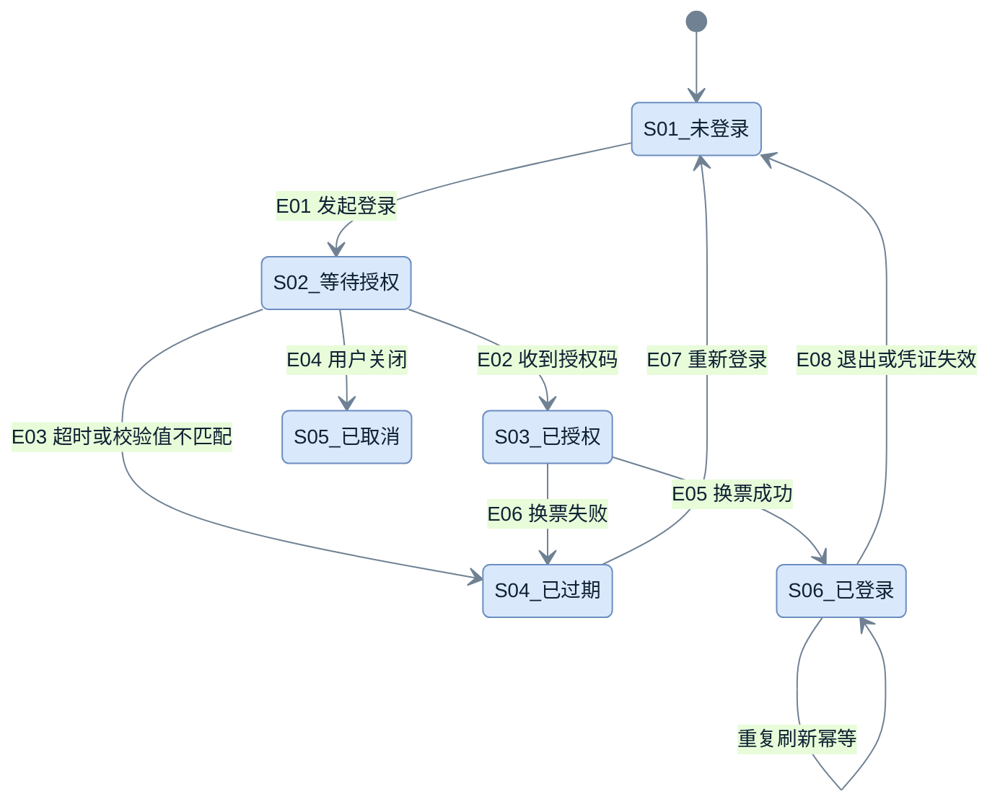

# 状态图模板（正文内嵌 mermaid + 九列明细表）

> 用法：状态图**必须配明细表**；图给结构，表给判据。
> 硬要求：节点 `S01_中文名`；迁移标签 = 事件号 + 触发条件；幂等态画自环；失败、重试、恢复列不得留空。

## 状态图

**怎么读**：`S02→S03` 只是「拿到授权码」，`S03→S06` 才是「建立本域会话」——两跳之间断掉就是「登录后仍回登录页」这类缺陷。`S04` 与 `S05` 必须可区分：过期要提示重登，取消不该自动跳页。

**注意**：同一状态在每一行都写全名（`S01_未登录 --> S02_等待授权`）。省略成 `S01 -->` 会被多数门禁判成「节点未命名」，因为名字定义在别的行。

## 状态明细表（九列必填）

| 状态编号 | 业务状态 | 技术状态 / 数据 | 状态拥有方 | 进入条件 / 交互 | 页面展示 | 允许操作 | 退出条件 | 失败、重试与恢复 |
| --- | --- | --- | --- | --- | --- | --- | --- | --- |
| S01 | 未登录 | 无有效会话 | 前端 | E01 | 登录页或弹窗 | 发起登录 | E01 进入 S02 | 无 |
| S02 | 等待授权 | 一次性校验值与校验器已写 | 前端 | E02 | 「正在登录…」 | 取消 | E02 / E03 / E04 | 超时进 S04，提示重登；不静默重试 |
| S03 | 已授权 | 持有一次性授权码 | 前端 | 回调页 | 加载态 | — | E05 / E06 | 授权码已用则进 S04，不可重放 |
| S04 | 已过期 | 授权码失效或校验值不匹配 | 前端 | E03 / E06 | 「登录已过期，请重新登录」 | 重新登录 | E07 | 不自动重试；用户点重登才回 S01 |
| S05 | 已取消 | 无残留凭据，清掉校验值 | 前端 | E04 | 留在原页，提示已取消 | 重新发起、继续浏览 | E01 | 不自动跳页、不重试 |
| S06 | 已登录 | 本域刷新凭证 + 内存访问令牌 | 前端 / 产品服务 | E05 | 目标页已登录态 | 正常操作、退出 | E08 | 刷新失效回 S01；接口失效走单飞刷新后重放一次 |

## 写法要点

| 要点 | 做法 | 反例 |
| --- | --- | --- |
| 状态号稳定 | 新增用续号 | 插入后重排（引用全断） |
| 幂等态 | 自环 + 说明（`S06_已登录 --> S06_已登录: 重复刷新幂等`） | 省略，读者以为会二次建会话 |
| 失败态可区分 | 过期与取消分开 | 合并成「失败」，无法决定是否自动跳页 |
| 「恢复」列 | 写清谁重试、几次、失败后去哪 | 留空或写「待定」 |
| 表覆盖全部状态 | 每个状态一行 | 只列图上出现过的几个 |

## 交付前自检

- [ ] 每个状态在表里都有一行，且九列无空
- [ ] 每个迁移都有事件号
- [ ] 失败与恢复列与异常矩阵一致（冲突时以异常矩阵为准并回改表）
- [ ] `accTitle` + `accDescr` 已写
- [ ] 已登录态写明「哪个域持有哪份凭证」
- [ ] 所有引用处都写状态全名，没有裸 `S01 -->`
