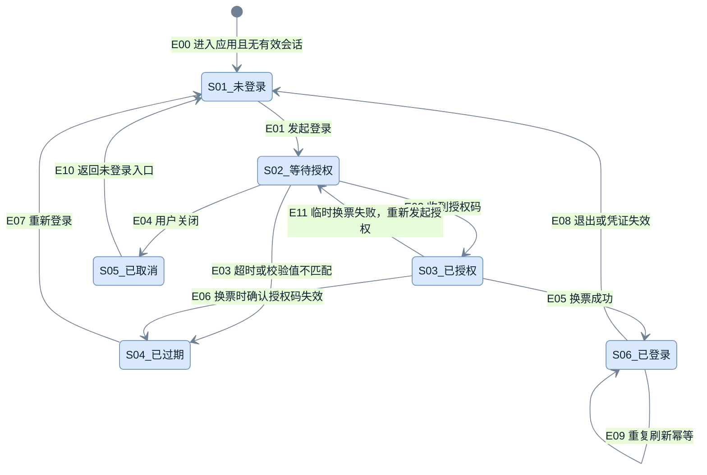

# 状态图模板（正文内嵌 mermaid + 九列明细表）

> 用法：状态图**必须配明细表**；图给结构，表给判据。
> 硬要求：节点 `S01_中文名`；迁移标签 = 事件号 + 触发条件；幂等态画自环；失败、重试、恢复列不得留空。

## 状态图

**范围**：本例为目标设计，覆盖授权等待、明确过期或取消，以及已登录后的刷新。非过期的传输错误由失败分支退回等待。

**怎么读**：E02 只证明收到授权码，E05 才建立本域会话。分别验证 E06 的授权码过期、E11 的临时失败恢复和 E04 的用户取消。E04 取消后可由 E10 返回 S01_未登录，再经 E01 发起；E09 刷新后仍在 S06_已登录，无第二次建会话的副作用。复制后绑定实际设计决定，并在对应测试用例留下断言。

**注意**：同一状态在每一行都写全名（`S01_未登录 --> S02_等待授权`）。省略成 `S01 -->` 会被多数门禁判成「节点未命名」，因为名字定义在别的行。

## 状态明细表（九列必填）

| 状态编号 | 业务状态 | 技术状态 / 数据 | 状态拥有方 | 进入条件 / 交互 | 页面展示 | 允许操作 | 退出条件 | 失败、重试与恢复 |
| --- | --- | --- | --- | --- | --- | --- | --- | --- |
| S01_未登录 | 未登录 | 无有效会话 | 前端 | E00 / E07 / E08 / E10 | 登录页或弹窗 | 发起登录 | E01 进入 S02_等待授权 | 用户通过 E01 发起；不自动重试 |
| S02_等待授权 | 等待授权 | 一次性校验值与校验器已写 | 前端 | E01 / E11 | 「正在登录…」 | 取消 | E02 / E03 / E04 | 超时进 S04_已过期；E11 来自重新发起的授权 |
| S03_已授权 | 已授权 | 持有一次性授权码 | 前端 | E02 收到回调授权码 | 加载态 | — | E05 / E06 / E11 | E06 确认失效进 S04_已过期；E11 清本次授权码并回 S02_等待授权 |
| S04_已过期 | 已过期 | 授权码失效或校验值不匹配 | 前端 | E03 / E06 | 「登录已过期，请重新登录」 | 重新登录 | E07 | 用户主动重登后回 S01_未登录；不自动重试 |
| S05_已取消 | 已取消 | 无残留凭据，清掉校验值 | 前端 | E04 | 留在原页，提示已取消 | 返回入口、继续浏览 | E10 返回 S01_未登录，随后 E01 可重发起 | 用户返回；不自动跳页、不重试 |
| S06_已登录 | 已登录 | 本域刷新凭证 + 内存访问令牌 | 前端 / 产品服务 | E05 | 目标页已登录态 | 正常操作、退出 | E08；E09 为自环 | E09 保持 S06_已登录；凭证失效经 E08 回 S01_未登录 |

## 写法要点

| 要点 | 做法 | 反例 |
| --- | --- | --- |
| 状态号稳定 | 新增用续号 | 插入后重排（引用全断） |
| 幂等态 | 自环 + 说明（`S06_已登录 --> S06_已登录: E09 重复刷新幂等`） | 省略，读者以为会二次建会话 |
| 失败态可区分 | 过期与取消分开 | 合并成「失败」，无法决定是否自动跳页 |
| 「恢复」列 | 写清谁重试、几次、失败后去哪 | 留空或写「待定」 |
| 表覆盖全部状态 | 每个状态一行 | 只列图上出现过的几个 |

## 交付前自检

- [ ] 每个状态在表里都有一行，且九列无空
- [ ] 每个迁移都有事件号
- [ ] 失败与恢复列与异常矩阵一致（冲突时以异常矩阵为准并回改表）
- [ ] `accTitle` + `accDescr` 已写
- [ ] 已登录态写明「哪个域持有哪份凭证」
- [ ] 所有引用处都写状态全名，没有裸 `S01 -->`
