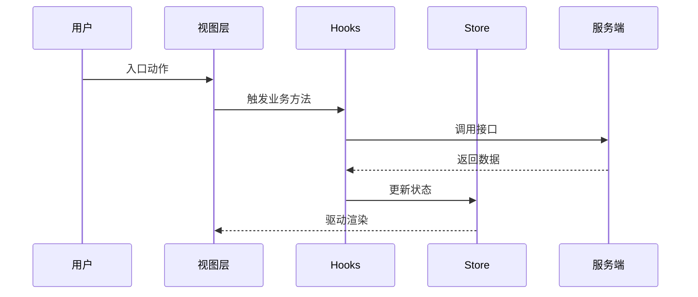

# <feature> — 前端技术方案（design/fe）
> 前置输入（spec/fe、design/be §1.4）/实施仓与目标 app（未核实挂 V）/分层约定/文档状态/影响面定级
## 图目录 <填：所列必须逐张兑现>
## 1. 设计方案
### 1.1 整体设计
#### 1.1.1 技术挑战 <填：表>
| 优先级 | 技术挑战 | 应对 |
| --- | --- | --- |
| （填写） | （填写） | （填写） |

#### 1.1.2 技术架构 <填：分层职责表（视图/hooks/store 各自边界）+ 能力域矩阵（视图/hooks/store/外部能力/文件/对应Spec）+ 组件关系树 + **文件落点表（每文件精确路径，新增/修改）**>
| 能力域 | 视图层职责 | Hooks 职责 | Store 职责 | 外部能力 | 文件/目录 | 对应 Spec/AC |
| --- | --- | --- | --- | --- | --- | --- |
| （填写） | （填写） | （填写） | （填写） | （填写） | （填写） | （填写） |

#### 1.1.3 核心业务流程 <填：S 步骤表（视图层状态/hooks 编排/store 读写/服务端调用/数据流转/成功异常去向/观测点）+ 时序图>
| 步骤 | 触发方/前置 | 视图层状态/行为 | Hooks 编排 | Store 读写 | 服务端调用 | 数据流转 | 成功/异常去向 | 观测点 |
| --- | --- | --- | --- | --- | --- | --- | --- | --- |
| S1 | （填写） | （填写） | （填写） | （填写） | （填写） | （填写） | （填写） | （填写） |

#### 1.1.4 复用边界 <填：业务组件 vs 公共组件；**data-testid 清单（testid|节点|出现条件）**>
| testid | 节点 | 出现条件 |
| --- | --- | --- |
| （填写） | （填写） | （填写） |

### 1.2 核心算法与关键逻辑 <填：每条核心逻辑一个 #### 小节，小节内 **加粗标签** 分段（触发条件/输入输出/判断顺序/不变式/代码职责落点）+ 语言级伪代码（竞态/防重/失效绑定必须写）；宽表格塞列是不合格形态（与 design/be §1.2 同口径）>
| 逻辑/能力 | 触发条件 | 实现落点 | 输入/输出 | 状态变化/外部调用 | 判断顺序/伪代码摘要 | 不变式 |
| --- | --- | --- | --- | --- | --- | --- |
| （填写） | （填写） | （填写） | （填写） | （填写） | （填写） | （填写） |

### 1.3 核心数据与缓存（前端视角） <填：核心数据/DTO→VM/共享状态/localStorage 有无/去重>
| 类型 | 说明 |
| --- | --- |
| 核心业务数据 | （填写） |
| DTO→Model/ViewModel | （填写） |
| 共享状态口径 | （填写） |
| localStorage/sessionStorage/Cookie | Key/结构/过期/迁移（无则删行） |

### 1.4 详细接口设计
#### 1.4.1 服务端接口 <填：| 能力 | 接口 | 方法 | 请求关键字段 | 响应关键字段 |；表头注一行：契约真源与裁决规则声明一次（见 1.4 节首），不做逐行「契约以谁为准」列>
| 能力 | 接口 | 方法 | 请求关键字段 | 响应关键字段 |
| --- | --- | --- | --- | --- |
| （填写） | （填写） | （填写） | （填写） | （填写） |

#### 1.4.2 客户端 Bridge <填：有无>
#### 1.4.3 数据映射与字段处理 <填：| 服务端字段 | 前端模型 | UI 展示 | 可空默认 | 非法枚举 |>
| 服务端字段 | 前端模型 | UI 展示 | 可空/默认 | 非法枚举处理 |
| --- | --- | --- | --- | --- |
| （填写） | （填写） | （填写） | （填写） | （填写） |

#### 1.4.4 主要 TypeScript 契约 <填：interface/type 全量>
#### 1.4.5 错误、重试与并发控制 <填：表；乐观更新回滚时序图>
| 场景 | 前端表现 | 处理策略 |
| --- | --- | --- |
| 错误码映射 | （填写） | （填写） |
| 请求超时 | （填写） | （填写） |
| 防重复提交 | （填写） | （填写） |
| 并发/晚到响应 | （填写） | （填写） |

#### 1.4.6 Mock/联调/接口未就绪方案
### 1.5 兼容性思考 / ### 1.6 灰度开关 <填：老后端降级、无本地迁移>
## 2. 稳定性方案 <填：级别/异常/上线/回滚/Checklist/灰度/监控排障表>
| 场景 | 应对方式 |
| --- | --- |
| 前端渲染/动态展示异常 | （填写） |
| 关键依赖不可用 | （填写） |
| 客户端 Bridge 异常 | （填写） |

**监控排障表**
| 用户现象/告警 | 首查步骤 | 日志/指标 | 可能原因 | 处理动作 |
| --- | --- | --- | --- | --- |
| （填写） | S* | （填写） | （填写） | （填写） |

## 4. Design 评审前自检
- ☐ 每条 P0 主链路已写清调用顺序、失败出口与观测点（见 1.1.3）
- ☐ 核心逻辑已说明触发条件、输入输出、判断顺序/伪代码、不变式（见 1.2）
- ☐ 服务端/Bridge/数据映射/TS 契约已说明（见 1.4）
- ☐ 错误码、重试、超时、并发、降级策略明确（见 1.4.5/2）
- ☐ 关键路径验证方式与可接受降级已明确
