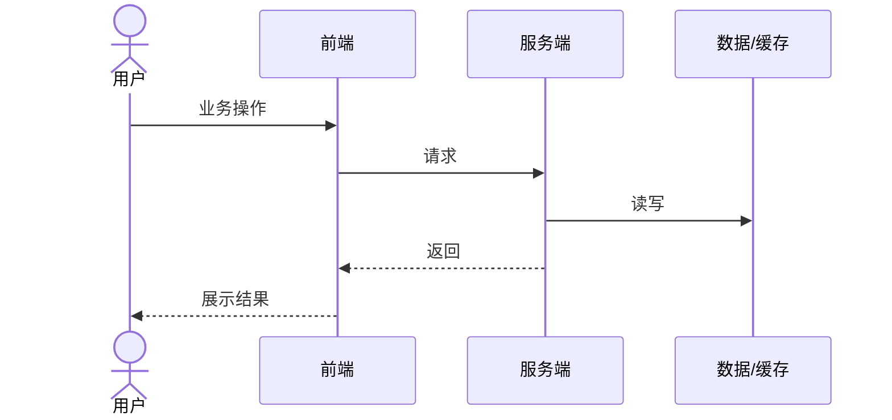

# <feature> — 测试与验证方案（design/qa）
> 前置输入：spec/qa 各 AC；CV 编号规则声明
## 1. 前置门禁与环境
<填：可测性门禁（testid 覆盖确认、阻塞提测项）>
| 检查项 | 期望事实 | 当前结论 | 阻塞提测 |
| --- | --- | --- | --- |
| 可操作元素挂载 testid | 用户可点击/输入/切换的元素 DOM 均有 data-testid | 已具备/缺失/不适用 | 是/否 |
| 值全局唯一且稳定 | 同文档内同值节点数=1；不随多语言/动态文案变化 | （填写） | 是/否 |

| 测试环境 | 用途 | 提供入口 | 必须就绪阶段 | 未就绪影响 |
| --- | --- | --- | --- | --- |
| 环境与版本 | （填写） | （填写） | 设计评审前/提测前 | （填写） |
| 账号与权限 | 普通/特殊角色/未登录 | （填写） | （填写） | （填写） |
| 测试数据 | 关键状态/边界/历史数据 | （填写） | （填写） | （填写） |
| 日志与监控 | 判断结果与定位 | （填写） | （填写） | （填写） |

## 2. 模块 × 验证类型矩阵
<填：| 模块 | CV 用例编号 | 验证类型(功能/边界/并发/兼容) | 执行端 |>
| 模块 | CV 用例编号 | 验证类型 | 执行端 |
| --- | --- | --- | --- |
| M01 | （填写） | 功能/边界/并发/兼容 | API/Web/客户端 |

## 3. 核心流程测试设计
<填：mermaid 流程 + 分支覆盖说明>

| 分支 | 覆盖说明 | 关联 CV |
| --- | --- | --- |
| 成功主路径 | （填写） | （填写） |
| 明确失败 | （填写） | （填写） |
| 结果未知/超时重试 | （填写） | （填写） |

## 4. 边界与异常覆盖
<填：边界矩阵，输入→结果>
| 类型 | 条件/触发 | 正确结果 | 关联 AC |
| --- | --- | --- | --- |
| 状态与时间 | （填写） | （填写） | （填写） |
| 数据与组合 | 空值/越界/非法枚举 | （填写） | （填写） |
| 下游异常 | 超时/失败/部分成功 | （填写） | （填写） |

## 5. 测试准备
| 准备项 | 具体内容 | 使用哪些 CV | 准备/复位方式 | 未就绪处理 |
| --- | --- | --- | --- | --- |
| Mock 与外部依赖 | （填写） | （填写） | 启用/复位 | （填写） |
| 配置与开关 | （填写） | （填写） | 启用/回滚 | （填写） |

## 6. 验证命令
<填：| 命令 | 覆盖什么 |；按目标仓 scripts 与构建入口核实后再写>
| 命令 | 覆盖什么 |
| --- | --- |
| （填写） | （填写） |

## 7. 发布判断条件
| 判断项 | 必须满足 | 不满足时 |
| --- | --- | --- |
| 核心 CV | P0/P1 已 confirmed | 阻塞发布 |
| 严重缺陷 | （允许遗留等级与前提） | （填写） |
| 回滚/降级 | 开关/版本回退/数据恢复 | （填写） |

## 8. 自检清单
- ☐ 每个范围内 AC 至少由一个覆盖项承接
- ☐ 资金/权限/安全/幂等/数据一致性风险均有 CV
- ☐ 阻塞提测项已关闭或可追溯
- ☐ 验证命令与入口已明确
