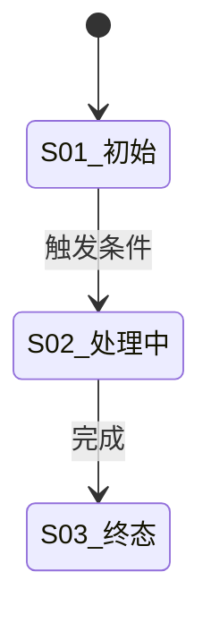

# <feature> — 后端需求补充（spec/be）
> 前置依赖/文档状态：待需求评审；冻结语义一句话
## 0. Proposal 反审 checklist
<填：#|缺口(引原文位置)|阻塞|工程默认值|状态；阻塞未闭禁入 design>
| # | 缺口（引原文位置） | 阻塞 | 工程默认值 | 状态 |
| --- | --- | --- | --- | --- |
| PRD-01 | （填写） | 是/否 | （填写） | 待产品确认/已关闭 |

## 1. 对象模型与口径
<填：补充口径表，不复述原文>
### 1.1 核心对象
| 对象 | 定义 | 关键字段 | 来源 |
| --- | --- | --- | --- |
| （填写） | （填写） | （填写） | （填写） |

### 1.4 状态机图
<填：任务/核心对象状态机 stateDiagram；原图纪律：每图回答一个问题>

## 2. 核心语义
<填：调度/触发/结算等口径表 + 判断顺序 + 不变式>
| 语义 | 判定顺序 | 不变式 | 边界 |
| --- | --- | --- | --- |
| （填写） | （填写） | （填写） | （填写） |

## 3. 冻结问题承接
<填：Q-xx 逐条工程口径，标注与建议值关系>
| 编号 | 问题 | 工程口径 | 与建议值关系 | 关闭条件 |
| --- | --- | --- | --- | --- |
| Q-01 | （填写） | （填写） | （填写） | （填写） |

## 4. 对前端的能力面
<填：API 能力清单>
| 能力 | 接口/方法 | 请求关键字段 | 响应关键字段 | 状态 |
| --- | --- | --- | --- | --- |
| （填写） | （填写） | （填写） | （填写） | 待设计/已冻结 |

## 5. 验收补充
<填：对原文验收的可测细化>
| 验收点 | 可测细化 | 判定方式 |
| --- | --- | --- |
| （填写） | （填写） | （填写） |
