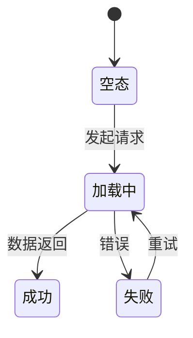

# <feature> — 前端规格书（spec/fe）
> 前置依赖/文档状态；原文已就近附低保真的不复述线框
## 0. PRD 不合规项（反审 checklist）
<填：#|缺口(引原文)|阻塞|工程默认值|状态>
| # | 缺口（引原文） | 阻塞 | 工程默认值 | 状态 |
| --- | --- | --- | --- | --- |
| PRD-01 | （填写） | 是/否 | （填写） | 待产品确认/已关闭 |

## 1. 页面与组件规格
### 1.1 <页面/状态两态>
<填：展示项、交互层级表（哪些不冒泡）、排序口径>
| 模块 | 展示条件 | 用户动作 | 排序/优先级 |
| --- | --- | --- | --- |
| （填写） | （填写） | （填写） | （填写） |

### 1.2 <弹窗/表单>
<填：入口与初始态、字段与校验表、隐藏字段>
| 字段 | 类型 | 校验规则 | 初始态 | 隐藏条件 |
| --- | --- | --- | --- | --- |
| （填写） | （填写） | （填写） | （填写） | （填写） |

## 2. 状态与数据
<填：数据拉取策略、状态机、错误兜底>

| 状态 | 展示 | 错误兜底 |
| --- | --- | --- |
| （填写） | （填写） | （填写） |

## 3. API 依赖
<填：指向 spec/be 能力面；字段契约后置回填的注明回填处>
- 依赖能力：（填写，关联 spec/be §4 能力面）

## 4. 埋点口径
<填：事件草案表（层级/类型/事件名/关键参数）；标注以埋点评审为准；不做的显式声明>
| 层级 | 类型 | 事件名 | 触发时机 | 关键参数 |
| --- | --- | --- | --- | --- |
| 页面 | 页面访问 | （填写） | （填写） | （填写） |
| 操作 | 点击 | （填写） | （填写） | （填写） |
| 转化 | 结果 | （填写） | （填写） | （填写） |

## 5. 降级规则
<填：服务不可用/老后端/无数据时逐条（"宁可不给入口"类决策写这里）>
| 场景 | 决策 | 兜底表现 |
| --- | --- | --- |
| 服务不可用 | （填写） | （填写） |
| 无数据 | （填写） | （填写） |
